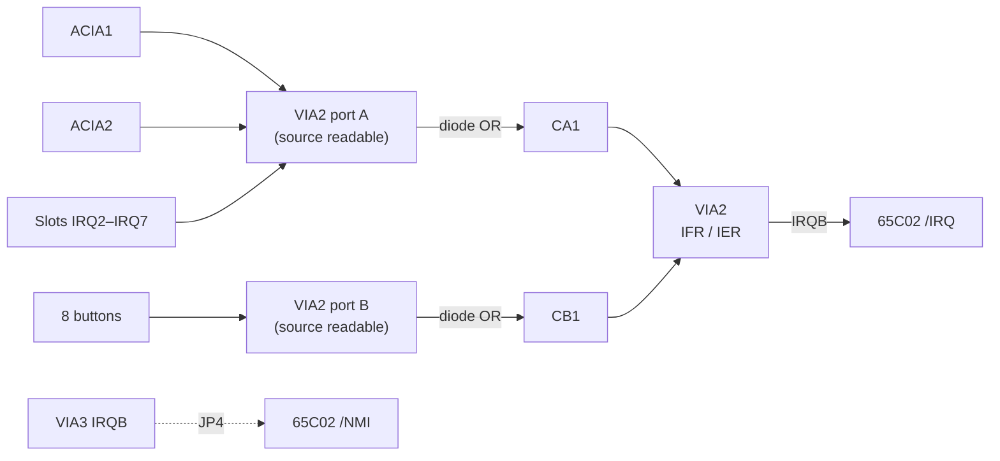

# Hardware Deep Dive – 65C02 Homebrew Computer

[← Back to overview](index.md)

This page describes the circuit of the board in detail. Sources: the thesis documentation in `Techniker-Dokus/Dokumentation`, the Eagle files in `schematics/` (schematic title "6502 Computer V2", silkscreen "65C02 Computer – Marco Müller – Version 1.0") and the cc65 memory config. Values marked *(computed)* or *(inferred)* are not stated directly in the documentation.

---

## Contents

1. [Board at a glance](#1-board-at-a-glance)
2. [Bus and bus LEDs](#2-bus-and-bus-leds)
3. [Address decoding](#3-address-decoding)
4. [Memory and RAM banking](#4-memory-and-ram-banking)
5. [Clock generation](#5-clock-generation)
6. [Parallel I/O: PIA and VIAs](#6-parallel-io-pia-and-vias)
7. [Interrupt architecture](#7-interrupt-architecture)
8. [LCD](#8-lcd)
9. [Serial ports (RS-232)](#9-serial-ports-rs-232)
10. [Expansion slots](#10-expansion-slots)
11. [Integrated logic analyzer](#11-integrated-logic-analyzer)
12. [Power supply](#12-power-supply)
13. [PCB layout and manufacturing](#13-pcb-layout-and-manufacturing)
14. [Bill of materials (summary)](#14-bill-of-materials-summary)

---

## 1. Board at a glance

```
┌──────────────────────────────────────────────────────────────┐
│ Address decoding   Clock generation           BluePill LA    │
│                                                              │
│ CPU            ROM            RAM1 (banked)   RAM2 (shared)  │
│                                                              │
│ VIA3   LED A   PIA     Buttons        VIA2        VIA1       │
│        LED B                                                 │
│                                                              │
│ ACIA2  MAX232   ACIA1  MAX232       LCD                      │
│        MAX232          MAX232       Expansion slots          │
└──────────────────────────────────────────────────────────────┘
          200 × 200 mm, 4 layers  (after layout_overview.png)
```

CPU, ROM and both RAMs sit **in one row**. This keeps the parallel address and data busses short and shows at a glance that these four chips form the core. Decoder, clocks, power and the BluePill are along the top edge. The peripheral chips are in the middle, serial ports and expansion slots at the bottom. Parts of one function block in the schematic are placed together on the PCB.

The schematic has **8 A3 sheets**: Address decoding / reset circuit · Clock generation / clock select · CPU, RAM, ROM · Outputs / NMI for timer interrupt · Inputs / interrupt handling · ACIAs / serial bus RS-232 · BluePill / decoupling · Expansion slots.

---

## 2. Bus and bus LEDs

All chips sit in parallel on the **address bus A0–A15**, the **data bus D0–D7**, **CLK** and **R/W**. Every one of these 26 lines has an **LED** so that the CPU state can be read off directly at low clock speeds.

The LED forward voltages were measured with an LED tester at 5 mA (red 1.9 V, yellow 2.8 V, green 2.9 V, blue 2.9 V). At 5 mA this would need about 620 Ω (red) and 420 Ω (others). To load the bus lines as little as possible and to use one resistor value, a single higher value was chosen. The LEDs are very bright low-power types.

> **Note for the article:** the documentation text says 1 kΩ, but the schematic and the BOM use **2.2 kΩ** for all 42 LEDs. At 2.2 kΩ the current is about 1.4 mA (red) and 1.0 mA (others) *(computed)*.

A jumper (**JP6**) connects the bus-LED cathodes to ground. Without it the bus LEDs are off. **JP3** does the same for the two PIA LED groups *(from the netlist)*.

---

## 3. Address decoding

The decoder is built only from **74HC logic**, no programmable logic. It is split into two parts.

### 3.1 Main decoding

Four chip selects are needed: ROM, lower RAM, upper RAM and the I/O page `$7Fxx`.

$$
\begin{aligned}
ROM &= A15 \\
RAM\_LO &= \overline{A15} \land \overline{A14} \\
IO &= \overline{A15} \land A14 \land A13 \land A12 \land A11 \land A10 \land A9 \land A8 \\
RAM\_HI &= \overline{A15} \land A14 \land \overline{IO}
\end{aligned}
$$

The IO term has eight inputs, which fits the **74HC30 8-input NAND** exactly and already gives the required active-low output. All chip selects are active low, so the final equations are:

$$
\begin{aligned}
\overline{ROM} &= \overline{A15} \\
\overline{RAM\_LO} &= \overline{\overline{ROM} \land \overline{A14}} \\
\overline{RAM\_HI} &= \overline{(\overline{ROM} \land A14) \land \overline{IO}} \\
\overline{IO} &= \overline{\overline{ROM} \land A14 \land A13 \land A12 \land A11 \land A10 \land A9 \land A8}
\end{aligned}
$$

Parts: **74HC00** (NAND, also used as inverters), **74HC08** (one AND for RAM_HI), **74HC30**.

### 3.2 I/O decoding

All peripherals live in the same page. A **74HC154 4-to-16 decoder** with inputs A4–A7 and enabled by $\overline{IO}$ creates 16 chip selects of 16 bytes each:

| Output | Signal | Range |
|:---:|---|---|
| 0 | /PIA | `$7F00` |
| 1–3 | /VIA1, /VIA2, /VIA3 | `$7F10`, `$7F20`, `$7F30` |
| 4–5 | /ACIA1, /ACIA2 | `$7F40`, `$7F50` |
| 6 | /GPU | `$7F60` |
| 7 + 8 | /SID (diode OR) | `$7F70–$7F8F` |
| 9–11 | /IO9, /IOA, /IOB | `$7F90`, `$7FA0`, `$7FB0` |
| 12 + 13 | /IOC (diode OR) | `$7FC0–$7FDF` |
| 14 + 15 | /IOD (diode OR) | `$7FE0–$7FFF` |

**Diode OR instead of a gate:** three areas need 32 addresses (e.g. for a **SID 6581/8580** sound chip with 29 registers). Two neighbouring decoder outputs are joined with two diodes and a pull-up resistor. This saves an IC and adds no gate delay.

### 3.3 Timing check

At 1 MHz one clock period is 1000 ns. The 65C02 uses both clock phases (internal during low, external during high), so the decoder must settle within **500 ns**. Typical propagation delays: 74HC00 = 7 ns, 74HC08 = 7 ns, 74HC30 = 12 ns, 74HC154 = 11 ns.

| Signal | Path | Delay |
|---|---|---:|
| /ROM | 74HC00 | 7 ns |
| /RAM_LO | 2 × 74HC00 | 14 ns |
| /RAM_HI | 74HC30 + 74HC08/00 | 19 ns |
| /IO | 74HC30 | 12 ns |
| /PIA (example I/O) | 74HC30 + 74HC154 | 23 ns |

The worst case is about **1/20 of the budget**. The decoder is not a speed limit at 1 MHz.

---

## 4. Memory and RAM banking

| Area | Chip | Notes |
|---|---|---|
| ROM `$8000–$FFFF` | **AT28C256-15** EEPROM, 32 k × 8 | Electrically erasable, ideal for development. In a **ZIF socket** to protect pins during frequent reprogramming |
| Banked RAM `$0000–$3FFF` | **IS61C5128AS-25**, 512 k × 8, SOP-32 SMD | 25 ns access time. A14–A18 come from VIA1 port B → **32 banks × 16 kB** |
| Shared RAM `$4000–$7EFF` | **UM61256K-15**, 32 k × 8, DIP-28 | From the author's stock. Only 16 kB used (minus the I/O page) |

**Bank switching:** VIA1 PB0–PB4 drive the nets BANK0–BANK4 to A14–A18 of the 512 kB SRAM. Writing `0`…`31` to `PORTB1` selects the bank. PB5–PB7 are free.

**The catch – banked zero page and stack:** zero page and stack are inside the banked area. After reset the VIA ports are inputs, the bank lines float and the bank (and with it the stack) can change randomly. **VIA1 port B must therefore be set to output and bank 0 before the first `JSR`.** During the very first CPU test (before any software existed) the bank lines were tied to 0 V directly at the VIA1 socket.

The idea behind it: in a future multitasking system each task could get **its own zero page and stack**. The downside: library routines cannot rely on fixed zero-page variables across banks.

**Total RAM:** 512 kB + 16 128 B ≈ **528 kB** *(computed)*.

---

## 5. Clock generation

Jumper header **JP9** connects exactly one source to the CPU clock:

| Jumper | Label | Source | Use |
|:---:|---|---|---|
| 1–2 | MAN | 555 **monostable** + button S11 | Debounced **single step** |
| 3–4 | 555 | 555 **astable**, adjustable with a 1 MΩ trimmer | Slow clock to watch the LEDs. Measured **≈ 5.5 Hz** (49 % duty cycle) to **≈ 776 Hz** (65 %) |
| 5–6 | OSC | **1 MHz** crystal oscillator (MXO45 series) | Normal operation |
| 7–8 | BP | BluePill pin PC13 | Prepared only. Does not work because the STM32 outputs 3.3 V. Would need a level shifter. The analyzer firmware does not implement it |

The two 555 circuits were copied 1:1 from **Ben Eater's 8-bit computer clock module**, because they are proven designs. The schematic lists LM555D parts; the documentation and BOM say NE555 (same function).

Measured results (scope pictures in `Techniker-Dokus/Dokumentation/pictures`):

- `prellen.jpg`: the button bounces (channel 3), the 555 output stays clean (channel 2).
- `astable_slow.jpg` / `astable_fast.jpg`: min/max frequency.
- `1mhz.jpg`: stable 1 MHz. Ringing on the edges comes from the scope ground at the USB socket, not from the oscillator.

The fully static **W65C02S** tolerates all of these clocks, including stopping completely.

---

## 6. Parallel I/O: PIA and VIAs

### 6.1 PIA – 16 LEDs (R6520)

| Port | Connection |
|---|---|
| PA0–PA7 | LED1–LED8 ("LED A") + header JP2 |
| PB0–PB7 | LED9–LED16 ("LED B") + header JP1 |

The **PIA has data-direction register and port register at the same address**. Bit 2 of the control register selects which one you access. Switching back and forth is clumsy, so the PIA only drives LEDs (no bidirectional devices like an LCD). It uses 4 of its 16 addresses (4 mirrors).

Headers JP1/JP2 (1 × 10): pin 1 = GND, pins 2–9 = port bits 7…0, pin 10 = +5 V *(from the netlist)*.

### 6.2 VIA1 – LCD and RAM banks

| Pin | Function |
|---|---|
| PA0 | LCD RS |
| PA1 | LCD R/W |
| PA2 | LCD E (2 × 16) / E1 (4 × 40) |
| PA3 | LCD E2 (second controller of a 4 × 40 LCD) |
| PA4–PA7 | LCD D4–D7 (4-bit mode) |
| PB0–PB4 | RAM bank A14–A18 |
| PB5–PB7 | free |

### 6.3 VIA2 – buttons and interrupt controller

| Pin | Function |
|---|---|
| PA0 / PA1 | /IRQ from ACIA1 / ACIA2 |
| PA2–PA7 | /IRQ2–/IRQ7 from the expansion slots |
| CA1 | diode-OR of all PA interrupt sources |
| PB0–PB7 | 8 user buttons (active low) |
| CB1 | diode-OR of all buttons |
| IRQB | → CPU /IRQ |

### 6.4 VIA3 – user port

All VIA3 port pins go to the **user port header JP5** (2 × 12):

| Pin | Signal | | Pin | Signal |
|:---:|---|---|:---:|---|
| 1 | +5 V | | 2 | +5 V |
| 3 | PB0 | | 4 | PA0 |
| 5 | PB1 | | 6 | PA1 |
| 7 | PB2 | | 8 | PA2 |
| 9 | PB3 | | 10 | PA3 |
| 11 | PB4 | | 12 | PA4 |
| 13 | PB5 | | 14 | PA5 |
| 15 | PB6 | | 16 | PA6 |
| 17 | PB7 | | 18 | PA7 |
| 19 | CB1 | | 20 | CA1 |
| 21 | CB2 | | 22 | CA2 |
| 23 | GND | | 24 | GND |

VIA3's IRQ output goes to jumper **JP4**. With the jumper fitted it drives the CPU **/NMI**. The schematic sheet is titled "NMI for Timer-Interrupt", so the intended use is a VIA timer as a non-maskable system tick *(inferred)*. A separate button (S2) can also pull /NMI low.

### 6.5 VIA chips used

Two **Rockwell R65C22** (date code 2002) and one **WDC W65C22S** (2018). They are not fully interchangeable: the WDC part has a **push-pull IRQ output**, the Rockwell parts an **open-drain output** that needs a pull-up. This difference caused one of the bring-up bugs ([details](bring-up.md#7-interrupts-and-the-ram-write-timing-bug)).

---

## 7. Interrupt architecture

The 65C02 has only **one maskable IRQ input** (plus NMI). If all sources were simply wired-OR to it, the ISR would have to poll every chip to find the source. Here **VIA2 acts as an interrupt controller**:



- Each source line goes to a port pin (so the ISR can read which one fired) **and** through a diode to CA1 or CB1 with a pull-up.
- CA1/CB1 are configured for a **negative edge** (`PCR = $CC`). VIA2 sets the matching bit in its **interrupt flag register (IFR)** and pulls IRQB low.
- **ISR flow:** read VIA2 IFR → CA1? → read port A and branch to the source routine, otherwise read port B (buttons) → `RTI`. Reading the port clears the CA1/CB1 flag.

| IRQ line | Source |
|---|---|
| PA0 | ACIA1 |
| PA1 | ACIA2 |
| PA2 | GPU slot |
| PA3–PA7 | IO9, IOA, IOB, IOC, IOD slots |
| — | Sound slot has no IRQ |

---

## 8. LCD

- **HD44780**-compatible character LCD, **2 × 16** fitted (footprint DIS1).
- Second footprint (DIS2) for a **4 × 40** LCD, which has two controllers. VIA1 PA3 provides the second enable line E2.
- **4-bit mode** to save port pins: only D4–D7 are used, the high nibble is sent first. Contrast via a 10 kΩ trimmer.
- R/W is connected, so the driver can **poll the busy flag** instead of using fixed delays.

---

## 9. Serial ports (RS-232)

| Item | Value |
|---|---|
| UART | 2 × **6551 ACIA** (Rockwell R6551 / RCA CDP65C51 per documentation, W65C51N footprint) |
| Baud clock | One **1.8432 MHz** oscillator feeds both ACIAs |
| Level shifters | **2 × MAX232 per port** (4 in total), 2.2 µF tantalum pump capacitors. Two chips per port so that TxD/RxD and all handshake lines are converted |
| Connectors | DSUB-9 female (RS-232 levels) + 1 × 8 pin header with TTL levels for each port |
| Tested | 8N1, **9600 Bd** (measured bit time 104.2 µs ≈ 9597 bit/s). Library also has 19 200 Bd |
| Levels | ≈ ±9 V measured at the board, inverted logic |

TTL header JP8 (ACIA1) / JP7 (ACIA2), pin 1–8: TXD, RXD, /RTS, /CTS, /DTR, /DCD, /DSR, GND.

**Practical notes from bring-up:**

- The 6551 only transmits while **/CTS is low**. Without a handshake partner, bridge RTS → CTS with a jumper.
- To connect to a standard USB-RS-232 adapter (which has the same DTE pinout), the author built **two null-modem adapters** in metal DSUB housings (TX/RX and handshake lines crossed).
- *Worth checking before publishing a pinout:* the board netlist shows DSUB pin 5 (signal ground) unconnected; only the shell is grounded. The signal ground then runs through the shell and cable screen *(netlist analysis, not mentioned in the documentation)*.
- *For rebuilders (general 6551 knowledge, not from the documentation):* current WDC **W65C51N** chips have a known bug: the transmit-empty flag (TDRE) is always set. The TDRE polling in `ACIA_TRANSMIT` then gives no protection and a delay loop is needed. The documented build uses older Rockwell/RCA parts.

---

## 10. Expansion slots

Seven **2 × 12 pin sockets**, **12.7 mm** apart, so small cards can be plugged in vertically.

| Slot | Chip select | Registers | IRQ line |
|---|---|:---:|---|
| Sound card | /SID `$7F70` | 32 | – |
| GPU (FPGA) | /GPU `$7F60` | 16 | /IRQ2 |
| IO9 | `$7F90` | 16 | /IRQ3 |
| IOA | `$7FA0` | 16 | /IRQ4 |
| IOB | `$7FB0` | 16 | /IRQ5 |
| IOC | `$7FC0` | 32 | /IRQ6 |
| IOD | `$7FE0` | 32 | /IRQ7 |

**Slot pinout** (verified for the sound slot JP11 from the board netlist; same scheme on all slots):

| Pin | Signal | | Pin | Signal |
|:---:|---|---|:---:|---|
| 1 | +5 V | | 2 | +5 V |
| 3 | A0 | | 4 | D0 |
| 5 | A1 | | 6 | D1 |
| 7 | A2 | | 8 | D2 |
| 9 | A3 | | 10 | D3 |
| 11 | A4 | | 12 | D4 |
| 13 | R/W | | 14 | D5 |
| 15 | n.c. | | 16 | D6 |
| 17 | CLK | | 18 | D7 |
| 19 | n.c. | | 20 | /RES |
| 21 | /CS (slot select) | | 22 | /IRQ (n.c. on sound slot) |
| 23 | GND | | 24 | GND |

Only A0–A4 are on the slot, enough for 32 registers. Larger memory-mapped devices would need their own banking. The slots are **not tested yet** because no cards exist. Their chip selects come from the same decoder that was validated by all other tests.

---

## 11. Integrated logic analyzer

An **STM32F103C8 "BluePill"** (72 MHz) sits in a socket on the board and reads the bus at every **rising clock edge**. It prints a line per cycle over USB serial:

```
1000000000000011   10101001   ADDR=8003  R DATA=a9
```

- Idea and original code: **Ben Eater** (Arduino Mega). Ported to the BluePill: new pin mapping, different serial output. Firmware: [`analyzer/analyzer.ino`](../analyzer/analyzer.ino).
- 26 inputs: A0–A15, D0–D7, CLK, R/W.
- Many STM32 pins are **5 V tolerant** and connect directly. The others use a **10 kΩ / 10 kΩ divider** (5 V → 2.5 V). The STM32 needs $V_{IH} = 0.41 \cdot (V_{DD} - 2\,\text{V}) + 1.3\,\text{V} = 1.833\,\text{V}$ at 3.3 V, so 2.5 V is a safe high level. The divider loads the bus with only 250 µA.
- Usable up to around **1 kHz** clock (tested at ≈ 10 Hz and 1 kHz). It cannot keep up with 1 MHz and was removed for full-speed operation.
- The schematic also routes BluePill PC13 to the clock jumper (unused, see [clock](#5-clock-generation)).

---

## 12. Power supply

- **5 V only.** Input via a **USB-B socket** (used for power only, data pins unconnected) **or** a 2-pole screw terminal. Both are in parallel.
- 100 µF electrolytic capacitor at the input, 100 nF decoupling capacitor at each IC.
- No regulator, fuse or reverse-polarity protection on the board *(from the netlist)*. The supply must be a clean 5 V source.
- All logic is CMOS (74HC, W65C02S, 65C22), so the board draws little current.
- Power-on reset circuit on sheet 1 ("POR") plus reset button.

---

## 13. PCB layout and manufacturing

| Item | Value |
|---|---|
| EDA | Autodesk **EAGLE 9.6.2**, education license (no limits on layers, size or pins) |
| Size | **200 × 200 mm** (the maximum allowed by the requirements) |
| Layers | **4**: two ground planes, two supply planes. Easier routing and solid ground for every IC |
| Silkscreen | Memory map, function block labels, connector labels, "65C02 Computer · Marco Müller · Version 1.0" |
| Manufacturer | **JLCPCB**, 5 boards (minimum quantity) + SMD stencil. Flying-probe test included. Cheaper than European fabs such as Aisler or Eurocircuits for a self-financed project |
| Parts | Reichelt (sockets, ZIF socket, buttons, logic, headers, RAM, ROM) and the author's stock |
| Assembly | Solder paste via stencil → SMD parts with tweezers (small to large) → **hot-air reflow** → THT parts (low to high) → cleaning with isopropanol and a soft brush |
| Holder | 3D-printed PLA holder designed in **FreeCAD** (added during the long-run test; model probably `Platinenschutz.FCStd` in the repository root, *inferred*) |

All 65xx chips, ROM and the shared RAM are **socketed**. This made the chip-by-chip bring-up possible.

---

## 14. Bill of materials (summary)

| Qty | Part | Qty | Part |
|---:|---|---:|---|
| 1 | W65C02S CPU | 4 | MAX232 |
| 1 | AT28C256 EEPROM | 2 | NE555 / LM555 |
| 1 | IS61C5128AS-25 SRAM | 1 | 1 MHz oscillator |
| 1 | UM61256 SRAM | 1 | 1.8432 MHz oscillator |
| 1 | R6520 PIA | 1 each | 74HC00, 74HC08, 74HC30, 74HC154 |
| 3 | 65C22 VIA | 22 | 1N4148 (MiniMELF) |
| 2 | 6551 ACIA | 42 | 0805 LEDs |
| 11 | 6 × 6 mm buttons | 2 | DSUB-9 female |
| 1 | STM32 BluePill | – | 0805 resistors/capacitors, tantalum caps, headers, sockets |

Full priced BOM: `Techniker-Dokus/Dokumentation/chapters/95-zusammenfassung.tex` (total **225.56 €**).

The 11 buttons are 8 user buttons, reset, NMI and single step *(reset assignment inferred)*.
