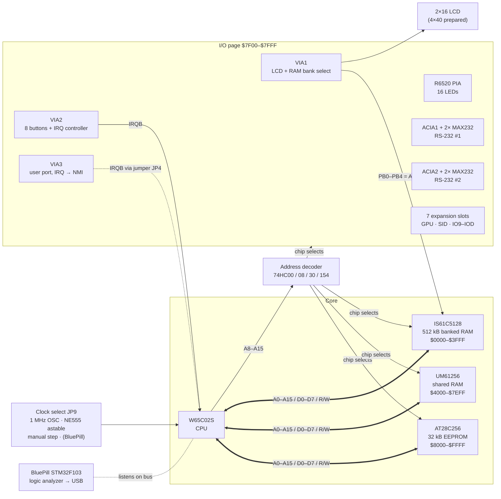

# 65C02 Homebrew Computer – A Single-Board 8-Bit Computer Built from Scratch

> *"6502 is alive!"* – the first text the board ever printed on its LCD

The **65C02 Homebrew Computer** is a self-designed **single-board computer** around the **WDC W65C02S** microprocessor. It was planned, laid out, assembled, brought up and programmed as the **final project of a state-certified technician course** (Technikerarbeit, data technology) in 2021/22. Everything sits on one **200 × 200 mm, 4-layer PCB**: CPU, 32 kB EEPROM, **528 kB of RAM (512 kB banked + 16 kB shared)**, five classic 65xx peripheral chips, two RS-232 ports, a character LCD, 16 LEDs, 8 buttons, **42 status LEDs** for the busses, three selectable clock sources and a **built-in logic analyzer** on an STM32 "BluePill" board. Seven **expansion slots** leave room for a graphics card, a sound card and other I/O cards.

The address decoding uses only **discrete 74HC logic** (no GAL/CPLD). The board is meant as a learning object: you can single-step the CPU by hand and watch every address, data and control line on the LEDs.

| | |
|---|---|
| **Author** | Marco Müller |
| **Context** | Technician thesis ("Planung und Bau eines 8bit-Computers mit 65C02 Mikroprozessor"), Heinrich-Hertz-Schule, data technology, Weingarten, 2022. Supervisor: Michael Busch |
| **Status** | Built and working. All interfaces tested except VIA3 (user port) and the expansion slots. Several hardware bugs fixed with patch wires (see [Bring-up](bring-up.md)) |
| **CPU** | WDC **W65C02S** (CMOS, fully static), **1 MHz** crystal oscillator, NE555 astable clock (≈ 5.5–776 Hz) or manual single step |
| **Memory** | 32 kB **AT28C256** EEPROM (ZIF socket) · 512 kB **IS61C5128** SRAM as 32 banks × 16 kB · 16 kB shared SRAM (**UM61256**, half used) |
| **Peripherals** | 1 × **R6520 PIA** (16 LEDs) · 3 × **65C22 VIA** (LCD + RAM banking, buttons + interrupt controller, user port) · 2 × **6551 ACIA** (RS-232) |
| **I/O** | 2 × RS-232 (DSUB-9, MAX232, 9600 Bd tested) · 2 × 16 LCD (4-bit mode, 4 × 40 LCD footprint prepared) · 8 buttons · 16 user LEDs · 26 bus LEDs |
| **Expansion** | 7 slots (2 × 12 pin headers): GPU, sound (SID), IO9, IOA, IOB, IOC, IOD |
| **Debug** | STM32F103 BluePill as **bus logic analyzer** (address, data, R/W per clock via USB serial) |
| **PCB** | 200 × 200 mm, 4 layers, mixed SMD/THT, made by JLCPCB, Eagle 9.6.2 |
| **Software** | 65C02 assembly with **cc65** (ca65 / ld65), flashed with **TL866A + minipro**, bash build script |
| **Cost** | ≈ **226 €** for one board (parts priced at Mouser, PCB + stencil 63.90 €) |

---

## Table of Contents

1. [What is the 65C02 Homebrew Computer?](#1-what-is-the-65c02-homebrew-computer)
2. [History and Motivation](#2-history-and-motivation)
3. [Goals and Requirements](#3-goals-and-requirements)
4. [System Architecture](#4-system-architecture)
5. [Memory Map](#5-memory-map)
6. [Hardware Overview](#6-hardware-overview)
7. [Software Overview](#7-software-overview)
8. [Bring-up and Lessons Learned](#8-bring-up-and-lessons-learned)
9. [Cost and Timeline](#9-cost-and-timeline)
10. [Status and Open Points](#10-status-and-open-points)
11. [Repository Structure](#11-repository-structure)
12. [Media and Downloads](#12-media-and-downloads)
13. [Credits](#13-credits)

Detailed pages:

- [Hardware deep dive](hardware.md) – decoding, banking, clocks, interrupts, connectors and pinouts
- [Software and toolchain](software.md) – cc65 setup, memory config, libraries, test programs
- [Bring-up and debugging](bring-up.md) – step-by-step commissioning and every bug that was found
- [Article guide](article-guide.md) – suggested article series, hooks, key numbers and image list

---

## 1. What is the 65C02 Homebrew Computer?

A "homebrew computer" is a computer that a hobbyist designs and builds from individual chips. This one uses the **65xx family**, the chip family of the Apple II, Commodore 64 and NES. The CPU is a modern **CMOS 65C02** from Western Design Center, which is still in production. Unlike the original NMOS 6502 it can run **statically**: the clock can be stopped or stepped by hand without losing the CPU state. That makes it ideal for learning and debugging.

The computer runs assembly programs from an EEPROM. It talks to a PC over two RS-232 ports, prints text on a character LCD, reads 8 buttons and drives 16 LEDs. **Every bus line has its own LED.** With the slow clock or the single-step button you can follow each instruction fetch, read and write on the board.

Target audience (from the requirements document):

- hobbyists, retro-computer fans and the homebrew-computer community,
- training companies that still teach assembly language,
- hardware developers who want to build and test their own expansion cards.

---

## 2. History and Motivation

- The author had long been interested in microprocessors and homebrew computers and had already **rebuilt the "MyCPU" by Dennis Kuschel**, a 6502-like CPU made only from discrete logic chips.
- A former colleague donated several **65xx-family ICs**. That made the idea of an own 65xx computer obvious.
- YouTube series about 6502 computers (above all **Ben Eater's "Build a 6502 computer"**) increased the motivation.
- The project became the **final thesis of the technician course**. Apart from the donated ICs it was **self-financed**, including the PCB.
- Goals: deepen the understanding of how CPUs and computers work, learn 6502 assembly, and get a **demonstration and teaching object** for trade fairs.

### Breadboard phase (inferred from the repository)

Before the PCB existed, a first version ran on breadboards. The repository still contains [`memory_breadboard.cfg`](../cc65_projects/09_final/memory_breadboard.cfg) (VIAs at `$7000/$7200/$7400`, PIA at `$7600`, ACIAs at `$7800/$7A00`) and early test programs for the **vasm** assembler in [`testfiles/vasm-files`](../testfiles/vasm-files). The PCB version moved all I/O into one 256-byte page at `$7F00` and switched to the cc65 toolchain.

---

## 3. Goals and Requirements

The scope was fixed in a requirements specification (Pflichtenheft). **The focus is hardware.** Software only has to prove that the hardware works. No C compiler is written or used. Graphics and sound are out of scope but prepared via slots.

| Requirement (must) | Result |
|---|---|
| Single-board computer with WDC 65C02 | ✅ W65C02S |
| 32 kB program memory | ✅ AT28C256 EEPROM |
| 16 kB RAM | ✅ exceeded: 512 kB banked + 16 kB shared |
| 1 MHz oscillator clock | ✅ |
| 8 LEDs and 8 buttons | ✅ 16 LEDs, 8 buttons |
| 2 × 16 character LCD | ✅ 4-bit mode |
| One RS-232 port, ≥ 9600 Bd | ✅ two ports, 9600 Bd measured |
| Expansion ports for free address ranges | ✅ 7 slots |
| Easy to learn, extendable | ✅ discrete logic, bus LEDs, single step |

| Optional ("can") requirement | Result |
|---|---|
| RAM banking | ✅ 32 banks × 16 kB |
| 16 LEDs | ✅ PIA ports A and B |
| Manual clock / single step | ✅ debounced NE555 monostable + button |
| Two serial ports | ✅ ACIA1 + ACIA2 |
| 4 × 40 LCD | ⚙️ footprint and second enable line prepared |
| GPIO header | ✅ VIA3 user port (not yet tested) |
| Integrated logic analyzer that does not disturb the CPU | ✅ BluePill (but see [bring-up](bring-up.md#9-long-run-test-and-the-logic-analyzer-side-effect)) |
| Max. PCB size 20 × 20 cm | ✅ exactly 200 × 200 mm |

Because the extra circuitry for the optional criteria was small, **all optional criteria were implemented**.

---

## 4. System Architecture



**How it works:**

1. The CPU puts an address on the 16-bit address bus. The **address decoder** turns the upper address bits into exactly one active chip select: ROM, banked RAM, shared RAM or the I/O page.
2. Inside the I/O page a **74HC154 4-to-16 decoder** splits the 256 addresses into **16 slots of 16 bytes**. Three pairs of slots are combined with **diode OR gates** into 32-byte areas (sound, IOC, IOD).
3. **VIA1** drives the upper address lines A14–A18 of the large SRAM. Writing a bank number (0–31) to its port B switches the whole lower 16 kB – **including zero page and stack**.
4. **VIA2** works as an **interrupt controller**: all interrupt sources are diode-ORed onto its CA1/CB1 inputs, while the individual lines are readable on ports A/B. Its IRQ output is the only connection to the CPU IRQ pin.
5. The **BluePill** listens passively on the bus and prints every clock cycle (address, data, read/write) to a PC.

---

## 5. Memory Map

The memory map is also printed on the PCB silkscreen ("Memory Map 65C02 Homebrew Computer").

| Start | End | Size | Device |
|:---:|:---:|---:|---|
| `$0000` | `$3FFF` | 16 kB × 32 banks | **Banked RAM** (incl. zero page `$00xx` and stack `$01xx`) |
| `$4000` | `$7EFF` | 16 128 B | **Shared RAM** |
| `$7F00` | `$7F0F` | 16 B | PIA (LEDs) |
| `$7F10` | `$7F1F` | 16 B | VIA1 (LCD, RAM banks) |
| `$7F20` | `$7F2F` | 16 B | VIA2 (buttons, IRQ controller) |
| `$7F30` | `$7F3F` | 16 B | VIA3 (user port) |
| `$7F40` | `$7F4F` | 16 B | ACIA1 |
| `$7F50` | `$7F5F` | 16 B | ACIA2 |
| `$7F60` | `$7F6F` | 16 B | GPU slot (FPGA planned) |
| `$7F70` | `$7F8F` | 32 B | Sound slot (SID 6581/8580 or AY-3) |
| `$7F90` | `$7F9F` | 16 B | IO9 slot |
| `$7FA0` | `$7FAF` | 16 B | IOA slot |
| `$7FB0` | `$7FBF` | 16 B | IOB slot |
| `$7FC0` | `$7FDF` | 32 B | IOC slot |
| `$7FE0` | `$7FFF` | 32 B | IOD slot |
| `$8000` | `$FFFF` | 32 kB | **ROM** (vectors at `$FFFA–$FFFF`, reset → `$8000`) |

**Why this layout?** The 65C02 fetches its reset vector from the top of memory, so ROM must be at the top. Zero page and stack live at the bottom, so RAM must be there. Keeping both areas contiguous makes the decoder simple. The banked RAM is placed at the bottom on purpose: in a future **multitasking system every task could get its own zero page and stack**.

---

## 6. Hardware Overview

| Block | Implementation |
|---|---|
| CPU | W65C02S6TPG-14 (DIP-40) |
| ROM | AT28C256-15 EEPROM in a ZIF socket |
| Banked RAM | IS61C5128AS-25 (512 k × 8, 25 ns, SOP-32 SMD) |
| Shared RAM | UM61256 (32 k × 8, DIP-28, only 16 kB used; from the author's stock) |
| Decoder | 74HC00, 74HC08, 74HC30 (8-input NAND), 74HC154 (4-to-16). Worst case delay 23 ns vs. 500 ns budget |
| Clock | 1 MHz oscillator · LM555/NE555 astable (pot. adjustable) · NE555 monostable + button (debounced single step) · BluePill output (prepared, not usable without level shifter). Selected with jumper JP9 |
| Parallel I/O | R6520 PIA, 3 × 65C22 VIA (2 × Rockwell 2002, 1 × WDC 2018) |
| Serial | 2 × 6551 ACIA, shared 1.8432 MHz oscillator, 4 × MAX232, 2 × DSUB-9 female, 2 × TTL pin headers |
| Display | HD44780 LCD, 4-bit mode on VIA1 port A, second enable line for 4 × 40 LCD |
| Indicators | 42 × 0805 LEDs: A0–A15, D0–D7, R/W, CLK, PIA port A, PIA port B |
| Power | 5 V via USB-B socket (power only) or screw terminal. No on-board regulator |
| Logic analyzer | STM32F103C8 BluePill in a socket. 5 V-tolerant pins or 10 k / 10 k dividers |
| PCB | 200 × 200 mm, 4 layers (2 ground, 2 supply planes), JLCPCB, SMD stencil |

Details: [hardware.md](hardware.md).

---

## 7. Software Overview

- **Language:** 65C02 assembly, using the extra 65C02 instructions (`BBR`/`BBS`, `PHX`/`PHY`, `STZ`, `WAI`, `STP`).
- **Toolchain:** VS Code (cc65 syntax plugin) → **ca65** assembler → **ld65** linker with a custom memory config → `rom.bin` → **minipro** + TL866A programmer → EEPROM. Everything runs on Ubuntu 20.04 and is wrapped in one [bash script](../cc65_projects/09_final/compile.bash).
- **Libraries** ([`cc65_projects/lib`](../cc65_projects/lib)): PIA, VIA, ACIA and a 4-bit HD44780 LCD driver (based on Ben Eater's LCD code).
- **Test programs:** one project per chip, in bring-up order (RAM, PIA, VIA/buttons, LCD, interrupts, ACIA, external IRQ, final demo).
- **Final demo:** buttons → LEDs, ACIA1 → LCD (terminal-to-LCD), ACIA2 → LEDs + echo. Serial input is interrupt-driven at 1 MHz.

Details: [software.md](software.md).

---

## 8. Bring-up and Lessons Learned

The board was brought up **one socketed chip at a time**, each with its own test program and the logic analyzer as the main debugging tool. Six hardware problems were found and fixed:

| # | Problem | Fix |
|:---:|---|---|
| 1 | Logic analyzer: address lines A7/A8 on the BluePill USB pins PA11/PA12 | Socket pins removed, A7/A8 rerouted to other pins via voltage dividers |
| 2 | I/O decoder: A4–A7 connected to the 74HC154 in the wrong order | Traces cut, patch wires |
| 3 | WDC 65C22 IRQ output kept the CPU IRQ line low | Rockwell 65C22 in the IRQ-controller socket + pull-up resistor on IRQ |
| 4 | RAM write timing: `/WE` driven directly by R/W, so wrong data was written while the clock was low | Extra NAND logic: `/WE = NOT(NOT R/W AND CLK)`, glued-on IC and wires |
| 5 | ACIA: CS0 left unconnected | Patch wires to tie CS0 high |
| 6 | ACIA does not transmit while CTS is high | Jumper RTS ↔ CTS |

Plus one open observation: in a long-run serial test the CPU crashed randomly **while the logic analyzer was plugged in** and ran perfectly without it.

The author's own conclusion: most errors came from **missing design reviews, a skipped ERC/DRC on the schematic and datasheets read too quickly**. Every error was analyzed and fixed quickly, and each one taught something. Full story: [bring-up.md](bring-up.md).

---

## 9. Cost and Timeline

**Cost:** ≈ **225.56 €** in total. Biggest items: PCB + stencil 63.90 €, 3 × 65C22 30.63 €, 4 × MAX232 23.20 €, 2 × 6551 14.62 €, AT28C256 11.22 €, W65C02S 10.81 €, R6520 10.21 €. Some ICs were donated or from stock. Their prices are estimates.

**Timeline (school year 2021/22):**

| Milestone | Planned | Actual |
|---|---|---|
| Topic and research | September | Sept.–Oct. |
| Proposal | October | October |
| Detailed research, requirements spec | November | Oct.–Nov. |
| Hardware design and ordering | December | Nov.–Dec. |
| First test code, start of documentation | January | Dec.–Feb. |
| Final software | February | February |
| Documentation | March | Feb.–May |
| Submission | April | May |

Delays came from debugging, the COVID situation and the extra work for the optional features.

---

## 10. Status and Open Points

- ✅ CPU, ROM, both RAMs and RAM banking
- ✅ PIA + 16 LEDs, VIA2 + buttons, VIA1 + LCD
- ✅ Interrupts via VIA2, ACIA1 and ACIA2 incl. MAX232, 9600 Bd
- ✅ All three clock sources, logic analyzer
- ⏳ VIA3 / user port not tested (the chip itself was tested in the VIA2 socket). It is a WDC part, so the IRQ issue may apply there too
- ⏳ Expansion slots not tested (no cards yet). Decoding is validated indirectly
- 💡 Ideas named in the documentation: graphics card (FPGA), sound card (SID 8580), multitasking with per-task zero page and stack, BluePill as clock source (needs level shifter)
- 💡 *Suggested for a board revision (inferred from the bug list):* integrate the `/WE` gating, fix the decoder order, ACIA CS0, BluePill pin mapping, IRQ pull-up

---

## 11. Repository Structure

```
6502-master/
├── analyzer/analyzer.ino         BluePill logic analyzer (Arduino/STM32duino)
├── cc65_projects/                Assembly projects for the PCB (cc65)
│   ├── 01_button_leds/           Early LED/LCD test
│   ├── 02_RAM-test/ … 08_EXT_IRQ Bring-up tests, one per chip
│   ├── 09_final/                 Final demo software
│   └── lib/                      pia.s, via.s, acia.s, lcd_2x16.s, zeropage.txt
├── schematics/                   Eagle project 6502_V2 (.sch, .brd, CAM, BluePill library)
├── testfiles/vasm-files/         Breadboard-era tests for the vasm assembler
├── Datenblätter/                 Datasheets of all ICs (third-party, do not republish)
├── Platinenschutz.FCStd / .stp   FreeCAD model of the PCB holder (3D-printed)
├── Techniker-Dokus/
│   ├── Pflichtenheft/            Requirements specification (LaTeX + PDF)
│   ├── Dokumentation/            Thesis documentation (LaTeX + PDF, schematic PDF, pictures)
│   └── praesentation/            Final presentation (ODP + PDF)
└── LaTeX/                        Separate learning diary (not used for these pages)
```

---

## 12. Media and Downloads

| Asset | Path |
|---|---|
| Block diagram | `Techniker-Dokus/Dokumentation/pictures/Blockschaltbild.png` |
| PCB layout overview (chip positions) | `Techniker-Dokus/Dokumentation/pictures/layout_overview.png` |
| Interrupt wiring of VIA2 | `Techniker-Dokus/Dokumentation/pictures/irq.png` |
| Interrupt service flow chart | `Techniker-Dokus/Dokumentation/pictures/irq-routine.png` |
| Scope: debounced single step | `Techniker-Dokus/Dokumentation/pictures/prellen.jpg` |
| Scope: astable clock min/max | `…/pictures/astable_slow.jpg`, `…/pictures/astable_fast.jpg` |
| Scope: 1 MHz oscillator | `…/pictures/1mhz.jpg` |
| Scope: UART TX, RX/TX echo, RS-232 levels | `…/pictures/dso_uart_tx.png`, `dso_uart_rx_tx.png`, `dso_uart_rx_tx_max232.png` |
| Full schematic (8 sheets, A3) | `Techniker-Dokus/Dokumentation/appendix/schematic_v2.pdf` |
| Thesis documentation | `Techniker-Dokus/Dokumentation/Doku.pdf` |
| Requirements specification | `Techniker-Dokus/Pflichtenheft/Pflichtenheft_V1.pdf` |
| Presentation | `Techniker-Dokus/praesentation/techniker.pdf` |
| Eagle files / Gerbers | `schematics/6502_V2.*` |

*Suggested additions: photos of the bare and assembled PCB, close-ups of the patch wires, the board in its 3D-printed holder, a GIF of the bus LEDs in single-step mode, a short video of terminal text appearing on the LCD.*

**Note:** No license file was found in the repository. Choose a license before publishing schematics and code. The null-modem diagram (`nullmodem.png`) and the datasheets are third-party material.

---

## 13. Credits

- Design, assembly, software and documentation: **Marco Müller**
- Supervisor of the technician thesis: **Michael Busch**, Heinrich-Hertz-Schule
- 65xx ICs donated by a former colleague
- Inspiration and reused building blocks: **Ben Eater** (6502 computer series, NE555 clock circuits, LCD routines, logic-analyzer sketch), **Garth Wilson** (6502 Primer, RAM write timing), **Bruce Clark** / 6502.org (65C02 opcodes), **Dennis Kuschel** (MyCPU)

---

### Sitemap

- **65C02 Homebrew Computer** (this page)
  - [Hardware deep dive](hardware.md)
  - [Software and toolchain](software.md)
  - [Bring-up and debugging](bring-up.md)
  - [Article guide](article-guide.md)
