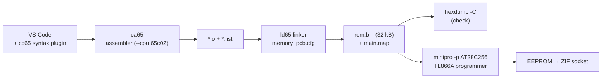
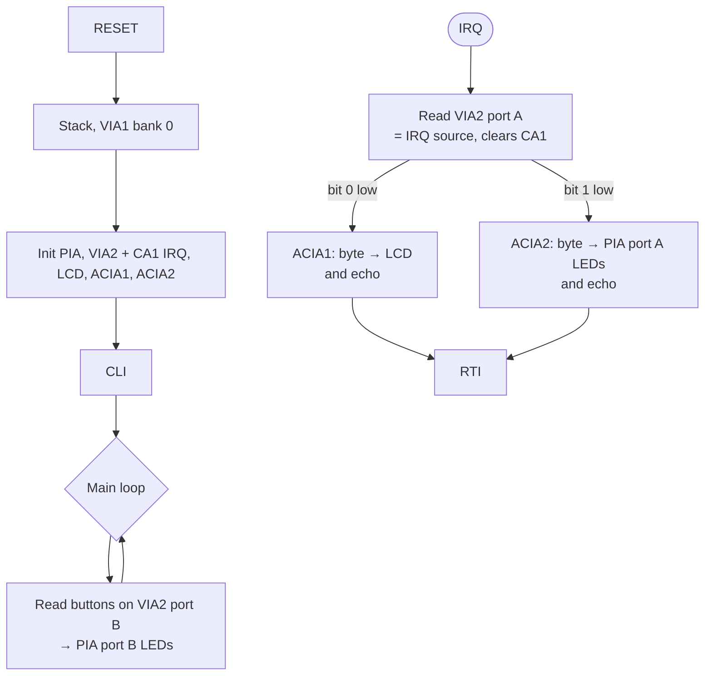

# Software and Toolchain – 65C02 Homebrew Computer

[← Back to overview](index.md)

The software in this project has one job: **prove that the hardware works**. It is written in plain **65C02 assembly**, one small program per chip, plus a final demo. This page explains the toolchain, the memory configuration, the libraries and the programs. It also covers the basic 6502 concepts readers need to follow the code.

---

## Contents

- [Software and Toolchain – 65C02 Homebrew Computer](#software-and-toolchain--65c02-homebrew-computer)
  - [Contents](#contents)
  - [1. Toolchain](#1-toolchain)
  - [2. Build script](#2-build-script)
  - [3. Linker memory configuration](#3-linker-memory-configuration)
  - [4. 6502 concepts in 60 seconds](#4-6502-concepts-in-60-seconds)
  - [5. Libraries](#5-libraries)
  - [6. Test programs](#6-test-programs)
  - [7. Final demo software](#7-final-demo-software)
  - [8. Logic analyzer firmware](#8-logic-analyzer-firmware)
  - [9. Code snippets for articles](#9-code-snippets-for-articles)
    - ["Does the RAM work?" – the first real program](#does-the-ram-work--the-first-real-program)
    - [Reading 8 buttons – classic 6502 vs. 65C02](#reading-8-buttons--classic-6502-vs-65c02)
    - ["Hello World" on the LCD](#hello-world-on-the-lcd)
    - [A fake interrupt to test the stack](#a-fake-interrupt-to-test-the-stack)
    - [Final ISR](#final-isr)

---

## 1. Toolchain



| Item | Choice |
|---|---|
| OS | Ubuntu 20.04 LTS |
| Editor | Visual Studio Code with the "cc65 for 6502/65816 machines" extension (SharpNinja) for syntax highlighting |
| Assembler / linker | **cc65** suite: **ca65** + **ld65** |
| Programmer | **TL866A** (MiniPro) with the open-source **minipro** CLI |
| Debug | `hexdump` to inspect the ROM image, on-board logic analyzer, oscilloscope |
| Earlier tool | The breadboard tests in `testfiles/vasm-files` used the **vasm** assembler (`vasm6502_oldstyle`) |

The requirements explicitly excluded writing or using a C compiler. The cc65 suite *could* compile C for this board later, since the memory config already exists.

---

## 2. Build script

Each project folder has a [`compile.bash`](../cc65_projects/09_final/compile.bash). It needs no file names. It assembles every `*.s` in `source/`, links all object files and optionally flashes the ROM:

```bash
./compile.bash        # assemble + link → output/rom.bin
./compile.bash -d     # … and show a hexdump of the ROM image
./compile.bash -f     # … and write it to the AT28C256 via minipro
```

Core steps:

```bash
ca65 --cpu 65c02 $file -o ../output/$file.o -l ../output/$file.list -I ../../lib
ld65 -C ../memory_pcb.cfg -m main.map $OBJECTS -o rom.bin
minipro -p AT28C256 -w rom.bin
```

Every project contains two linker configs: `memory_pcb.cfg` (used) and `memory_breadboard.cfg` (old breadboard address map).

---

## 3. Linker memory configuration

[`memory_pcb.cfg`](../cc65_projects/09_final/memory_pcb.cfg) describes the PCB's memory map to the linker. Highlights:

- Every peripheral is a `MEMORY` area with `define=yes`. The linker exports symbols like `__VIA1_START__`, and the libraries compute register addresses from them (`PORTB1 = __VIA1_START__ + 0`). **Moving a chip means changing one line in the config, not the code.**
- **32 `BANKn` segments** map onto the same `RAM_BANK` area `$0000–$3FFF`, one per RAM bank.
- `ZEROPAGE` at `$0000`, stack at `$0100`, `BSS` in the shared RAM.
- `CODE`, `ISRS` and `RODATA` in ROM. `VECTORS` at offset `$7FFA` → `$FFFA–$FFFF`.
- **Unused ROM is filled with `$DB` = `STP`** (stop the processor). If the CPU ever jumps into empty ROM, it halts instead of running garbage. (The breadboard config filled with `$EA` = `NOP`.)
- The comments document the interrupt mapping: ACIA1 → IRQ0, ACIA2 → IRQ1, GPU → IRQ2, IO9…IOD → IRQ3…IRQ7, VIA3 → NMI.

---

## 4. 6502 concepts in 60 seconds

| Concept | Explanation |
|---|---|
| **Zero page** `$0000–$00FF` | The first 256-byte page. Special addressing modes only need the low byte, so instructions are shorter and faster. The 65C02 bit instructions `BBR`/`BBS`/`RMB`/`SMB` only work here |
| **Stack** `$0100–$01FF` | Page 1. Return addresses and saved registers. `PHA`/`PLA` push and pull. Initialised with `LDX #$FF / TXS` |
| **Vectors** | `$FFFA` NMI, `$FFFC` RESET, `$FFFE` IRQ. Each holds a 2-byte address. On this board RESET always points to `$8000`, the start of ROM |
| **Reset sequence** | After reset the CPU runs 7 cycles of initialisation and reads the reset vector in cycles 6 and 7 |
| **Number notation** | `$5A` / `0x5A` hex, `%0101` / `0b0101` binary, `#` = immediate value (not an address) |

On this board zero page and stack are **inside the banked RAM**. Every program therefore starts like this:

```asm
RESET:
    ldx #$FF        ; init stack pointer
    txs
    lda #$FF        ; VIA1 port B = output (RAM bank lines)
    sta DDRB1
    lda #$00        ; select bank 0
    sta PORTB1
    ; only now JSR is safe – before this, the stack could switch banks
```

---

## 5. Libraries

All in [`cc65_projects/lib`](../cc65_projects/lib) and included with `.include`.

| File | Contents |
|---|---|
| [`pia.s`](../cc65_projects/lib/pia.s) | Register names, `PIA_Init`: selects DDR via the control register, sets both ports to output, switches back to the port register |
| [`via.s`](../cc65_projects/lib/via.s) | Register names for VIA1–3 (port, DDR, PCR, IFR, IER), bit maps of PCR/IER/IFR as comments. `VIA1_Init`, `VIA2_Init`, `VIA3_Init`, `VIA2_enable_Button_IRQ` (CB1), `VIA2_enable_External_IRQ` (CA1), `VIA2/3_disable_IRQ` |
| [`acia.s`](../cc65_projects/lib/acia.s) | Register names for both ACIAs, fully commented bit maps of status, control and command registers. `ACIAx_INIT`: soft reset, receive IRQ on, no parity, 8N1 **9600 Bd** (19 200 Bd prepared). `ACIAx_TRANSMIT`: waits for TDRE, then sends |
| [`lcd_2x16.s`](../cc65_projects/lib/lcd_2x16.s) | HD44780 in **4-bit mode**: `lcd_setup`, `lcd_instruction`, `print_char`, `set_cursor` (0–15 line 1, 40–55 line 2), `lcd_wait` (busy-flag polling), `DELAY_100us` for higher clock speeds. Based on Ben Eater's 8-bit LCD code, adapted to 4-bit mode with the HD44780 datasheet |
| [`zeropage.txt`](../cc65_projects/lib/zeropage.txt) | Manual list of zero-page variables |

**Zero-page usage:**

| Address | Use |
|:---:|---|
| `$00` | LCD high nibble |
| `$01` | LCD low nibble |
| `$02` | LCD delay counter |
| `$03` | Copy of VIA2 IRQ/port register for `BBR` tests |
| `$04` / `$05` | Copies of ACIA1/ACIA2 status for `BBR4` (TDRE) |

---

## 6. Test programs

Each new socketed chip got **its own test program**, so routines for one chip could not hide a fault in another.

| Project | Tests | What it does |
|---|---|---|
| (no code) | CPU | `$EA` (NOP) forced onto the data bus with resistors at the empty ROM socket. CPU free-runs, logic analyzer shows the reset sequence |
| (no code) | ROM | ROM filled with `$EA`. Same result, now through ROM chip select + R/W |
| [`02_RAM-test`](../cc65_projects/02_RAM-test/source/main.s) | Shared RAM | Writes `$55`/`$AA` to `$4000`/`$4001`, reads them back. Checked with the analyzer |
| [`03_PIA-test`](../cc65_projects/03_PIA-test/source/main.s) | PIA + LEDs | Pattern `$49` rotated with `ROR` through both LED ports. The carry flag acts as a hidden 9th bit |
| [`04_VIA2-test`](../cc65_projects/04_VIA2-test/source/main.s) | VIA2 + buttons | Polls the buttons, shows a pattern per button. Two methods: `BIT` + branch vs. 65C02 `BBR` |
| (documentation) | Banked RAM | Writes `$55` in bank 0 and `$AA` in bank 1 at the same address, switches banks, reads both back to the LEDs |
| [`05_LCD-test`](../cc65_projects/05_LCD-test/source/main.s) | VIA1 + LCD | " Hello, World!" on line 1, " 6502 is alive! " on line 2, running LEDs |
| [`06_Interrupt-test`](../cc65_projects/06_Interrupt-test/source/main.s) | IRQ via VIA2 | Button ISR with `BBR` → LED pattern. Contains the "fake interrupt" test (push address + status, `RTI`) used to find the RAM timing bug |
| [`07_ACIA-test`](../cc65_projects/07_ACIA-test/source/main.s) | ACIA TX | "Babbling idiot": sends "Hello World!" + CR/LF endlessly |
| [`08_EXT_IRQ`](../cc65_projects/08_EXT_IRQ/source/main.s) | ACIA RX + IRQ | Receive interrupt → byte shown on LEDs → echoed back |
| [`09_final`](../cc65_projects/09_final/source/main.s) | Everything | Final demo, see below |
| [`01_button_leds`](../cc65_projects/01_button_leds/source/main.s) | (early) | Early LED/LCD test ("Hello, World!", "(c) Marco Mueller"). Includes `lcd.s`, which is no longer in `lib/` *(inferred: will not build as is)* |

---

## 7. Final demo software

[`09_final/source/main.s`](../cc65_projects/09_final/source/main.s) runs at **1 MHz** (serial buffers would overflow at slow clocks), so the logic analyzer is unplugged.



- **Buttons → LEDs:** the button states on VIA2 port B are inverted and written to PIA port B (polled).
- **ACIA1 → LCD:** every received character is printed on the LCD ("terminal to LCD").
- **ACIA2 → LEDs:** every received byte is shown in binary on PIA port A and echoed back.
- **Serial reception is interrupt-driven** through the VIA2 interrupt controller.

> **Note for the article:** the documentation says the buttons light *one* LED each (routine `LED_Single`) and that only ACIA2 echoes. The code in the repository calls `LED_Full` (all pressed buttons shown at once) and echoes on **both** ports. Describe whichever version runs on your board.

---

## 8. Logic analyzer firmware

[`analyzer/analyzer.ino`](../analyzer/analyzer.ino) – Arduino-style sketch for the STM32 BluePill (STM32duino core, *inferred from the pin names*):

- 16 address pins and 8 data pins as inputs. CLK and R/W as inputs.
- `attachInterrupt(CLOCK, onClock, RISING)`: on every rising clock edge, read all lines and print them.
- Output per cycle: address bits, data bits, then `ADDR=xxxx  R/W DATA=xx` in hex.
- Pin list shows the bring-up fix: A7/A8 now use **PC15/PC14** instead of the USB pins PA11/PA12.

---

## 9. Code snippets for articles

### "Does the RAM work?" – the first real program

```asm
loop:
    lda #$55        ; 01010101
    sta $4000       ; write to RAM
    lda #$AA        ; 10101010
    sta $4001
    nop
    lda $4000       ; read back
    lda $4001
    nop
    jmp loop
```

Logic analyzer excerpt (write and read of `$4000`):

```
ADDR  DATA  R/W
8003  A9    R     lda #
8004  55    R       $55
8005  8D    R     sta abs
8006  00    R       low byte
8007  40    R       high byte
4000  55    W     ← write to RAM
…
4000  55    R     ← read back from RAM
```

### Reading 8 buttons – classic 6502 vs. 65C02

```asm
; classic 6502: 3 instructions per bit
    lda #$01
    bit PORTB2
    beq taster1

; 65C02: one instruction per bit (zero page only)
    lda PORTB2
    sta $03
    bbr0 $03, Taster_1   ; branch if bit 0 = 0 (button pressed)
    bbr1 $03, Taster_2
    ; … bbr7
```

### "Hello World" on the LCD

```asm
    jsr lcd_setup
    ldx #0
HW: lda hello_world,x
    beq NEXT            ; zero terminator
    jsr print_char
    inx
    jmp HW
NEXT:
    lda #40             ; cursor to line 2
    jsr set_cursor
    ; … print " 6502 is alive! "

hello_world: .asciiz " Hello, World!"
alive:       .asciiz " 6502 is alive! "
```

### A fake interrupt to test the stack

```asm
    lda #$80    ; return address high byte
    pha
    lda #$00    ; return address low byte
    pha
    php         ; processor status
    rti         ; "return" → should restart at $8000
```

### Final ISR

```asm
ISR:
    sei
    pha
    lda PORTA2          ; which source? (also clears CA1 flag)
    sta $03
    bbr0 $03, COM1      ; ACIA1 IRQ active (low)
    bbr1 $03, COM2      ; ACIA2 IRQ active (low)
    jmp RETURN_IRQ
COM1:
    lda RXDATA1
    sta $20
    jsr print_char      ; to LCD
    lda $20
    jsr ACIA1_TRANSMIT  ; echo
    jmp RETURN_IRQ
COM2:
    lda RXDATA2
    sta PORTA_PIA       ; to LEDs
    jsr ACIA2_TRANSMIT  ; echo
RETURN_IRQ:
    pla
    cli
    rti
```
