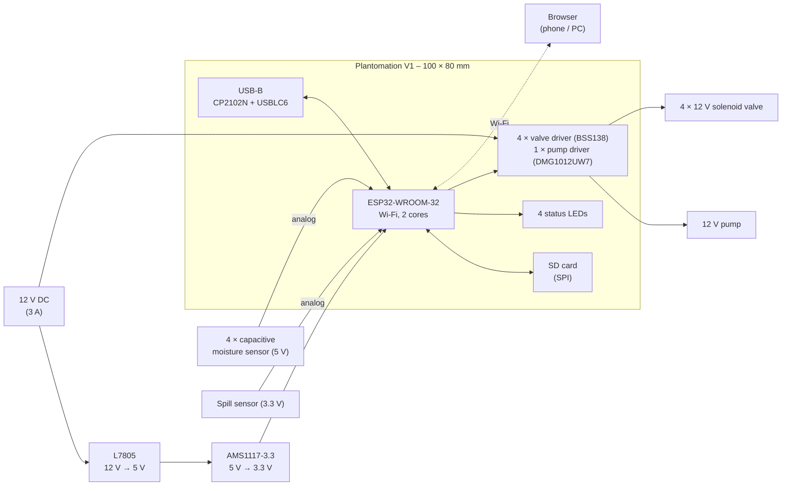
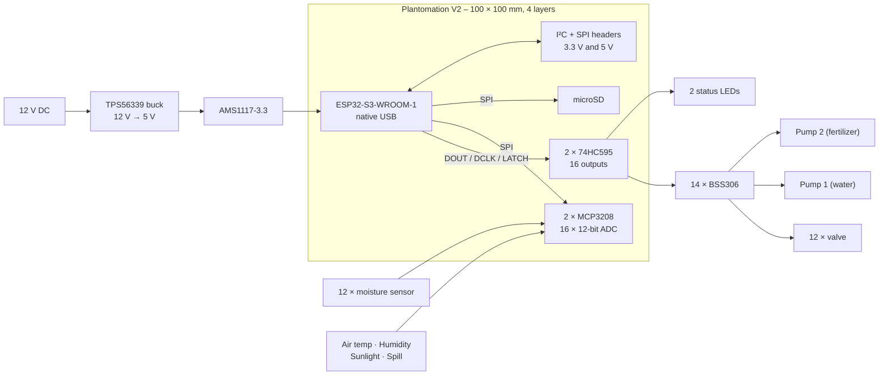
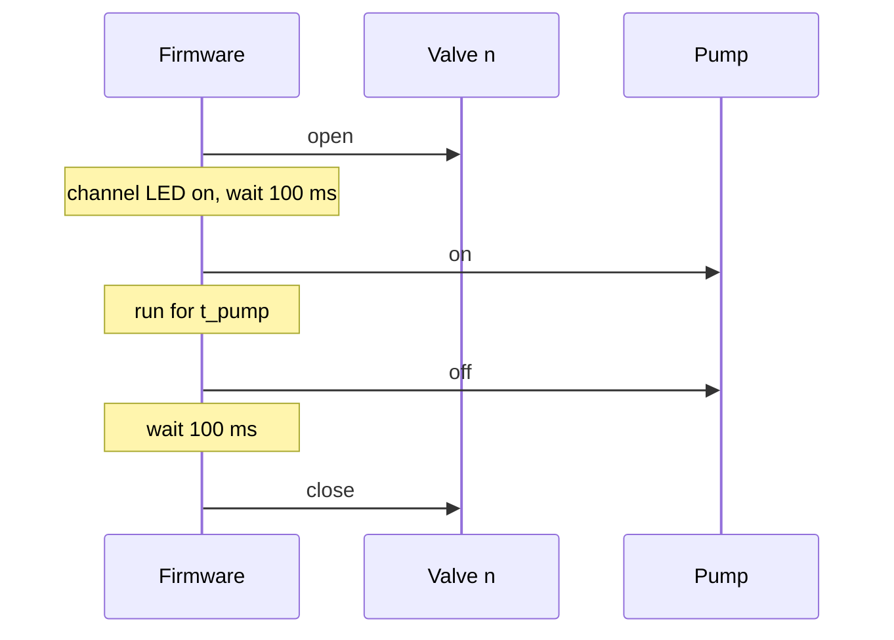
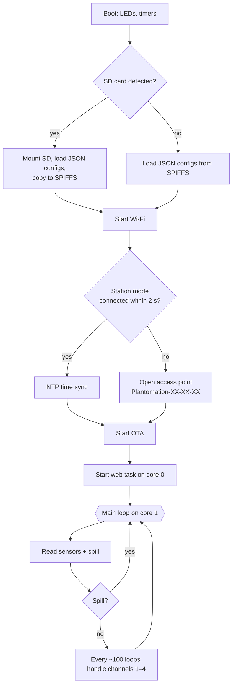

# Plantomation – An Open-Source Automatic Plant Watering System with ESP32

> *"I always forget to water my house plants and eventually they all die. This will be a thing of the past thanks to this small project!"* – from the Plantomation technical note

**Plantomation** is a DIY, open-source **automatic plant watering system** built around an **ESP32**. One controller board drives **one pump per liquid** and a **row of solenoid valves**, one valve per plant. Capacitive **soil moisture sensors** tell the controller when a plant is dry. A small **web interface** lets you name your plants, choose how each one is watered and watch the moisture values live. Configuration and log files live on an **SD card**.

The project exists in two hardware generations:

- **V1** – ESP32-WROOM-32, **4 channels**, one pump. Built, tested and running with a full web interface.
- **V2** – ESP32-S3, **12 channels**, **two pumps** (water + fertilizer), external 12-bit ADCs, shift-register-driven outputs and expansion ports. PCB designed, firmware at the bring-up stage.

| | |
|---|---|
| **Author** | Marco Müller ("Synthron") |
| **Community** | Developed with help from the Discord community **"Freie Maker"** (firmware, feature ideas, front-end) |
| **Status** | V1: PCB designed, ordered, assembled and tested; firmware feature-complete except calibration, water-volume counter and low-water alarm. V2: PCB design finished, not yet ordered; firmware is a hardware test |
| **Purpose** | Automatic watering of house plants by soil moisture or by timer |
| **Channels** | V1: 4 plants, 1 pump · V2: 12 plants, 2 pumps |
| **Supply** | 12 V DC (V1 silkscreen: "12V 3A Input"). Pump and valves run directly from 12 V |
| **Controller** | V1: ESP32-WROOM-32 @ 240 MHz · V2: ESP32-S3-WROOM-1 (8 MB flash / 8 MB PSRAM board definition) |
| **Sensors** | Capacitive soil moisture sensors (analog), spill sensor. V2 adds air temperature, air humidity and sunlight inputs |
| **User interface** | Wi-Fi web interface (Control / Configuration / About), 4 status LEDs, USB serial monitor |
| **Storage** | SD card (config + logs) with fallback to internal SPIFFS flash |
| **Updates** | USB or over-the-air (ArduinoOTA) |
| **Tools** | KiCad (PCBs), FreeCAD (3D-printed mounting plates), PlatformIO + Arduino framework (firmware), LaTeX (documentation) |
| **License** | *No license file in the repository – clarify before publishing* |
| **Source** | [GitHub – Synthron/Plantomation](https://www.github.com/Synthron/Plantomation) |

---

## Table of Contents

1. [What is Plantomation?](#1-what-is-plantomation)
2. [History – From a Smart Flower Pot to a 12-Channel Controller](#2-history--from-a-smart-flower-pot-to-a-12-channel-controller)
3. [Design Philosophy](#3-design-philosophy)
4. [System Architecture](#4-system-architecture)
5. [How Watering Works](#5-how-watering-works)
6. [Safety Features](#6-safety-features)
7. [Web Interface](#7-web-interface)
8. [Configuration & Storage](#8-configuration--storage)
9. [Hardware Design Approach](#9-hardware-design-approach)
10. [Mechanics & 3D-Printed Parts](#10-mechanics--3d-printed-parts)
11. [Software Architecture](#11-software-architecture)
12. [V1 vs. V2 at a Glance](#12-v1-vs-v2-at-a-glance)
13. [Project Status & Roadmap](#13-project-status--roadmap)
14. [Repository Structure](#14-repository-structure)
15. [Media & Downloads](#15-media--downloads)
16. [Credits](#16-credits)

---

## 1. What is Plantomation?

Plantomation sits next to your plants and a water reservoir. For every plant there is:

- a **capacitive soil moisture sensor** in the pot,
- a **solenoid valve** with a hose leading to the pot.

All valves share **one pump** (V1) or **two pumps** (V2). To water a plant, the controller opens that plant's valve, runs the pump for a calculated time and closes the valve again. Because the pump is shared, only one channel is watered at a time.

Each channel can run in one of three modes:

| Mode | Behaviour |
|---|---|
| **Disabled** | The channel does nothing |
| **Moisture control** | The controller reads the soil sensor and waters when the moisture drops below a threshold (0–100 %) set with a slider |
| **Time control** | The controller waters a set volume (ml) at a fixed interval (hours) |

You configure everything in the browser. Out of the box, Plantomation opens its own Wi-Fi network. You can switch it to join your home network instead.

---

## 2. History – From a Smart Flower Pot to a 12-Channel Controller

### The idea

Plantomation was started by a friend of the author who wanted a **"smart flower pot"**. The plan was a split: Synthron does the hardware, the friend does the software. The friend soon dropped out for personal reasons.

### The restart

Some time later Synthron revived the project for a very practical reason: house plants that keep dying because nobody waters them. He updated the schematic and designed a PCB. In the words of the About page: *"The design choice for 4 channels was more of a coincidence and pin-constraint than educated thought."*

### Community help

The project was shared on the Discord community **"Freie Maker"**. Several members joined in, helped with the code, suggested features and *"especially helped with the front-end"*. The V1 PCB carries an **"approved – theBrutzler"** review mark on the silkscreen.

### V1 (schematic dated 2023-11-24)

The V1 board (Rev 1.0) was designed, ordered, assembled and tested. The firmware got a full web interface, SD/SPIFFS file management, moisture and time control, spill detection and logging. A LaTeX technical note documents configuration, start-up and troubleshooting.

### V2 (schematic dated 2023-12-04)

Only days after V1, work on V2 started. Its goals, *inferred from the design*:

- **More plants:** 12 channels instead of 4. The ESP32 has too few pins for 12 valves and 12 analog sensors, so V2 moves the outputs to **74HC595 shift registers** and the sensors to **two MCP3208 ADCs**.
- **Fertilizer:** a **second pump**, so each plant can get water *and* liquid fertilizer on separate schedules.
- **Climate data:** inputs for **air temperature, air humidity, sunlight** and the spill sensor.
- **Stronger outputs:** BSS306 MOSFETs instead of the small BSS138 used for V1's valves.
- **Expansion:** I²C and SPI headers (3.3 V and level-shifted 5 V) and a header to chain more shift registers.

3D-model backups from **March 2024** show the mechanical work on the V2 base plate.

---

## 3. Design Philosophy

- **One pump, many valves.** Pumps are the expensive and bulky part. A single pump plus cheap 12 V solenoid valves scales much better than one pump per plant.
- **Capacitive, not resistive sensors.** Capacitive soil sensors do not corrode in wet soil like bare-electrode sensors.
- **Safety first.** A dedicated **spill sensor** stops all watering when water is detected where it should not be.
- **Works without infrastructure.** No cloud, no app, no home-automation server. The device makes its own Wi-Fi network if needed and serves its own web page.
- **Config you can read.** All settings are plain **JSON files** on the SD card. You can edit them in the browser *or* in a text editor.
- **Graceful fallback.** No SD card? The firmware uses its internal flash (SPIFFS). Wi-Fi join fails? It opens an access point.
- **Hackable.** PlatformIO, the Arduino framework and readable C++ classes. OTA updates make firmware changes easy once the board is installed.

---

## 4. System Architecture

### V1



### V2



---

## 5. How Watering Works

### Moisture control

1. The firmware reads each enabled moisture sensor several times and averages the readings (V1: 10 samples, 100 ms apart).
2. It converts the raw ADC value into **0–100 %** using two calibration points: **dry ≈ 3400** and **wet ≈ 1600** ADC counts. The firmware comment notes the sensor delivers about **2.8 V in dry air** and **1.5 V in water**.
3. If the moisture is **below the threshold** set in the web interface, the valve opens, the pump runs, and the valve closes again.

### Time control

A hardware timer per channel fires after the set interval (hours). The channel is then watered with the set volume.

### From millilitres to pump time

You enter the **pump flow rate in ml/min** once. The firmware converts a volume into a run time:

$$
t_\text{pump}\,[\text{s}] = \frac{60 \cdot V\,[\text{ml}]}{Q\,[\text{ml/min}]}
$$

Example: 100 ml with a pump that delivers 200 ml/min → 30 s.

### Valve/pump sequence



The valve opens **before** the pump starts and closes **after** it stops, so the pump never pushes against a closed system.

---

## 6. Safety Features

| Feature | How it works |
|---|---|
| **Spill detection** | An analog spill sensor is read continuously. Above a threshold (V1: ADC ≥ 200) the system enters **lockdown**: no channel is watered, the web interface shows *"Spill Detected"* in red and the event is logged. |
| **Empty reservoir detection** *(documented, not yet implemented)* | If the moisture value does not change after 5 watering cycles, the system should raise *"Water Reservoir Empty"* and stop until acknowledged. |
| **Boot status LEDs** *(documented)* | Four LEDs show System / Wi-Fi / SD / JSON status for 3 s at boot. |
| **Flyback diodes** | Every valve and pump output has an LL4148 diode against inductive spikes. |
| **USB ESD protection** | USBLC6-2SC6 on the USB data lines. |
| **Separate web core** | Web server and OTA run on core 0, the watering logic on core 1. A busy web page cannot block watering and vice versa. |

---

## 7. Web Interface

The ESP32 serves three pages. They are styled in earthy brown and leaf green and update themselves via AJAX.

| Page | Content |
|---|---|
| **Control** (`/`) | One card per channel: plant name, mode, moisture threshold slider (dry / mid / wet) *or* interval + volume, current moisture in %. System status at the top, refreshed every 2 s. |
| **Configuration** (`/config`) | Mode selection per channel (Disabled / Moisture / Time), pump flow rate, log level (None / Events / All), debug level (None / Actions / All), Wi-Fi settings (SSID, password, station or access-point mode, hostname). V2 adds a second pump rate and a sensor-calibration button. |
| **About** (`/about`) | The story of the project and a link to GitHub. |

System status shown at the top of every page:

| Status | Colour |
|---|---|
| Operational | green |
| Spill Detected | crimson |
| Setup Fail | orange |
| SD Fail – Internal Fallback | orange |
| Reservoir Empty | light blue |
| System Error | crimson |

**First connection.** Without a Wi-Fi config, Plantomation opens its own network:

| | |
|---|---|
| SSID | `Plantomation-XX-XX-XX` (last three bytes of the MAC address) |
| Password | `Planto1!` |
| IP address | `4.3.2.1` |

In station mode the device's IP address is printed on the USB serial port at boot. The PCB has a white silkscreen field labelled **"IP:"** and **"SN:"** to write it down.

---

## 8. Configuration & Storage

At boot the firmware checks for an SD card (card-detect pin).

- **SD card present:** configs are loaded from `/config/` on the SD card and **copied to internal flash**. Logs are written to `/log/`.
- **No SD card:** configs are loaded from internal SPIFFS. No logging.

```
SD card                        Internal SPIFFS
/                              /
├── config/                    ├── control.json
│   ├── control.json           ├── plant1.json … plant4.json
│   ├── plant1.json … 4.json   └── wifi.json
│   └── wifi.json
└── log/
    ├── plant1.log … 4.log
    └── events.log
```

| File | Keys |
|---|---|
| `control.json` | `pumprate` (ml/min), `log_level` (0 none, 1 errors, 2 all), `debug_level` (0 none, 1 actions, 2 all), `sysstate` |
| `plantN.json` | `name`, `op_mode`, `moisture` (0–100), `interval_time` (h), `volume` (ml), `log_enable` |
| `wifi.json` | `mode` (0 access point, 1 station), `ssid`, `password`, `hostname` |

Log lines are semicolon-separated (`date;time;event;value`), so they open directly in a spreadsheet. With NTP (station mode, `pool.ntp.org`, UTC+1) the time stamps are correct.

---

## 9. Hardware Design Approach

| Item | V1 | V2 |
|---|---|---|
| PCB | 100 × 80 mm, 2 layers | 100 × 100 mm, 4 layers |
| MCU | ESP32-WROOM-32 | ESP32-S3-WROOM-1 |
| USB | USB-B, CP2102N USB-UART, USBLC6-2SC6, auto-reset transistors | USB-B to the ESP32-S3 native USB, USBLC6-2SC6 |
| 5 V | L7805 (D-PAK) on a Fischer FK 244 13 heatsink | TPS56339 synchronous buck with 5.6 µH IHLP inductor |
| 3.3 V | AMS1117-3.3 | AMS1117-3.3 |
| Valve drivers | 4 × BSS138 low-side, LL4148 flyback | 12 × BSS306 low-side, LL4148 flyback |
| Pump drivers | 1 × DMG1012UW7 | 2 × BSS306 |
| Moisture inputs | 4 × ESP32 ADC1 | 12 × MCP3208 (12 bit) |
| Extra inputs | Spill | Spill, air temperature, air humidity, sunlight (3.3 V or 5 V selectable) |
| Storage | SD card (GSD090012SEU socket) | microSD (Hirose DM3AT) |
| Connectors | JST-XH (2- and 3-pin) | JST-XH for power/pumps, 2.54 mm pin headers for valves and sensors |
| Expansion | – | I²C and SPI headers at 3.3 V and 5 V (BSS138 level shifters), shift-register chain header |
| Buttons | RST, BOOT | RESET, Boot0 |
| Silkscreen | OSHW, ESD and WEEE logos, Plantomation logo, "approved theBrutzler" | OSHW, ESD and WEEE logos, Plantomation logo, "12 Channel – 4 Sensors" |

Most passives are 0805 and all semiconductors are standard SMD parts (SOT-23, SOIC-16, SOT-223). The boards were designed for assembly at JLCPCB (order-number placeholder on the silkscreen).

Details: [V1 controller](pages/v1.md) · [V2 controller](pages/v2.md)

---

## 10. Mechanics & 3D-Printed Parts

The mechanical parts are modelled in **FreeCAD** and printed. Purpose *inferred from file and object names*:

| File | Purpose |
|---|---|
| `V1/carrier_plate.FCStd` | Carrier plate for V1: holds the PCB on standoffs, has aligned slots for the 4 valves, fixation posts and a fixing bar. Contains the imported 3D PCB model |
| `V1/3D Files/base.3mf` | Printable base / carrier plate |
| `V1/3D Files/fixer.3mf` | Fixing bar for the valves |
| `V1/3D Files/hose_fix.3mf` | Hose holder |
| `V2/3D_files/baseplate.FCStd` / `baseplate.3mf` | V2 base plate with an array of valve mounts and mounts for **Pump 1** and **Pump 2** |
| `V2/3D_files/baseplate-fixbar.3mf` | Fixing bar for the V2 base plate |
| `V2/3D_files/Valve_Bar.3mf` | Bar that holds the row of valves |
| `V2/3D_files/base_v2.FCStd` / `base.3mf` | V2 base with the imported V2 PCB model |

---

## 11. Software Architecture

| Item | Choice |
|---|---|
| Build | **PlatformIO**, platform `espressif32`, **Arduino** framework |
| Libraries | ArduinoJson, AsyncTCP, ESPAsyncWebServer, ArduinoOTA, SD, SPIFFS |
| Web pages | Plain HTML/CSS/JS in `src/html/`. A pre-build Python script (`html-save.py`) packs them into C strings in `sites.h` |
| Upload | USB serial, or OTA (`espota`) to the device's IP |
| Debug | V1: ESP-Prog JTAG · V2: ESP32-S3 built-in USB-JTAG |
| Multitasking | FreeRTOS task for web server + OTA pinned to core 0, application in `loop()` on core 1 |



The code is organised in small classes: `Wifi`, `Plant` (one object per channel) and `SysConf`. Each class can `load_config()` and `save_config()` itself from any file system (SD or SPIFFS).

---

## 12. V1 vs. V2 at a Glance

| | V1 | V2 |
|---|---|---|
| Channels | 4 | 12 |
| Pumps | 1 | 2 (water + fertilizer) |
| MCU | ESP32 | ESP32-S3 |
| Output control | direct GPIO | 2 × 74HC595 shift registers |
| Sensor ADC | internal ESP32 ADC | 2 × MCP3208, 12 bit, 16 channels |
| Environment sensors | – | air temperature, humidity, sunlight |
| 5 V supply | linear regulator + heatsink | switching regulator |
| Expansion | – | I²C, SPI (3.3 V + 5 V), shift-register chain |
| Per-channel settings | name, mode, threshold *or* interval + volume | name, mode, threshold, interval + volume **per pump** |
| Status | built & tested | PCB designed, firmware bring-up |

---

## 13. Project Status & Roadmap

**V1**

- ✅ PCB designed, ordered, assembled, tested
- ✅ Web interface (AJAX, multi-page, control, config, about)
- ✅ Wi-Fi management, SD + SPIFFS file management, config copy SD → SPIFFS
- ✅ Moisture control, time control, spill detection, debug and log levels
- ✅ Documentation: config, Wi-Fi, control modes, operation
- ⏳ Sensor calibration via web page
- ⏳ Internal water-volume counter
- ⏳ Low-water alarm
- ⏳ UI documentation

**V2**

- ✅ PCB design finished
- ⏳ Order, assemble, test
- ⏳ Firmware (currently a shift-register test that cycles through all 12 channels)
- ✅ Web pages for 12 channels / 2 pumps drafted
- ⏳ Documentation

---

## 14. Repository Structure

```
Plantomation/
├── README.md
├── V1/
│   ├── README.md                Feature list & to-do list
│   ├── carrier_plate.FCStd      FreeCAD carrier plate (with PCB model)
│   ├── 3D Files/                Printable parts (.3mf)
│   ├── doc/                     LaTeX technical note
│   │   ├── chapters/            Intro, file system, config, getting started,
│   │   │                        troubleshooting, operation
│   │   └── pictures/            Logo
│   ├── Hardware/                KiCad project + 3D models
│   └── Plantomation/            PlatformIO firmware (ESP32)
│       └── src/                 main, classes, server, web, html/
└── V2/
    ├── README.md
    ├── 3D_files/                FreeCAD base plate, valve bar (.FCStd, .3mf)
    ├── Firmware/                PlatformIO firmware (ESP32-S3)
    │   ├── boards/              Custom board JSON (ESP32-S3 N8R8)
    │   └── src/
    └── Hardware/                KiCad project (4 sheets), BOM (.csv)
```

---

## 15. Media & Downloads

| Asset | Path |
|---|---|
| Logo (flower in a pot with PCB traces, water arc) | `V1/doc/pictures/logo.png`, `logo_notext.png` |
| Technical note (LaTeX source) | `V1/doc/tech-note.tex` |
| KiCad projects | `V1/Hardware/`, `V2/Hardware/` |
| V2 bill of materials | `V2/Hardware/Plantomation_V2.csv` |
| 3D-printable parts | `V1/3D Files/*.3mf`, `V2/3D_files/*.3mf` |
| Firmware | `V1/Plantomation/`, `V2/Firmware/` |

*Suggested additions for the website: photos of the assembled V1 board and a full setup with reservoir, pump and valves; screenshots of the three web pages; KiCad 3D renders of V1 and V2; a short video of a watering cycle; a moisture-over-time chart made from the SD log files.*

---

## 16. Credits

- Design, hardware and firmware: **Marco Müller ("Synthron")**.
- Original idea: a friend of the author ("smart flower pot").
- Firmware help, feature ideas and front-end: the **"Freie Maker"** Discord community.
- PCB review (V1): **theBrutzler**.

---

### Sitemap

- **Plantomation** (this page)
  - [V1 Controller – 4 channels](pages/v1.md)
  - [V2 Controller – 12 channels, 2 pumps](pages/v2.md)
  - [Notes for authors](pages/author-notes.md)
