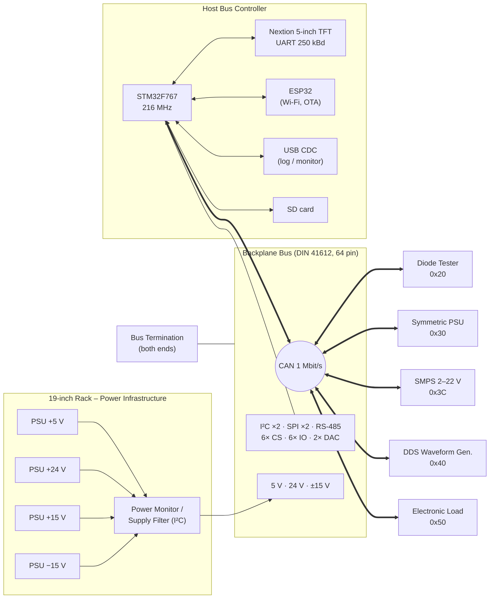
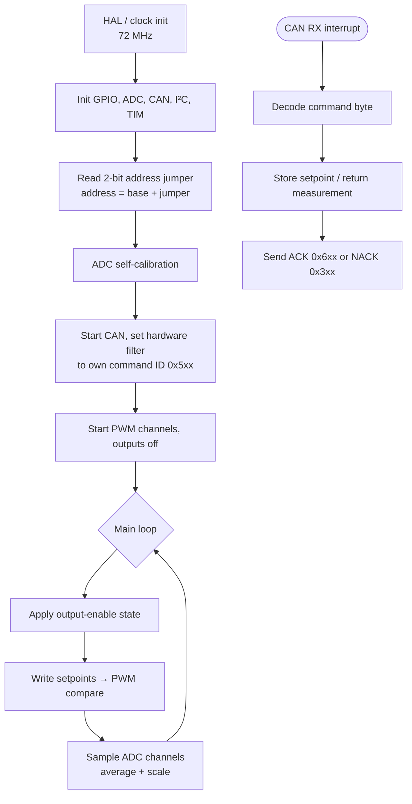

# ModLab – A Modular Station for Your Electronics Workbench

> *"Absolutely over-engineered."* – the design motto of the ModLab

The **ModLab** is a modular, microcontroller-driven electronics workstation built into a 19" rack. Each instrument (power supplies, a function generator, an electronic load, a diode tester, …) sits on its own 3U Eurocard plug-in module. All modules share a common **backplane bus** that supplies power and connects them to a central **Host Bus Controller (HBC)**. The HBC has a 5" touch display and controls everything over **CAN bus**.

The current hardware generation is **ModLab V3**. It is designed from scratch, mostly with readily available parts, in **KiCad**. The firmware is written in **C on STM32 microcontrollers** (STM32Cube HAL + PlatformIO).

| | |
|---|---|
| **Author** | Marco Müller ("Synthron") |
| **Status** | Work in progress – long-term hobby project with no fixed deadline |
| **Form factor** | 19" rack, 3U subracks, 160 × 100 mm Eurocards |
| **Backplane** | DIN 41612 64-pin (rows a + c) |
| **Main bus** | CAN, 1 Mbit/s, custom "Command – Value" protocol |
| **Controller** | STM32F767 (HBC) + ESP32 co-processor, STM32F103 on every module |
| **User interface** | 5" Nextion TFT touch display, USB (debug), planned web monitor (ESP32) |
| **Tools** | KiCad (PCBs), FreeCAD (front panels), QElectroTech (rack wiring), STM32CubeMX + PlatformIO (firmware), Nextion Editor (GUI), LaTeX (technical documentation) |
| **Source** | [GitHub](https://github.com/Synthron/ModLab) · [GitLab](https://gitlab.synthron.de/Synthron/ModLab) |

---

## Table of Contents

1. [What is the ModLab?](#1-what-is-the-modlab)
2. [History – From FMAS to ModLab V3](#2-history--from-fmas-to-modlab-v3)
3. [Design Philosophy & Lessons Learned](#3-design-philosophy--lessons-learned)
4. [The Rack](#4-the-rack)
5. [System Architecture](#5-system-architecture)
6. [The Backplane Bus](#6-the-backplane-bus)
7. [Communication Protocols](#7-communication-protocols)
8. [Hardware Design Approach](#8-hardware-design-approach)
9. [Software Architecture](#9-software-architecture)
10. [Modules](#10-modules)
11. [Project Status & Roadmap](#11-project-status--roadmap)
12. [Repository Structure](#12-repository-structure)
13. [Media & Downloads](#13-media--downloads)
14. [Credits](#14-credits)

---

## 1. What is the ModLab?

The ModLab is a **bench instrument system**. Instead of one stand-alone device per job, all instruments share:

- **one rack and power infrastructure**: a 20U 19" rack with central mains switching, emergency stop, fuses and four bench power supplies (5 V, 24 V, ±15 V),
- **one backplane bus** that gives every module power and a set of digital interfaces (CAN, I²C, SPI, RS-485, GPIO, DAC lines),
- **one user interface**: the Host Bus Controller with its 5" touch screen finds the connected modules, shows their values and sends their settings.

Each plug-in module has its **own STM32 microcontroller**. It handles the real-time work locally: generating PWM setpoints, sampling ADCs and running measurement sequences. It talks to the HBC only through short CAN messages. Because the modules are independent, you can add new instruments without changing the existing ones. Up to **four modules of the same type** can run at the same time (selected by an address jumper on each card).

The rack also houses the **FMAS**, the training system the project grew out of (see below).

---

## 2. History – From FMAS to ModLab V3

### The FMAS (apprenticeship)

The **FMAS** (*Flexibles Modulares Ausbildungs-System*, "Flexible Modular Training System") was a 3U rack system used at the **Karlsruhe Institute of Technology (KIT)** during the author's apprenticeship. Trainees learned with it how to draw schematics, lay out PCBs, etch them in-house and debug circuits with a multimeter and oscilloscope.

- The backplane carried **9 V DC** and **12 V, 24 V and 20-0-20 V AC**. Almost every module needed its own rectifier, filter and regulator.
- All modules were **purely discrete**: no microcontrollers and no programmable logic. That made them robust, but not very smart.
- Modules included LM317/LM337/LM723 power supplies, an LED tester (current source + voltmeter), discrete and XR2206-based waveform generators, a signal tracer, a logic probe, a continuity tester, an LED dice and similar projects.
- Most backplane lines were unused, which left lots of room for improvement.

The original FMAS still lives in the lower half of the ModLab rack, partly out of nostalgia and partly to show where the project came from.

### Arduino Workstation (V1)

During the second year of the apprenticeship the author had finished all FMAS modules. He then proposed his own system: the **Arduino Workstation**. It worked as a proof of concept, but it had serious design flaws: a hand-wired 32-pin backplane, "virtual" 24 V made from ±12 V, and many manual potentiometers and buttons.

### V2

V2 used an **Arduino Due** as the main controller. In the author's words it "didn't work" and was never really documented.

### ModLab V3 (current)

V3 is a complete restart with a clear goal: plan everything, simulate difficult circuits and review every design. The main changes:

- AVRs are dropped completely in favour of **STM32** microcontrollers.
- Settings are **digital** (PWM-generated reference voltages, DACs, digital pots) instead of potentiometers.
- A proper **PCB backplane** with fixed supply rails replaces the hand wiring.
- **CAN** is the main bus between the modules.

---

## 3. Design Philosophy & Lessons Learned

**Lessons from the Arduino Workstation:**

| Lesson | Consequence in V3 |
|---|---|
| **No virtual grounds!** Using +12 V / −12 V as "24 V" caused endless trouble. | The backplane carries a real, separate **24 V rail** in addition to **±15 V** and **5 V**. |
| **No hand-wired backplanes!** 32 hand-soldered pins caused connection problems. | The backplane and bus terminators are **PCBs** with DIN 41612 connectors. |
| **Planning, planning, planning.** The old system was improvised. | Every design is planned, difficult circuits are simulated first, and every design gets a review before ordering. |

**Guiding principles in V3:**

- **Modular above all.** Each module is self-contained. It has its own MCU, its own local 3.3 V regulator, its own CAN transceiver and a front connector that passes the backplane through.
- **Think about the whole system.** Bus capacity, addressing and protocol are designed for future modules and avoid bottlenecks.
- **Use hardware loops where it makes sense.** The power supplies regulate in **analog hardware**. The MCU only provides the reference voltages (filtered PWM) and measures the results. This avoids slow and fragile software PID loops.
- **Safe by design.** The planned web interface on the ESP32 is for **monitoring and diagnosis only**, not for control, for security reasons.
- **Open to other controllers.** Dedicated 5 V and 3.3 V SPI buses and 5 V-tolerant I/Os allow later modules with AVRs, PICs or other controllers, "if they fit the function".

---

## 4. The Rack

### Layout

The whole system lives in a **20U 19" rack**. The front is the "user side". The back holds the installation and support systems.

| U | Front | Back |
|---:|---|---|
| 18–20 | **ModLab** subrack #1 (3U) | Cover plate, power supplies **24 V & 5 V** |
| 15–17 | **ModLab** subrack #2 (3U) | Cover plate, power supplies **+15 V & −15 V** |
| 12–14 | **Control panel** | Cover plate, filter, fuses |
| 7–11 | DIN rail / cable channel | DIN rail / cable channel |
| 4–6 | **FMAS** subrack #1 (3U) | Cover plate, voltage regulator, fuses |
| 1–3 | **FMAS** subrack #2 (3U) | Cover plate, mains connector, transformer |

Two 3U subracks are used for the ModLab and two for the FMAS, which leaves 5U for the control panel and cable management.

### Electrical installation

The rack wiring is drawn in **QElectroTech** ([installationsplan](../installationsplan), PDF export `installationsplan_neu.pdf`). It has three folios:

1. **Power supply & emergency stop** (*Stromversorgung, Not-AUS*): mains input with PE, fuses, control switches, indicator lamps, contactors and a **Pilz PNOZ X10.11P safety relay** for the emergency-stop circuit.
2. **FMAS connection**: contactor-switched supply for the FMAS with its original transformer, fuses and terminal strips.
3. **ModLab connection**: contactor-switched supply for the ModLab power supplies. The labels name `230V/5V DC 10A`, `230V/24V DC 10A` and two `230V/15V DC 5A` units (for +15 V and −15 V).

Key features:

- **Control panel.** Power to each part of the rack (ModLab, FMAS) is enabled separately, so only the parts in use are powered. The control voltage has its own switch for extra safety.
- **The big red "OH SHIT" button.** A real emergency stop, monitored by the safety relay.
- **Inrush current limiter.** The four switch-mode supplies can each draw up to 40 A at power-up (≈ 160 A peak in total). An active current limiter restricts the current for the first ~70 ms. This protects the house fuses, the wall wiring and the contactor contacts.
- **Pluggable power.** The ModLab subracks get their power through high-current **DIN 41612 H15** connectors with cable lugs, so the rack can be partly taken apart for transport or upgrades. (The FMAS power lines are soldered directly to its backplanes.)
- **Laser-engraved panels.** Artwork for the front panel, the fuse panel and the logo is in [`Engravings/`](../Engravings).

---

## 5. System Architecture



**How it works:**

1. When it starts, the **HBC scans the bus**. It sends a CAN *Ping* to the four possible addresses of every known module type and records which modules answer.
2. The **touch display** shows one page per module class. Channels that are not present are greyed out or hidden.
3. When the user enters values and presses *Set*, the display sends a binary command to the HBC over UART. The HBC turns it into CAN *Set Parameter* / *Enable Output* commands for the selected module.
4. When the display requests a refresh, the HBC reads the measured values from the module with CAN *Get Parameter* commands and writes them back to the display as ASCII commands.
5. Each module runs its own loop: it applies the setpoints (PWM → analog reference), samples its ADCs and answers CAN requests from an interrupt handler.

---

## 6. The Backplane Bus

The backplane is the heart of the modularity. Every slot gets the same 64 pins (DIN 41612, rows a and c).

### Supply voltages

| Rail | Purpose | Notes |
|---|---|---|
| **+5 V** | Logic, peripherals, 5 V controllers | PSU up to 15 A, fused at 10 A. Modules make their own 3.3 V with LDOs (AP1117-33). |
| **+24 V** | Power stages (SMPS, current sources, loads) | Fused at 10 A. Very power-hungry future modules should bring their own supply. |
| **+15 V / −15 V** | Analog circuits (op-amps, amplifiers, waveform generation, negative supplies) | "Symmetric 30 V". |

Each supply rail uses **4 pins** to maximise current capacity, with plenty of GND pins in between.

### Interfaces

| Interface | Details | Use |
|---|---|---|
| **CAN** | Differential, 1 Mbit/s, SN65HVD232 transceivers | **Main workhorse** for all module communication |
| **I²C (Standard Mode)** | 100 kHz | Backup / small periodic data |
| **I²C (Fast Mode)** | 400 kHz | Backup / small periodic data |
| **RS-485** | MAX485E on the HBC | Reserved for experiments with **Modbus** |
| **SPI (5 V)** | MOSI/MISO/SCK | For 5 V controllers and peripherals without level shifters |
| **SPI (3.3 V)** | MOSI/MISO/SCK | For 3.3 V devices |
| **CS0 – CS5** | 6 dedicated chip selects | SPI node selection |
| **IO0 – IO5** | 6 general-purpose IOs, 5 V compatible | Status, interrupt and error signals |
| **DAC0 / DAC1** | Analog outputs from the HBC (buffered) | Planned speaker module (startup melody, alarms, acoustic events) |

Slot-address encoding on the backplane was considered and dropped (too many pins). Instead, **each module has a 2-bit address jumper**.

### Pinout (DIN 41612, a + c)

| Signal (a) | Pin | Pin | Signal (c) |
|---|:---:|:---:|---|
| +5 V | 1 | 1 | +5 V |
| +5 V | 2 | 2 | +5 V |
| GND | 3 | 3 | GND |
| GND | 4 | 4 | GND |
| +24 V | 5 | 5 | +24 V |
| +24 V | 6 | 6 | +24 V |
| GND | 7 | 7 | GND |
| GND | 8 | 8 | GND |
| CAN+ | 9 | 9 | CAN− |
| IO0 | 10 | 10 | IO1 |
| SDA_FM | 11 | 11 | SCL_FM |
| IO2 | 12 | 12 | IO3 |
| SDA | 13 | 13 | SCL |
| IO4 | 14 | 14 | IO5 |
| RS485+ | 15 | 15 | RS485− |
| GND | 16 | 16 | GND |
| GND | 17 | 17 | GND |
| DAC0 | 18 | 18 | DAC1 |
| CS0 | 19 | 19 | CS1 |
| MOSI1 | 20 | 20 | MISO1 |
| CS2 | 21 | 21 | CS3 |
| SCK1 | 22 | 22 | SCK2 |
| CS4 | 23 | 23 | CS5 |
| MOSI2 | 24 | 24 | MISO2 |
| +15 V | 25 | 25 | +15 V |
| +15 V | 26 | 26 | +15 V |
| GND | 27 | 27 | GND |
| GND | 28 | 28 | GND |
| −15 V | 29 | 29 | −15 V |
| −15 V | 30 | 30 | −15 V |
| GND | 31 | 31 | GND |
| GND | 32 | 32 | GND |

*(`_FM` = Fast Mode I²C. The technical note lists pin c12 as "IO2"; by the numbering scheme it is IO3.)*

Both ends of the backplane are terminated by the **[Bus Termination](modules/bus-termination.md)** cards.

---

## 7. Communication Protocols

### 7.1 CAN – the module protocol

**Layers**

| Layer | Implementation |
|---|---|
| Physical | STM32 bxCAN peripheral + **SN65HVD232** transceiver, half-duplex differential, **1 Mbit/s** |
| Transport | **Plain 8-byte CAN frames.** ISO-TP was considered and rejected because of its overhead. Commands are designed to fit into one frame. |
| Application | Custom **"Command – Value"** protocol with **ping-pong** replies. Every reply repeats the command byte, so it is clear which command it answers. |

**ID encoding.** The 11-bit standard ID = **message type** (upper nibble) + **module address** (lower byte). Every module can filter in hardware for messages addressed to it. No CPU time is spent on foreign traffic.

| ID | Message type |
|---|---|
| `0x7xx` | Auto message (informational, e.g. "conversion done") |
| `0x6xx` | Reply to command – **ACK** |
| `0x5xx` | **Standard command** (HBC → module) |
| `0x4xx` | Warning / state change |
| `0x3xx` | Reply to command – **NACK** |
| `0x2xx` | Processing error |
| `0x1xx` | Critical error |
| `0x0xx` | Reserved |

**Module base addresses.** The lower 2 bits come from the module's address jumper, so up to 4 instances per type are possible.

| Base address | Module | Address range |
|---|---|---|
| `0x10` | Host Bus Controller | – |
| `0x20` | [Diode Tester](modules/diode-tester.md) | `0x20–0x23` |
| `0x30` | [Symmetric Linear Power Supply](modules/symmetric-power-supply.md) | `0x30–0x33` |
| `0x34`, `0x38` | Reserved | |
| `0x3C` | [24 V Switching Mode Power Supply](modules/smps.md) | `0x3C–0x3F` |
| `0x40` | [DDS Waveform Generator](modules/waveform-generator.md) | `0x40–0x43` |
| `0x50` | [Electronic Load](modules/electronic-load.md) | `0x50–0x53` |

**Commands** (byte 0 of the payload)

| Code | Command | Payload (command) | Payload (reply) |
|---|---|---|---|
| `0x01` | Reset module | – | cmd, status |
| `0x05` | Ping / discovery | – | cmd, status |
| `0x10` / `0x11` | Set / Get **8-bit** parameter | index, [value] | cmd, status, [value] |
| `0x14` / `0x15` | Set / Get **16-bit** parameter | index, [value] | cmd, status, [value] |
| `0x18` / `0x19` | Set / Get **32-bit** parameter | index, [value] | cmd, status, [value] |
| `0x20` | Get status information | – | cmd, status, channel info (bits 0–3 PWM ch., bits 4–5 ADC ch.) |
| `0x40` / `0x41` | Enable / Disable output | – | cmd, status |
| `0x60` / `0x61` | Set / Get operation mode | mode | cmd, (mode), status |

The parameter indices depend on the module (see the module pages). Multi-byte values are sent **MSB first**.

**Status byte** (in every reply; `0` = OK)

| Bit | Meaning |
|---|---|
| 0 | Index mismatch |
| 1 | Data mismatch |
| 2 | Channel mismatch |
| 3 | Operation mode mismatch |
| 4 | Processing error |
| 5 | I/O error |
| 6 | Unknown command |
| 7 | Reserved |

The lower nibble shows protocol errors ("not available" or "wrong length"). The upper nibble shows internal module errors.

**Auto messages:** `0x10` = *Conversion done*. The Diode Tester sends it to the HBC (`0x710`) when a measurement sequence is finished.

**Example – setting the SymPSU (address 0x30) to +5.00 V:**

```
HBC  → 0x530  [14 10 01 F4]      Set16, index 0x10 (V+ set), value 500 (×10 mV)
PSU  → 0x630  [14 00]            ACK, status OK
HBC  → 0x530  [40]               Enable output
PSU  → 0x630  [40 00]            ACK
HBC  → 0x530  [15 20]            Get16, index 0x20 (V+ measured)
PSU  → 0x630  [15 00 01 F3]      ACK, value 499
```

### 7.2 TFT display protocol (Nextion ↔ HBC)

- **Physical:** 5 V TTL UART, **250 000 baud, 8N1**.
- **HBC → TFT:** ASCII instructions ending with `0xFF 0xFF 0xFF`. They set properties of on-screen objects directly. The display only knows integers; the number box places the decimal point.

| Example | Effect |
|---|---|
| `t1.txt="foo"` | Set text |
| `t1.aph=127` | Make object fully opaque (`aph=25` = greyed out) |
| `x1.val=330` | Show 3.30 in a float box with 2 decimals |
| `vis t1,0` / `vis t1,1` | Hide / show object |
| `rest` | Reset the display |

- **TFT → HBC:** short binary commands.

| Command | Meaning | Payload |
|---|---|---|
| `0x55 nn` | **Page change**: `00` Home/Settings, `01` Diode Tester, `02` Function Generator, `03` Symmetric PSU, `04` SMPS, `05` Electronic Load | 1 byte |
| `0x5C …` | **Set process data** for the module on the current page | Module ID + module-specific data, LSB first (Diode Tester 4 B, Function Gen. 10 B, SymPSU 9 B, SMPS 5 B, Load 5 B) |
| `0x50 IS` | **Set output**: I = channel/sub-ID 1–4, S = 0 off / 1 on | 1 byte |
| `0x53` | **Read data**: request fresh measured values for the current page | – |
| `0x5A xx` | **General settings / debug**: `10/11` CAN log over USB off/on, `20/21` TFT log off/on, `30/31` simulate missing modules off/on, `4x` rescan bus | 1 byte |

### 7.3 USB monitor

USB (CDC virtual COM port) is currently used as a **debug log**. It can mirror all CAN and TFT traffic when enabled on the display. A full **USB monitor** is planned: sending CAN frames, setting variables in the HBC and controlling the whole ModLab from a PC.

### 7.4 Planned / TBD

ESP32 ↔ HBC SPI protocol, backplane SPI (5 V / 3.3 V) and I²C (standard / fast mode) protocols are reserved and still to be defined.

---

## 8. Hardware Design Approach

All V3 boards are designed in **KiCad** (V3 project folders under [`Hardware/V3`](../Hardware/V3)) as **160 × 100 mm Eurocards**.

**Common building blocks on every module:**

| Block | Implementation |
|---|---|
| Microcontroller | **STM32F103C8T6** (Cortex-M3, 72 MHz from a 12 MHz HSE ×6 PLL) |
| CAN | **SN65HVD232** 3.3 V CAN transceiver |
| Local logic supply | **AP1117-33** LDO from +5 V |
| Negative analog reference | **79L05 / 7905** (−5 V) on modules that need it |
| Address | 2×2 pin-header **address jumper** (2 bits → 4 instances) |
| Protection | **TVS diodes** and **bulk capacitance** on the backplane rails |
| Programming | SWD header (ST-Link) |
| Setpoints | STM32 timer **PWM (16-bit) → RC/active low-pass filter** → analog reference for the analog control loop |
| Measurement | STM32 internal 12-bit **ADC** with averaging, scaled by divider / shunt amplifier |
| Connector | DIN 41612 2×32 (a + c) to the backplane |

**Front panels** are designed in **FreeCAD** and 3D printed (`.3mf`). Finished panels exist for the Diode Tester, Function Generator, Electronic Load, SMPS, Symmetric PSU and the Mainboard (two variants: "Fusion" and "NEXTION" display cut-outs). Templates for 12 TE / 36 TE panel widths and component models are in [`Hardware/frontpanels/Templates`](../Hardware/frontpanels/Templates).

**Schematic PDFs** for all major boards are in [`doc/schematics`](../doc/schematics).

---

## 9. Software Architecture

### Toolchain

| Item | Choice |
|---|---|
| Code generation | **STM32CubeMX** (`.ioc` per project), converted to PlatformIO with **stm32pio** (`convert.sh`) |
| Build | **PlatformIO**, platform `ststm32`, `framework = stm32cube` (HAL) |
| Boards | `genericSTM32F103C8` (modules), `nucleo_f767zi` (HBC), `esp32dev` (ESP32, Arduino framework) |
| Upload / debug | **ST-Link** (SWD); clone-chip CPUTAPID workaround in some projects |
| GUI | **Nextion Editor** project `Modlab_TFT.HMI`, compiled `Modlab_TFT.tft` |
| Docs | LaTeX technical note (`doc/tech-note.tex`) |

### Common firmware pattern (modules)



- Each project contains a copy of the shared **`modlab` library** (`lib/modlab/modlab.c/.h`). It holds the address and command definitions, `send_rec()` / `send_rec16()` reply helpers, `send_cmd()` / `send_set16()` request helpers and a TIM1-based `delay_us()`.
- CAN reception is **interrupt-driven** (FIFO0). The hardware filter only lets the module's own command ID through.
- The main loop is a simple **super-loop** without an RTOS.

### Host Bus Controller firmware

The HBC firmware (STM32F767, 216 MHz) uses **page-driven** scheduling. The main loop calls the handler for the display page that is currently active. The handler forwards user input to the modules and reads back measurements when asked. See the [Host Bus Controller](modules/host-bus-controller.md) page for details.

---

## 10. Modules

| Module | Function | Key specs | CAN addr. | Status |
|---|---|---|---|---|
| [**Host Bus Controller**](modules/host-bus-controller.md) | Brain & user interface | STM32F767, ESP32, 5" TFT, SD, USB, SRAM | `0x10` | V1 built, V2 designed |
| [**Bus Termination / Adapter**](modules/bus-termination.md) | Bus termination, rail LEDs, front bus connector | 120 Ω CAN & RS-485 termination, TVS | – | Built |
| [**Diode Tester**](modules/diode-tester.md) | Forward voltage & crude I-V curve of diodes/LEDs | 4 current sources → 15 currents 2–37 mA | `0x20` | V2 built |
| [**Symmetric Linear PSU**](modules/symmetric-power-supply.md) | Dual-tracking lab supply | 0…±12 V, 0…1.2 A, CV/CC, 10 mV steps | `0x30` | V1 built, V2 designed |
| [**Switching Mode PSU**](modules/smps.md) | High-current lab supply | 2–22 V, 0–5 A, CV/CC, TL494 | `0x3C` | Rev 1 built, redesign pending |
| [**DDS Waveform Generator**](modules/waveform-generator.md) | Function generator | AD9833, up to 12.5 MHz, sine/triangle/square, PWM gain & offset | `0x40` | Built |
| [**Electronic Load**](modules/electronic-load.md) | Dual-channel constant-current load | 2 × IRFP044N, 0.1 Ω/30 W shunts, temperature-controlled fan | `0x50` | Built |
| [**Power Monitor / Supply Filter**](modules/power-monitor.md) | Rack supply filtering & monitoring | 4 rails, LC filter, ACS723 current sensors, I²C | (I²C) | Hardware designed, firmware skeleton |

### Planned / concept modules

- **Symmetric switching mode power supply**: single regulated voltage, CC/CV, PWM-controlled.
- **Analog waveform generator**: MAX038-based concept.
- **Logic probe tester**: shows logic levels, can inject a low-power square wave to trace signals, 3D-printed probes with pogo pins.
- **Continuity tester.**
- **Speaker module**: uses the backplane DAC lines for startup melodies, error tones and continuity beeps.
- **Oscilloscope**: a single-channel DSO-138 clone ported to a Eurocard for quick checks of slow signals.

---

## 11. Project Status & Roadmap

**Hardware**

- ✅ All main modules redesigned around STM32
- ✅ Host Bus Controller V1 (STM32F767): reviewed, ordered, assembled
- ⏳ Host Bus Controller V2: new LCD connector, no external SRAM, reset header
- ✅ Diode/LED Tester V1 and V2
- ✅ Variable power supply V1. ⏳ V2: relay footprint fixed, feedback dividers corrected; review/order/assembly open
- ✅ Symmetric PSU V1. ⏳ V2: negative channel and CC LEDs fixed; review/order/assembly open
- ✅ Waveform generator, ✅ Electronic load, ✅ Termination boards / bus extenders
- ⏳ DSO-138 clone, logic tester, continuity tester, speaker module

**Software**

- ✅ CAN protocol: command and data structure defined
- ✅ HBC: USB debug, Nextion GUI + µC interface, CAN
- ⏳ HBC: I²C; SPI / DAC / RS-485 (no use case yet)
- ⏳ ESP32: communication with the STM32, basic web interface (✅ OTA updates)
- ✅ Diode Tester, SymPSU, SMPS, Waveform Generator firmware (CAN, ADC, PWM, AD9833)
- ⏳ Power Monitor: voltage/current measurement, I²C communication

**Documentation**

- ✅ Rewritten in English, TFT protocol documented
- ⏳ Better introduction, attach schematics

---

## 12. Repository Structure

```
ModLab/
├── README.md                 Project readme & to-do list
├── Modlab_TFT.tft            Compiled Nextion GUI (upload to display)
├── installationsplan         QElectroTech rack wiring (+ PDF export)
├── doc/                      LaTeX technical note, pictures, schematic PDFs
│   ├── chapters/             Intro, rack, FMAS, ModLab, bus, modules, protocols (CAN, TFT)
│   ├── pictures/             Logos, HBC overview, current source, GUI concept
│   └── schematics/           PDF schematics of all V3 boards
├── Engravings/               Laser-engraving artwork (front, fuse panel, logo)
├── Hardware/
│   ├── frontpanels/          FreeCAD front panels (+ 3MF), templates
│   └── V3/                   KiCad projects
│       ├── Bustermination/
│       ├── current_sensor_filter/   (Power Monitor hardware)
│       ├── Diode Tester/ (V1, V2)
│       ├── Electronic_Load/
│       ├── Mainboard/ (V1 = F767, V2 = F407)
│       ├── Power_SMPS/
│       ├── symmetric_power_supply/ (V1, V2)
│       └── Waveform_Generator/
└── Software/                 PlatformIO / STM32CubeMX projects
    ├── Mainboard/            HBC: Mainboard_F767, Mainboard_ESP32, Nexion_TFT
    ├── Diode_Tester/
    ├── SymPSU/
    ├── SMPS/
    ├── Waveform/
    ├── Load/
    └── Power_Monitor/
```

---

## 13. Media & Downloads

Assets in the repository that can be used on the website:

| Asset | Path |
|---|---|
| Logo (various) | `doc/pictures/logo_new.png`, `logo_black.png`, `logo_noname.png`, `Software/Mainboard/Nexion_TFT/MODLAB_TRANSPARENT.png` |
| HBC board overview drawing | `doc/pictures/overview_cpu.png` |
| Diode Tester current-source schematic | `doc/pictures/cc_source.png` |
| Early GUI concept (Arduino Workstation era) | `doc/pictures/gui.jpg` |
| Early diode-test flowchart concept | `doc/pictures/Pruefvorgang.png` |
| Technical documentation (PDF) | `doc/tech-note.pdf` |
| Schematics (PDF) | `doc/schematics/*.pdf` |
| Rack wiring (PDF) | `installationsplan_neu.pdf` |
| Front panel 3D models | `Hardware/frontpanels/finished/*.3mf` |
| Engraving artwork | `Engravings/*.bmp` |

*Suggested additions for the website: photos of the rack, the control panel, each assembled module and the TFT pages; KiCad 3D renders of each PCB.*

---

## 14. Credits

- **Symmetric power supply** design derived from *"Bench Power Supply"* by **The Big One** on [Hackaday.io](https://hackaday.io/project/4154-bench-power-supply).
- **DDS waveform generator** circuit around the AD9833 based on the guide by **Daumemo** ([daumemo.com](https://daumemo.com)).
- CAN HAL examples inspired by [controllerstech.com](https://controllerstech.com/can-protocol-in-stm32/).
- FMAS: training system of the Karlsruhe Institute of Technology (KIT) apprenticeship workshop.

---

### Sitemap

- **ModLab** (this page)
  - [Host Bus Controller](modules/host-bus-controller.md)
  - [Bus Termination / Bus Adapter](modules/bus-termination.md)
  - [Diode Tester](modules/diode-tester.md)
  - [Symmetric Linear Power Supply](modules/symmetric-power-supply.md)
  - [Switching Mode Power Supply](modules/smps.md)
  - [DDS Waveform Generator](modules/waveform-generator.md)
  - [Electronic Load](modules/electronic-load.md)
  - [Power Monitor / Supply Filter](modules/power-monitor.md)
