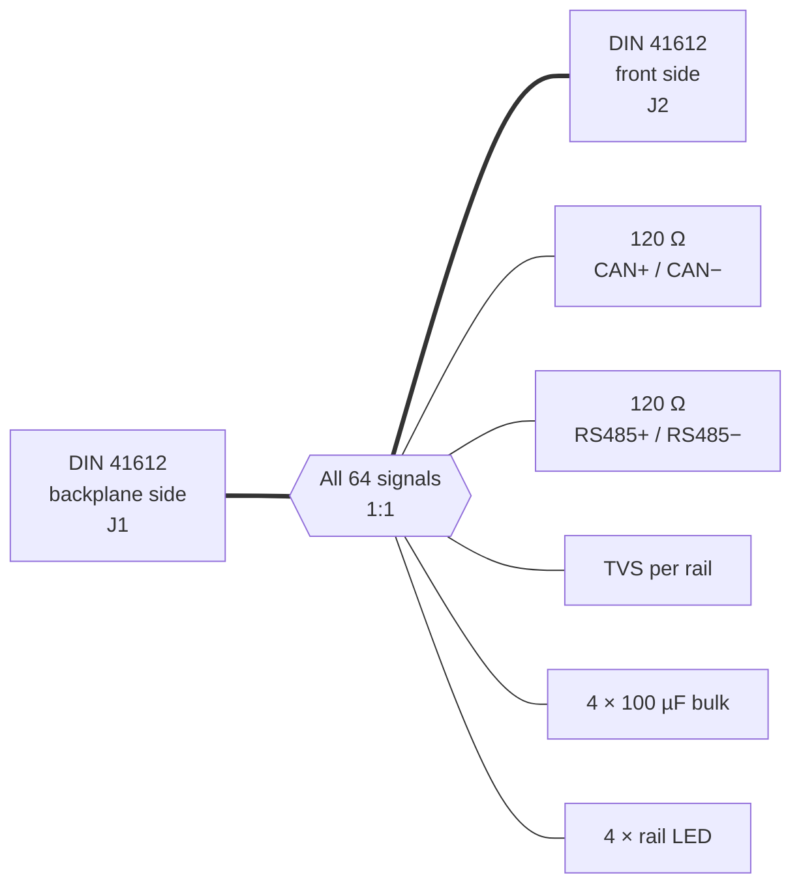

# Bus Termination / Bus Adapter

> **The bookends of the backplane.** It terminates the differential bus lines, shows the state of every supply rail with an LED and brings the whole bus out to the front panel.

[← Back to ModLab overview](../index.md)

---

## At a Glance

| | |
|---|---|
| **Function** | Bus termination, rail monitoring, 1:1 bus extension |
| **Quantity** | 2 per backplane (one at each end) |
| **Active parts** | None (no MCU, no CAN address) |
| **Terminated buses** | CAN (120 Ω), RS-485 (120 Ω) |
| **Rail indicators** | 4 LEDs: +5 V, +24 V, +15 V, −15 V |
| **Protection** | TVS diodes and bulk capacitors on every rail |
| **PCB** | 160 × 100 mm Eurocard, 2 layers |
| **Schematic** | [doc/schematics/Bustermination.pdf](../../doc/schematics/Bustermination.pdf) |

---

## Overview

The Bus Adapter was one of the first ModLab modules. It has three jobs:

1. **Termination.** CAN and RS-485 are differential buses and need a 120 Ω termination at **both physical ends**. That is why the card is built twice and placed in the outermost slots of each subrack.
2. **Bus extension.** A slot holding only two resistors would be wasted. So each card has a **second DIN 41612 connector on its front edge** that is wired **1:1 to the backplane**. External boards, test adapters or prototypes can be plugged in there.
3. **Rail monitoring.** Each supply voltage has its own **LED**. You can see at a glance that all rails are present, or that a fuse has blown.

The card also adds **TVS protection** and **bulk capacitance** to every rail at the ends of the backplane.

---

## Hardware

### Components

| Ref. | Part | Function |
|---|---|---|
| J1, J2 | DIN 41612, 2×32 (a + c) | Backplane connector and front pass-through connector |
| R5 | **120 Ω** | CAN termination |
| R6 | **120 Ω** | RS-485 termination |
| D1–D4 | **SMAJ5.0A** (5 V), **P6SMB26** (24 V), **2 × P6SMB16** (±15 V) | TVS overvoltage protection per rail |
| D5–D8 | LEDs | Rail indicators +5 V, +24 V, +15 V, −15 V |
| R1 | 2.2 kΩ | LED series resistor (+5 V) |
| R2 | 10 kΩ | LED series resistor (+24 V) |
| R3, R4 | 6.8 kΩ | LED series resistors (±15 V) |
| C | 4 × 100 µF | Bulk capacitance per rail |

The schematic is a single sheet with the sections *Backplane*, *TVS Protection*, *Power LEDs* and *Bulk Capacitance*.

---

## Software

None. This is a purely passive board.

---

## Status

✅ Designed, built and in use ("Termination boards and Bus Extenders" are complete in the project to-do list).

---

## Files

| Type | Location |
|---|---|
| KiCad project | [`Hardware/V3/Bustermination`](../../Hardware/V3/Bustermination) |
| Schematic PDF | [`doc/schematics/Bustermination.pdf`](../../doc/schematics/Bustermination.pdf) |
