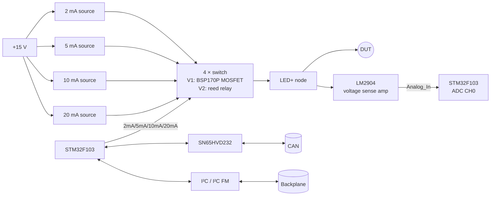
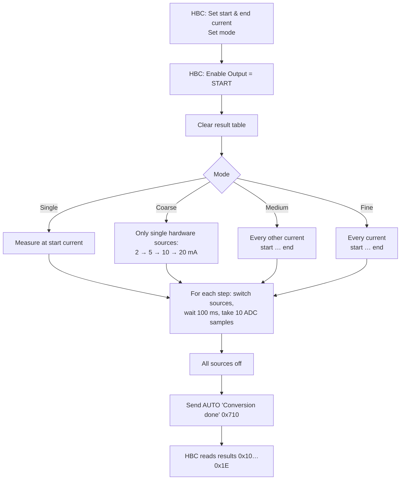

# Diode Tester

> **Quick forward-voltage checks and crude I-V curves for diodes and LEDs.** Four switchable constant-current sources give 15 different test currents from 2 mA to 37 mA.

[← Back to ModLab overview](../index.md)

---

## At a Glance

| | |
|---|---|
| **Function** | Diode / LED tester: forward voltage at defined currents, characteristic curve |
| **Current sources** | 4 × constant current: ≈ 2.2 mA, 4.9 mA, 9.8 mA, 19.6 mA |
| **Test currents** | 15 combinations: 2, 5, 7, 10, 12, 15, 17, 20, 22, 25, 27, 30, 32, 35, 37 mA |
| **Measurement** | DUT voltage via sense amplifier and the STM32 12-bit ADC (10 samples averaged) |
| **Modes** | Single value, coarse / medium / fine characteristic curve |
| **Source switching** | V1: P-channel MOSFETs. **V2: reed relays** |
| **MCU** | STM32F103C8T6 @ 72 MHz |
| **Bus interfaces** | CAN (used), I²C (wired, reserved) |
| **CAN address** | `0x20` (+ jumper → `0x20–0x23`) |
| **TFT page** | `0x01` |
| **PCB** | 160 × 100 mm, 2 layers |
| **Revisions** | V1 (built), V2 (built) |
| **Schematic** | [doc/schematics/Diode_Tester.pdf](../../doc/schematics/Diode_Tester.pdf) |

---

## Overview

The Diode Tester is simple in concept and very handy in practice. Plug a diode or LED into the front, pick a current on the touch screen, and the ModLab shows the forward voltage. Because the four current sources can be **combined**, the module can also step through up to **15 currents** in one run and return a **characteristic curve**.

It is a modern version of the LED tester from the original FMAS training system (current source + voltmeter), now digitally controlled and connected to the bus.

---

## Hardware

### The current sources

Each source is a classic **transistor constant-current source** referenced to a **5.6 V Zener diode** on the +15 V rail:

By Kirchhoff's voltage law the emitter resistor sees the Zener voltage minus the base-emitter drop:

$$
U_R = U_Z - U_{BE} = 5.6\,\text{V} - 0.7\,\text{V} = 4.9\,\text{V}
\qquad\Rightarrow\qquad I = \frac{4.9\,\text{V}}{R}
$$

| Source | Resistor | Current |
|---|---|---|
| 2 mA | 2.2 kΩ | $4.9\,\text{V} / 2.2\,\text{k}\Omega = 2.22\,\text{mA}$ |
| 5 mA | 1 kΩ | $4.9\,\text{V} / 1\,\text{k}\Omega = 4.9\,\text{mA}$ |
| 10 mA | 499 Ω | $4.9\,\text{V} / 499\,\Omega = 9.81\,\text{mA}$ |
| 20 mA | 2 × 499 Ω parallel | $4.9\,\text{V} / 249.5\,\Omega = 19.63\,\text{mA}$ |

All four outputs are tied to the common `LED+` node, so the currents **add up** when several sources are switched on. The DUT sits between `LED+` and ground ("Output Pads"). With the +15 V supply this leaves roughly 9 V of compliance voltage, enough for any LED colour, including blue and white.

### Block diagram

### Board sections

The single schematic sheet contains: 2 / 5 / 10 / 20 mA current sources, voltage sense amplifier, output pads, CPU with main crystal, address select, bus drivers and transceivers, backplane, bulk capacitance, TVS protection, 3.3 V regulator and decoupling.

### Key components

| Function | Part |
|---|---|
| Microcontroller | STM32F103C8T6 |
| CAN transceiver | SN65HVD232 |
| Current-source transistors | **BCX53** (PNP) + **BSS138** per source |
| References | 4 × **5.6 V Zener** diodes |
| Source switches V1 | 4 × **BSP170P** P-channel MOSFET |
| Source switches V2 | 4 × **Standex-Meder CO 3570.1331.051** reed relays (SIL, SPST) |
| Sense amplifier | **LM2904** dual op-amp |
| Logic supply | AP1117-33 |
| DUT connector | 2-pin header "Diode" |
| Address | 2×2 jumper header (V2) |

### V1 → V2

In **V1** the sources were switched by P-channel MOSFETs, which "for some strange reason didn't work". **V2** replaces them with small **reed relays** from the parts drawer. V2 also adds a proper 2×2 address jumper header.

---

## Firmware

**Project:** [`Software/Diode_Tester`](../../Software/Diode_Tester)

| | |
|---|---|
| Build | PlatformIO, `framework = stm32cube`, ST-Link (with CPUTAPID workaround for clone chips) |
| Clock | 12 MHz HSE × 6 = 72 MHz |
| Code generation | STM32CubeMX (`Diode_Tester.ioc`) via stm32pio |

### Pin map

| Pin | Function |
|---|---|
| PA0 – ADC CH0 | DUT voltage (`Analog_In`) |
| PA3 | Source **2 mA** |
| PA4 | Source **5 mA** |
| PA5 | Source **10 mA** |
| PA6 | Source **20 mA** |
| PB4 / PB3 | Address jumper bit 0 / 1 |
| PB8 / PB9 | CAN RX / TX |
| PB6 / PB7 | I²C1 (100 kHz, reserved) |

### Current selection

The test current is a **4-bit mask**. Bit 0 = 2 mA, bit 1 = 5 mA, bit 2 = 10 mA, bit 3 = 20 mA. Masks 1…15 give the 15 currents:

| Mask | 1 | 2 | 3 | 4 | 5 | 6 | 7 | 8 | 9 | 10 | 11 | 12 | 13 | 14 | 15 |
|---|---|---|---|---|---|---|---|---|---|---|---|---|---|---|---|
| **mA** | 2 | 5 | 7 | 10 | 12 | 15 | 17 | 20 | 22 | 25 | 27 | 30 | 32 | 35 | 37 |
| **Index** | `0x10` | `0x11` | `0x12` | `0x13` | `0x14` | `0x15` | `0x16` | `0x17` | `0x18` | `0x19` | `0x1A` | `0x1B` | `0x1C` | `0x1D` | `0x1E` |

### Measurement sequence

The averaged ADC value is converted to the DUT voltage:

$$
U_\text{DUT} = \frac{(\overline{\text{ADC}} + 20)\cdot 100}{420}
$$

This uses about 420 counts per volt with a +20 count offset correction. The result is in 10 mV steps, and the measuring range is roughly 0 … 9.7 V.

### Operation modes

| Mode | Name | Behaviour |
|---|---|---|
| 0 | **Single** | Measure only at the start current |
| 1 | **Coarse curve** | Start → end current, single hardware sources only |
| 2 | **Medium curve** | Start → end current, every other possible current |
| 3 | **Fine curve** | Start → end current, every possible current |

*(Over CAN the mode is sent as 1–4. The firmware subtracts 1 internally.)*

### CAN interface

| Command | Index | Size | Meaning |
|---|---|---|---|
| Set 8 bit (`0x10`) | `0x20` | 1 B | **Start current** (index 0–14) |
| | `0x21` | 1 B | **End current** (index 0–14) |
| Set mode (`0x60`) | – | 1 B | Operation mode |
| Enable output (`0x40`) | – | – | **Start measurement** |
| Get 16 bit (`0x15`) | `0x10…0x1E` | 2 B | DUT voltage at 2 … 37 mA |
| Ping (`0x05`) | – | – | Discovery |
| *Auto* `0x710` | – | 1 B | `0x10` = conversion done (module → HBC) |

### TFT integration

On page `0x01` the user selects one of up to four testers (`r0…r3`, greyed out if not present), the mode and the start/stop currents. The display sends `0x5C` with **4 bytes** (module ID, mode, start index, stop index). The HBC configures the module and starts the sequence. When `AUTO_DONE` arrives, it reads all 15 results and fills the result table on the screen.

---

## Early Concept

An earlier flowchart (`doc/pictures/Pruefvorgang.png`, German) shows a planned **auto-ranging test voltage**:

1. Select the current and switch the relays.
2. Apply a 5 V test voltage. If the ADC reads > 4 V, switch to 15 V. If it reads > 14 V, switch to 24 V. If it reads > 23 V, report **"Overload"**.
3. If the ADC reads 0 V, report **"Short circuit"** (*Kurzschluss*).
4. Otherwise output the converted voltage and release all relays.

The V3 hardware simplifies this to a fixed +15 V compliance supply.

---

## Status

✅ V1 and V2 hardware built, ✅ firmware complete (CAN, test sequence, ADC).

---

## Files

| Type | Location |
|---|---|
| KiCad V1 / V2 | [`Hardware/V3/Diode Tester`](../../Hardware/V3/Diode%20Tester) |
| Schematic PDF | [`doc/schematics/Diode_Tester.pdf`](../../doc/schematics/Diode_Tester.pdf) |
| Current source illustration | `doc/pictures/cc_source.png` |
| Front panel | `Hardware/frontpanels/finished/Diode_Tester.FCStd`, `Diode_Tester.3mf`, template `diode_tester.fpd` |
| Firmware | [`Software/Diode_Tester`](../../Software/Diode_Tester) |
