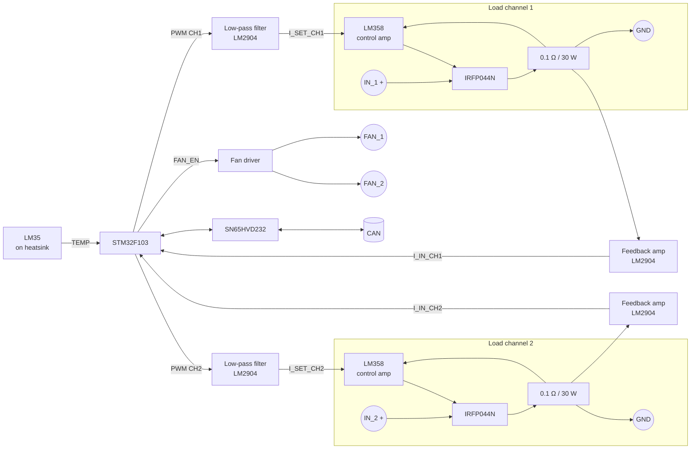
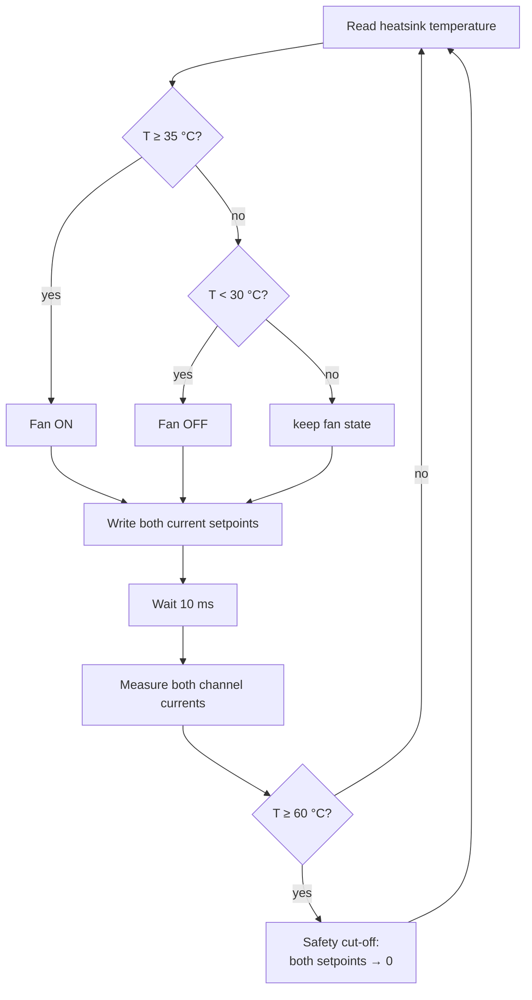

# Electronic Load

> **Two independent constant-current sink channels** with big MOSFETs, precision power shunts, a heatsink temperature sensor and automatic fan control. Ideal for testing power supplies, batteries and converters.

[← Back to ModLab overview](../index.md)

---

## At a Glance

| | |
|---|---|
| **Function** | Programmable DC electronic load (constant current) |
| **Channels** | 2, independent |
| **Current** | Up to 15 A (design target), 10 mA resolution |
| **Power devices** | 2 × **IRFP044N** N-MOSFET on SK 03 heatsinks |
| **Current sense** | 2 × **0.1 Ω / 30 W** precision power resistors (CAD MP930) |
| **Thermal management** | LM35 temperature sensor on the heatsink, fan control (2 fan headers), over-temperature cut-off |
| **Control** | 2 × 16-bit PWM → low-pass filter → analog current loop |
| **Measurement** | 2 × current (ADC), 1 × temperature (ADC) |
| **MCU** | STM32F103C8T6 @ 72 MHz |
| **CAN address** | `0x50` (+ jumper → `0x50–0x53`) |
| **TFT page** | `0x05` |
| **Schematic** | [doc/schematics/Electronic_Load.pdf](../../doc/schematics/Electronic_Load.pdf) |

---

## Overview

A bench full of power supplies needs something to load them with. The ModLab Electronic Load has **two channels**. Each one is a classic **op-amp + MOSFET + shunt constant-current sink**. As with the power supplies, the STM32 does not regulate in software. It only sets a **reference voltage** per channel (filtered PWM), and an analog op-amp loop drives the MOSFET gate so that the shunt voltage matches the reference.

A **temperature sensor** on the heatsink is read continuously. The firmware switches the **fans** on and off with hysteresis and **shuts both channels down** if the heatsink gets too hot.

---

## Hardware

### Block diagram

### Schematic sheets

| Sheet | Contents |
|---|---|
| **Top level** | Backplane connector, sheet links |
| **Load** | "Load Channels": 2 × MOSFET + power shunt + LM358 control amplifier, inputs `IN_1` / `IN_2` |
| **Support** | "Low-Pass Filter" for both PWM setpoints, "Feedback Amplifier" for both shunt signals, "Temperature Sensor", "Fan Control" |
| **CPU** | STM32F103C8, crystal, SN65HVD232, address jumper, SWD |
| **Power** | Bulk capacitance, TVS, **AP1117-33** (+3.3 V), **L79L05** (−5 V) |

### Key components

| Function | Part |
|---|---|
| Load MOSFETs | 2 × **IRFP044N** (TO-247) |
| Heatsinks | 2 × **SK 03** |
| Shunts | 2 × **0.1 Ω, 1 %, 30 W** (CAD MP930-0.10) |
| Control amplifier | **LM358** |
| Filter / feedback / fan op-amps | **LM2904** |
| Temperature sensor | **LM35** (TO-92), 10 mV/°C |
| Fan connectors | 2 × 2-pin (`FAN_1`, `FAN_2`) |
| Load inputs | 2 × 2-pin (`IN_1`, `IN_2`) |
| Microcontroller | STM32F103C8T6 |
| CAN transceiver | SN65HVD232 |

At 15 A a single 0.1 Ω shunt drops 1.5 V and dissipates 22.5 W, which is why the 30 W power resistors are needed.

### Power rails used

**+24 V, ±15 V** (analog), **+5 V** → 3.3 V (logic), local **−5 V** (L79L05).

---

## Firmware

**Project:** [`Software/Load`](../../Software/Load)

| | |
|---|---|
| Build | PlatformIO `genericSTM32F103C8`, `framework = stm32cube`, ST-Link |
| Clock | 12 MHz HSE × 6 = 72 MHz |
| Code generation | STM32CubeMX 6.5 (`Load.ioc`) via stm32pio |

### Pin map

| Pin | Function |
|---|---|
| PA15 – TIM2 CH1 | PWM current setpoint **channel 1** |
| PB3 – TIM2 CH2 | PWM current setpoint **channel 2** |
| PA0 – ADC CH0 | Measured current channel 1 |
| PA1 – ADC CH1 | Measured current channel 2 |
| PA2 – ADC CH2 | Heatsink temperature (LM35) |
| PB0 | `FAN_EN` (fan on/off) |
| PB5 / PB4 | Address jumper bit 0 / 1 |
| PA11 / PA12 | CAN RX / TX |
| PB6 / PB7 | I²C1 (400 kHz, reserved) |

### Conversion formulas

$$
\text{CCR} = \frac{I_{[10\,\text{mA}]}\cdot 2037.31}{100}
\qquad
I_{[10\,\text{mA}]} = \frac{\overline{\text{ADC}}\cdot 100}{251.366}
\qquad
T_{[^\circ\text{C}]} = \frac{\overline{\text{ADC}}\cdot 3.3}{40}
$$

Every reading is the average of **10 samples**. The temperature formula is the LM35's 10 mV/°C applied directly to the 3.3 V / 12-bit ADC.

### Main loop & thermal management

- **Fan hysteresis:** on at ≥ 35 °C, off below 30 °C.
- **Over-temperature protection:** at ≥ 60 °C both channels are forced to 0 A.

### CAN interface

| Command | Index | Size | Meaning |
|---|---|---|---|
| Set 16 bit (`0x14`) | `0x10` | 2 B | Current setpoint **channel 1** [10 mA] |
| | `0x11` | 2 B | Current setpoint **channel 2** [10 mA] |
| Get 16 bit (`0x15`) | `0x20` | 2 B | Measured current channel 1 [10 mA] |
| | `0x21` | 2 B | Measured current channel 2 [10 mA] |
| Get 8 bit (`0x11`) | `0x22` | 1 B | Heatsink **temperature** [°C] |
| Ping (`0x05`) | – | – | Discovery |

The load has no output relay. A setpoint of 0 turns a channel off.

### TFT integration

On page `0x05` the display sends **5 bytes** of process data: module ID, channel 1 current and channel 2 current (16-bit, LSB first). On a read request the HBC fetches both currents and the temperature for each present load (up to 4) and shows them on the screen.

---

## Status

✅ Hardware built, ✅ firmware with CAN interface, current control, fan control and over-temperature cut-off.

*The original concept mentioned a thermocouple on the heatsink. The built version uses an LM35 semiconductor sensor.*

---

## Files

| Type | Location |
|---|---|
| KiCad project | [`Hardware/V3/Electronic_Load`](../../Hardware/V3/Electronic_Load) |
| Schematic PDF | [`doc/schematics/Electronic_Load.pdf`](../../doc/schematics/Electronic_Load.pdf) |
| Front panel | `Hardware/frontpanels/finished/Load.FCStd`, `Load.3mf` |
| Firmware | [`Software/Load`](../../Software/Load) |
