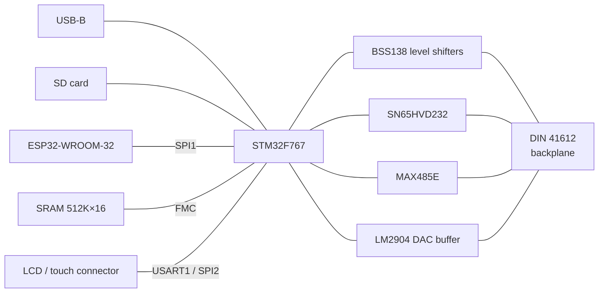
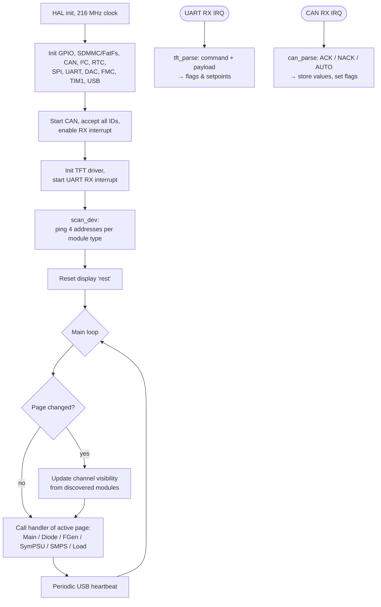

# Host Bus Controller (HBC / Mainboard)

> **The brain of the ModLab.** It is the master of every backplane interface, the user interface with its 5" touch screen and the gateway to USB and Wi-Fi.

[← Back to ModLab overview](../index.md)

---

## At a Glance

| | |
|---|---|
| **Function** | System controller, bus master, user interface |
| **CAN address** | `0x10` (sends commands with ID `0x5xx`) |
| **MCU** | STM32F767ZIT6: Cortex-M7, **216 MHz**, 2 MB flash, 512 KB RAM (V1) |
| **Co-processor** | ESP32-WROOM-32 (Wi-Fi, OTA updates, planned web monitor) |
| **Display** | Nextion 5" TFT with touch, UART at 250 kBaud |
| **Storage** | microSD card (SDMMC + FatFs), 512 K × 16 external SRAM (FMC) |
| **PC interface** | USB Full Speed (CDC virtual COM port) |
| **Backplane interfaces** | CAN, 2 × I²C (100/400 kHz), RS-485, 2 × SPI, 6 × CS, 6 × IO, 2 × DAC |
| **PCB** | 160 × 100 mm Eurocard, 4 layers, 195 parts (V1) |
| **Revisions** | V1 (built, "V3 R1.0", 2022-11-19), V2 (designed) |
| **Schematic** | [doc/schematics/Mainboard_767.pdf](../../doc/schematics/Mainboard_767.pdf) |

---

## Overview

The Host Bus Controller is the busiest card in the system:

- It **discovers** every module on the CAN bus at startup.
- It runs the **touch GUI** and turns user input into CAN commands.
- It reads **measured values** back from the modules and shows them on the display.
- It is the **master of all backplane buses** (CAN, I²C, SPI, RS-485) and drives the two **DAC lines**.
- It offers a **USB debug/monitor port** and an **SD card** for logging and configuration.
- It carries an **ESP32** for a planned web-based monitoring and diagnosis interface. For security reasons this web interface is read-only and has **no control functions**.

The STM32F767 was chosen for plenty of headroom: 2 MB flash, 512 KB RAM and 216 MHz, so it can process everything quickly. External SRAM was added on purpose for data-heavy future modules such as a **logic analyzer**.

---

## Hardware (V1)

### Board layout

USB, the SD card and the ESP32 sit on the left (front-panel side). The STM32 and the SRAM are in the centre, and the level shifters, CAN and RS-485 transceivers sit next to the backplane connector on the right. The LCD connector and the status LEDs run along the bottom edge.

### Schematic sheets

| Sheet | Contents |
|---|---|
| **Master sheet & bus connector** | DIN 41612 backplane connector, links to the sub-sheets |
| **CPU – LCD – RAM** | STM32F767, external SRAM on FMC, LCD/touch connector, SWD, boot option, crystals, status LEDs |
| **ESP32 – SD – Shifters and Drivers** | ESP32 module, SD card socket, level shifters for the 5 V bus, CAN and RS-485 transceivers, DAC buffers, USB protection with software disconnect |
| **Power** | Two 3.3 V LDOs (separate rails for STM32 and ESP32) |

### Key components

| Function | Part |
|---|---|
| Microcontroller | **STM32F767ZIT6** (LQFP-144) |
| External RAM | **IS61WV5126EEBLL-10** – 512 K × 16 (8 Mbit) asynchronous SRAM on FMC |
| Co-processor | **ESP32-WROOM-32** (connected via SPI1, plus UART header) |
| CAN transceiver | **SN65HVD232** |
| RS-485 transceiver | **MAX485E** |
| Level shifting | **27 × BSS138** MOSFET level shifters, so all bus I/Os are 5 V compatible |
| DAC buffer | **LM2904** dual op-amp |
| Voltage regulators | **2 × AP1117-33** (3.3 V for STM32 and ESP32) |
| USB | USB-B connector, TVS protection, **BC856** high-side switch for software USB disconnect |
| SD card | GSD09002SEU socket (1-bit SDMMC) |
| Clocks | HSE crystal for the PLL, 32.768 kHz crystal for the RTC |
| Connectors | DIN 41612 2×32 (a+c), LCD 2×20 header, SWD 1×4, boot option 1×2, ESP UART 1×3 |
| Indicators | 8 LEDs for bus activity (CAN, RS-485, I²C1, I²C2, ESP, SD, SPI3, SPI4) |

### Peripheral map

| STM32 peripheral | Use |
|---|---|
| **CAN1** (PB8/PB9) | Backplane CAN, 1 Mbit/s |
| **USART1** (PB14/PB15) | Nextion TFT, 250 000 Bd 8N1, TX via DMA |
| **UART7** (PF6/PF7, DE = PF8) | RS-485 backplane, 115 200 Bd, hardware driver-enable |
| **I²C1** (PB6/PB7) | Backplane I²C, Fast Mode (400 kHz) |
| **I²C2** (PB10/PB11) | Backplane I²C, Standard Mode (100 kHz) |
| **SPI1** | ESP32 co-processor |
| **SPI2** | TFT touch controller |
| **SPI3 / SPI4** | The two backplane SPI buses (5 V and 3.3 V) |
| **DAC1 / DAC2** (PA4/PA5) | Backplane DAC0/DAC1 (buffered) → planned speaker module |
| **FMC** | External SRAM, 16-bit bus |
| **SDMMC1** (PC8–PC12, PD2) | SD card, with card-detect and write-protect inputs |
| **USB OTG FS** | CDC device |
| **RTC** | Real-time clock |
| **TIM1** | Microsecond time base (`delay_us()`) |
| GPIO | `CS_0…CS_5`, `GPIO_0…GPIO_5`, `ESP_CS`, `ESP_RDY`, `LCD_CS`, `USB_Disconnect`, 8 LEDs |

### Power

The HBC uses **+5 V** from the backplane and makes its own 3.3 V rails with two AP1117-33 regulators. +24 V and ±15 V are routed on the board but not regulated there.

---

## Hardware V2 (designed, not yet built)

The V2 design fixes the lessons learned from V1. It simplifies the board and moves to a smaller MCU:

| Change | V1 | V2 |
|---|---|---|
| MCU | STM32F767ZIT6 (LQFP-144) | **STM32F407VGT6** (LQFP-100) |
| External SRAM | IS61WV5126 on FMC | **Removed** |
| TFT connection | 2×20 LCD header | **4-pin JST-XH** (Nextion: 5 V, TX, RX, GND) on USART1 |
| USB protection | Discrete TVS | **USBLC6-2SC6** |
| SD card | SDMMC | SDIO |
| Backplane SPI | SPI3 / SPI4 | SPI2 = 5 V bus, SPI3 = 3.3 V bus |
| RS-485 | UART7 | UART4 |
| Reset header | – | planned (README) |

PCB: also 4 layers, 160 × 100 mm. The current firmware still targets V1 (F767).

---

## User Interface – Nextion 5" TFT

The GUI is built with the **Nextion Editor** (`Software/Mainboard/Nexion_TFT/Modlab_TFT.HMI`). The compiled binary is `Modlab_TFT.tft` in the repository root. Assets include the transparent ModLab logo and the fonts Arial 16/32, Courier Mono 16 and Lucida Mono 16.

**Pages**

| Page ID | Page | Contents |
|---|---|---|
| `0x00` | **Home / General settings** | Debug switches: CAN log over USB, TFT log over USB, simulate missing modules, rescan bus |
| `0x01` | **Diode Tester** | Up to 4 testers (`r0…r3`), start/stop current, mode, result table with 15 values |
| `0x02` | **Function Generator** | Up to 4 channels (`t51…t54`): waveform, frequency, amplitude, offset, output on/off |
| `0x03` | **Symmetric PSU** | Up to 4 units (`t79…t82`): V+/I+/V−/I− setpoints and readings, output on/off |
| `0x04` | **SMPS** | Up to 4 units (`t43…t46`): V/I setpoints and readings, output on/off |
| `0x05` | **Electronic Load** | Up to 4 units: 2 current setpoints, 2 current readings, heatsink temperature |

Only the modules shown on the current page are polled. Channels of modules that were not found during discovery are greyed out (`aph=25`) or hidden (`vis …,0`).

**Interface:** 5 V TTL UART, 250 000 baud, 8N1. The HBC sends ASCII commands ending with `FF FF FF`. The display sends compact binary commands (`0x55` page change, `0x5C` set data, `0x50` set output, `0x53` read data, `0x5A` settings). See the [protocol section on the overview page](../index.md#72-tft-display-protocol-nextion--hbc) for details.

---

## Firmware (STM32F767)

**Project:** [`Software/Mainboard/Mainboard_F767`](../../Software/Mainboard/Mainboard_F767)

| | |
|---|---|
| Build | PlatformIO, `board = nucleo_f767zi`, `framework = stm32cube` |
| Code generation | STM32CubeMX (`Software.ioc`) via stm32pio |
| Clock | 12 MHz HSE → PLL → **216 MHz** SYSCLK (APB1 54 MHz, APB2 108 MHz, 48 MHz for USB/SDMMC) |
| Middleware | USB Device (CDC), FatFs (SD) |
| Libraries | `lib/modlab` (CAN protocol), `lib/tft` (Nextion driver & page logic), `lib/usb_mon` (USB monitor stub) |

### Program flow

### Module discovery

`scan_dev()` sends **CAN Ping (`0x05`)** to all four addresses of every known module type:

| Type | Addresses pinged |
|---|---|
| Diode Tester | `0x520–0x523` |
| Symmetric PSU | `0x530–0x533` |
| SMPS | `0x53C–0x53F` |
| Waveform Generator | `0x540–0x543` |
| Electronic Load | `0x550–0x553` |

Each ACK sets a bit in a per-type **presence bitmask**. The display pages use these bitmasks to enable or grey out channels. A rescan can be started from the home screen.

### CAN handling

- `transmit()` sends a standard frame and waits up to **2 ms** for the reply.
- `can_parse()` (interrupt) looks at the message type `(StdId & 0xF00)`:
  - **ACK `0x6xx`**: stores 8/16/32-bit values (`rec_8`, `rec_16`, …) and confirms the command,
  - **AUTO `0x7xx`**: e.g. `AUTO_DONE` from the Diode Tester → read its results,
  - **NACK `0x3xx`**: error handling.
- Helper functions: `send_cmd()`, `send_get()`, `send_set8/16/32()`, `send_set_opmode()`. Values are sent big-endian.

### Page handlers (what the HBC does per module)

| Page | On "Set" (`0x5C`) | On "Output" (`0x50`) | On "Read" (`0x53`) / Auto |
|---|---|---|---|
| Diode Tester | Set start/end current index, operation mode, then *Enable Output* (= start) | – | After `AUTO_DONE`: read 15 voltages → `x0…x15` |
| Function Gen. | Set waveform (mode), frequency (32 bit), amplitude, offset | Enable/disable output relay | – |
| Symmetric PSU | Set V+, I+, V−, I− | Enable/disable | Read V+/I+/V−/I− → `x4…`, 8 boxes per unit |
| SMPS | Set V, I | Enable/disable | Read V, I → 4 boxes per unit |
| Load | Set current CH0, CH1 | – | Read I CH0/CH1 → `x…`, temperature → `n0…n3` |

### Debug features

- **CAN log over USB**: every CAN frame sent or received is printed on the USB CDC port.
- **TFT log over USB**: UART traffic to and from the display (prepared).
- **Simulate missing modules**: shows all channels on every page, so the GUI can be developed without the hardware.
- **USB heartbeat**: a periodic `USB Test Zyklus, Tick-Time = …` message.

---

## Firmware (ESP32 co-processor)

**Project:** [`Software/Mainboard/Mainboard_ESP32`](../../Software/Mainboard/Mainboard_ESP32)

| | |
|---|---|
| Build | PlatformIO, `board = esp32dev`, Arduino framework, 240 MHz |
| Function today | Connects to Wi-Fi as a station and provides **ArduinoOTA** firmware updates over the air. Restarts automatically if the Wi-Fi connection fails. |
| Planned | SPI link to the STM32 (`ESP_CS` / `ESP_RDY` are already wired) and a **web interface for monitoring and diagnosis only** |

---

## Development Status

| Item | Status |
|---|---|
| V1 hardware | ✅ Reviewed, ordered, assembled |
| USB debug, Nextion GUI & interface, CAN | ✅ Working |
| I²C | ⏳ Open |
| SPI, DAC, RS-485 | ⏸ Initialised in hardware/firmware, no use case yet |
| SD-card logging | ⏳ Hardware and FatFs ready, not used yet |
| USB monitor (control via PC) | ⏳ Planned |
| ESP32 web interface, STM32 ↔ ESP32 link | ⏳ Planned (OTA ✅) |
| V2 hardware (F407, no SRAM, JST TFT connector, reset header) | ⏳ Designed |

---

## Files

| Type | Location |
|---|---|
| KiCad V1 | [`Hardware/V3/Mainboard/V1`](../../Hardware/V3/Mainboard/V1) |
| KiCad V2 | [`Hardware/V3/Mainboard/V2`](../../Hardware/V3/Mainboard/V2) |
| Schematic PDF | [`doc/schematics/Mainboard_767.pdf`](../../doc/schematics/Mainboard_767.pdf) |
| Front panel | `Hardware/frontpanels/finished/Mainboard.FCStd`, `Mainboard-NEXTION.3mf`, `Mainboard-Fusion.3mf` |
| Firmware STM32 | [`Software/Mainboard/Mainboard_F767`](../../Software/Mainboard/Mainboard_F767) |
| Firmware ESP32 | [`Software/Mainboard/Mainboard_ESP32`](../../Software/Mainboard/Mainboard_ESP32) |
| Nextion GUI | [`Software/Mainboard/Nexion_TFT`](../../Software/Mainboard/Nexion_TFT), compiled `Modlab_TFT.tft` |
| Board overview image | `doc/pictures/overview_cpu.png` |
