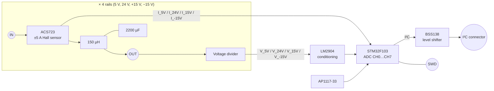

# Power Monitor / Supply Filter

> **The guardian of the rack's power rails.** It filters all four backplane supply voltages and measures their voltage and current, so the ModLab can show how much power each rail delivers.

[← Back to ModLab overview](../index.md)

---

## At a Glance

| | |
|---|---|
| **Function** | LC filtering plus voltage and current monitoring of the four rack supply rails |
| **Rails** | +5 V, +24 V, +15 V, −15 V |
| **Filtering** | 150 µH toroid inductor + 2200 µF capacitor per rail |
| **Current sensing** | 4 × **ACS723-05AB** Hall-effect sensors (±5 A, 400 mV/A, galvanically isolated) |
| **Voltage sensing** | Resistive dividers per rail → ADC |
| **MCU** | STM32F103C8T6 (8 MHz crystal, 72 MHz) |
| **Interface** | **I²C** (JST-XH 4-pin, BSS138 level shifting), SWD (JST-XH 4-pin) |
| **Connections** | 8 × screw terminals (IN / OUT per rail) |
| **Form factor** | Stand-alone board for the rack's supply section (no DIN 41612 / no CAN) |
| **PCB** | 4 layers, 91 parts |
| **Status** | Hardware designed (2022-11), firmware is a skeleton |

---

## Overview

The rack's switching power supplies (5 V/10 A, 24 V/10 A, 2 × 15 V/5 A) feed the backplane. This board is meant to sit **between the supplies and the backplane**, most likely in the *Filter / Fuses* section on the back of the rack:

- An **LC low-pass filter** on every rail reduces the switching noise of the supplies before it reaches the sensitive analog modules (waveform generator, linear PSU, …).
- A **Hall-effect current sensor** in every rail measures the load current without a lossy shunt and with galvanic isolation.
- A **voltage divider** per rail lets the STM32 measure the actual rail voltage.
- The values are made available over **I²C**, which is the role the backplane's "small periodic data" I²C bus was designed for.

The idea goes back to the very first ModLab GUI concept, which already had a **"Spannungsüberwachung"** (voltage monitoring) box listing *Voltage 1–4* with volts and amps:

---

## Hardware

### Block diagram

### Key components

| Ref. | Part | Function |
|---|---|---|
| U1–U4 | **ACS723xLCTR-05AB** | Bidirectional Hall-effect current sensors, ±5 A, 400 mV/A, 5 V supply |
| L1–L4 | 150 µH | Vishay TJ5 toroid inductors (rail filter) |
| C4–C7 | 2200 µF | Bulk capacitors (rail filter) |
| U5 | LM2904 | Analog signal conditioning |
| U7 | STM32F103C8T6 | Measurement and I²C interface |
| U6 | AP1117-33 | 3.3 V supply |
| Q1, Q2 | BSS138 | I²C level shifter |
| Y1 | 8 MHz crystal | MCU clock |
| J1–J4 | Screw terminals | `5V IN`, `24V IN`, `15V IN`, `-15V IN` |
| J5–J8 | Screw terminals | `5V OUT`, `24V OUT`, `15V OUT`, `-15V OUT` |
| J9 | JST-XH 4-pin | SWD |
| J10 | JST-XH 4-pin | I²C |

Analog front end: 100 Ω / 1 nF RC filters, 3.9 kΩ and 12 kΩ divider resistors, plus further 10 k / 18 k / 20 k / 68 k / 100 k resistors in the LM2904 conditioning stage. *(Check the exact divider ratios in KiCad before publishing numbers.)*

---

## Firmware

**Project:** [`Software/Power_Monitor`](../../Software/Power_Monitor)

| | |
|---|---|
| Build | PlatformIO `genericSTM32F103C8`, `framework = stm32cube` |
| Clock | 8 MHz HSE × 9 = 72 MHz |
| Code generation | STM32CubeMX (`Power_Monitor.ioc`) via stm32pio |

### Configured peripherals

| Peripheral | Configuration |
|---|---|
| ADC1 | Channels 0–7 on PA0…PA7 (4 × current, 4 × voltage) |
| I²C1 | PB6/PB7, 400 kHz, 7-bit addressing |
| TIM1 | Microsecond time base |

### Implementation status

The CubeMX project and peripheral initialisation are in place, but the application logic is still to be written. Planned work from the project to-do list:

- ⏳ Voltage measurement
- ⏳ Current measurement
- ⏳ I²C communication with the Host Bus Controller

Once finished, the HBC home screen can show live voltage, current and power for each rail, and the SD card can log them.

---

## Files

| Type | Location |
|---|---|
| KiCad project | [`Hardware/V3/current_sensor_filter`](../../Hardware/V3/current_sensor_filter) |
| BOM | `Hardware/V3/current_sensor_filter/current_sensor_filter.csv` |
| Firmware | [`Software/Power_Monitor`](../../Software/Power_Monitor) |
| GUI concept | `doc/pictures/gui.jpg` |
