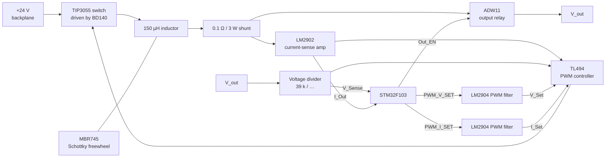

# Switching Mode Power Supply (SMPS)

> **The ModLab's workhorse supply:** a TL494-based buck converter that makes **2 … 22 V at up to 5 A** from the 24 V backplane rail, with digitally set voltage and current limits.

[← Back to ModLab overview](../index.md)

---

## At a Glance

| | |
|---|---|
| **Function** | High-current single-channel bench power supply |
| **Topology** | Buck converter, **TL494** PWM controller, 24 V input |
| **Output voltage** | 2 … 22 V, 10 mV resolution |
| **Output current** | 0 … 5 A, 10 mA resolution |
| **Modes** | CV and CC (hardware regulation by the TL494's two error amplifiers) |
| **Control** | 2 × 16-bit PWM → filtered references for voltage and current |
| **Measurement** | 2 ADC channels (output voltage, output current) |
| **Output switching** | Power relay (Panasonic ADW11) |
| **MCU** | STM32F103C8T6 @ 72 MHz |
| **CAN address** | `0x3C` (+ jumper → `0x3C–0x3F`) |
| **TFT page** | `0x04` |
| **Revision** | Rev 1 built, redesign planned |
| **Schematic** | [doc/schematics/Power_SMPS.pdf](../../doc/schematics/Power_SMPS.pdf) |

---

## Overview

The linear [Symmetric PSU](symmetric-power-supply.md) is limited to about 1.2 A. For anything more power-hungry the ModLab has a **switching supply** that uses the 24 V backplane rail.

The key design decision: **no software regulation loop**. A classic **TL494** PWM controller does all the regulation. The STM32 only provides the **reference voltages** for output voltage and current limit (as filtered PWM signals) and measures the actual output values. This avoids a "complicated and possibly slow and inaccurate software PID regulator" and keeps the circuit simple.

- **Voltage feedback:** a resistive divider from the output.
- **Current feedback:** a high-current shunt with a differential amplifier.
- Both feedback signals go to the TL494's two internal error amplifiers. Whichever loop demands less duty cycle wins, which gives a smooth automatic **CV/CC crossover**.

---

## Hardware

### Block diagram

### Schematic sheets

| Sheet | Contents |
|---|---|
| **Top level** | DIN 41612 backplane connector, **ADW11 output relay** with LL4148 flyback diode and BSS138 driver, output connector |
| **SMPS** | TL494 controller, TIP3055 / BD140 switch stage, MBR745 freewheel diode, 150 µH inductor, 220 µF output capacitors, 0.1 Ω shunt, LM2902 current-sense amplifier ("Current Sense Amplifier"), voltage-sense divider ("Voltage sensing"), heatsink |
| **CPU** | STM32F103C8, crystal, SN65HVD232 CAN transceiver with common-mode choke and TVS, LM2904 PWM filter / buffer stages, address jumper (2×2), SWD |
| **Power** | Bulk capacitance, TVS protection (P6SMB26 on 24 V, P6SMB16 on ±15 V), **AP1117-33** (+3.3 V), **L79L05** (−5 V for the op-amps) |

### Key components

| Function | Part |
|---|---|
| PWM controller | **TL494** |
| Power switch | **TIP3055** (NPN power transistor) with **BD140** driver |
| Freewheel diode | **MBR745** Schottky |
| Inductor | 150 µH |
| Current shunt | **0.100 Ω, 3 W+** (0.5 V drop and 2.5 W loss at 5 A) |
| Current-sense / control op-amps | **LM2902** (quad) |
| PWM filter op-amp | **LM2904** (dual) |
| Output relay | **Panasonic ADW11** power relay |
| Microcontroller | STM32F103C8T6 |
| CAN transceiver | SN65HVD232 |
| Local regulators | AP1117-33, L79L05 |

### Power rails used

**+24 V** (power stage), **+15 V / −15 V** (analog, via −5 V regulator), **+5 V** (logic, via 3.3 V LDO).

---

## Firmware

**Project:** [`Software/SMPS`](../../Software/SMPS)

| | |
|---|---|
| Build | PlatformIO `genericSTM32F103C8`, `framework = stm32cube`, ST-Link |
| Clock | 12 MHz HSE × 6 = 72 MHz |
| Code generation | STM32CubeMX (`SMPS.ioc`) via stm32pio |

### Pin map

| Pin | Function |
|---|---|
| PA15 – TIM2 CH1 | PWM setpoint (current) |
| PB3 – TIM2 CH2 | PWM setpoint (voltage) |
| PA0 – ADC CH0 | Measured output **voltage** |
| PA1 – ADC CH1 | Measured output **current** |
| PA7 | **Output enable** (relay) |
| PB5 / PB4 | Address jumper bit 0 / 1 |
| PB8 / PB9 | CAN RX / TX |
| PB6 / PB7 | I²C1 (400 kHz, reserved) |

*(The code comments call CH1 "Volt" and CH2 "Amp", but the setter functions write voltage to CCR2 and current to CCR1.)*

### Setpoint conversion

TIM2 runs with a period of 65 535 (**16-bit, ≈ 1.1 kHz**). The CAN setpoints arrive in 10 mV / 10 mA units and are multiplied by 10 internally.

$$
\text{CCR}_V = 4096 + \frac{U_\text{mV} - 2000}{1000}\cdot 2631.58 \qquad (2000 \le U_\text{mV} \le 22000)
$$

$$
\text{CCR}_I = \frac{I_\text{mA}}{1000}\cdot 12800 \qquad (I_\text{mA} \le 5000)
$$

The voltage is clamped to **2 … 22 V** and the current to **≤ 5 A** in software.

### Measurement

Each channel is sampled **10 times** (100 µs apart, after 1 ms of settling) and averaged:

$$
U_{[10\,\text{mV}]} = \frac{\overline{\text{ADC}}\cdot 100}{168.294} \qquad
I_{[10\,\text{mA}]} = \frac{\overline{\text{ADC}}\cdot 100}{821.177}
$$

### Main loop

1. Set the output relay from `outputState`.
2. Convert and write the voltage and current setpoints.
3. Wait 1 ms.
4. Measure voltage and current.

### CAN interface

| Command | Index | Size | Meaning |
|---|---|---|---|
| Set 16 bit (`0x14`) | `0x10` | 2 B | Set **voltage** [10 mV] |
| | `0x11` | 2 B | Set **current limit** [10 mA] |
| Get 16 bit (`0x15`) | `0x20` | 2 B | Measured **voltage** [10 mV] |
| | `0x21` | 2 B | Measured **current** [10 mA] |
| Enable output (`0x40`) | – | – | Close output relay |
| Disable output (`0x41`) | – | – | Open output relay |
| Ping (`0x05`) | – | – | Discovery |

### TFT integration

On page `0x04` the display sends **5 bytes** of process data: module ID, voltage, current (16-bit each, LSB first). On a read request the HBC fetches `0x20`/`0x21` and shows them in the number boxes of the selected unit (4 boxes per unit, up to 4 units).

---

## Status & Next Revision

Rev 1 meets the target specs, but the documentation notes it "will need a redesign in order to fix some mistakes". The project to-do list for the next revision of the variable power supply includes:

- ✅ Fix the relay footprint
- ✅ Correct the feedback dividers for proper signal levels
- ⏳ Review, order and assemble

---

## Files

| Type | Location |
|---|---|
| KiCad project | [`Hardware/V3/Power_SMPS`](../../Hardware/V3/Power_SMPS) |
| Schematic PDF | [`doc/schematics/Power_SMPS.pdf`](../../doc/schematics/Power_SMPS.pdf) |
| Front panel | `Hardware/frontpanels/finished/SMPS.FCStd`, `SMPS.3mf` |
| Firmware | [`Software/SMPS`](../../Software/SMPS) |
