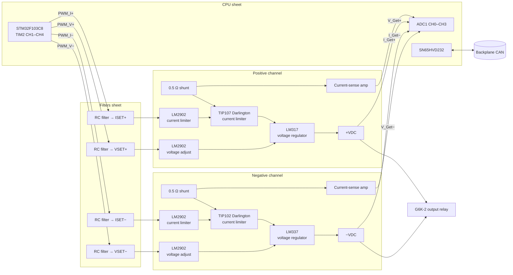

# Symmetric Linear Power Supply (SymPSU)

> **A dual-tracking linear lab supply on a Eurocard:** 0 … +12 V and 0 … −12 V at up to 1.2 A per channel, with constant-voltage and constant-current modes, fully digitally controlled.

[← Back to ModLab overview](../index.md)

---

## At a Glance

| | |
|---|---|
| **Function** | Symmetric (bipolar) linear bench power supply |
| **Positive channel** | 0 … +12 V, 0 … 1.2 A |
| **Negative channel** | 0 … −12 V, 0 … 1.2 A |
| **Modes** | CV (constant voltage) and CC (constant current) per channel, CC LED indicators |
| **Resolution** | 10 mV (voltage), 1 mA steps in firmware (current) |
| **Control** | 4 × 16-bit PWM → filtered analog setpoints, analog regulation loop |
| **Measurement** | 4 ADC channels (V+, I+, V−, I−) |
| **Output switching** | Relay (Omron G6K-2), enabled by software |
| **MCU** | STM32F103C8T6 @ 72 MHz |
| **CAN address** | `0x30` (+ jumper → `0x30–0x33`) |
| **TFT page** | `0x03` |
| **PCB** | 160 × 100 mm, 4 layers, 197 parts |
| **Revisions** | V1 (built, 2022-11-27), V2 (designed) |
| **Schematic** | [doc/schematics/symmetric_power_supply.pdf](../../doc/schematics/symmetric_power_supply.pdf) |

---

## Overview

Every electronics bench needs a symmetric supply for op-amp circuits, audio and analog experiments. The ModLab SymPSU is based on the well-known **"Bench Power Supply" by *The Big One* on [Hackaday.io](https://hackaday.io/project/4154-bench-power-supply)**. It was adapted for the ModLab:

- It is redesigned for an **STM32 controller** running at **3.3 V**.
- The original dedicated **DAC was replaced by the STM32's PWM channels** with analog filtering.
- The STM32's **internal ADC** measures the outputs.
- It is controlled over **CAN** from the Host Bus Controller.

Regulation is done **entirely in analog hardware**. The MCU only sets reference voltages and reads back the measurements, so the supply responds quickly and stays stable even if the firmware is busy.

---

## Hardware

### Block diagram

### Schematic sheets

| Sheet | Contents |
|---|---|
| **Overview** | Top level, backplane connector, sheet links |
| **Power** | Bulk capacitance, TVS protection, AP1117-33 3.3 V regulator for the STM32 |
| **CPU** | STM32F103, crystal, SWD, CAN transceiver, address jumper, output-enable/relay drive |
| **Filters** | Four PWM-to-analog filters (VSET±, ISET±), multi-stage RC networks (470 nF / 5.6 nF with 1 kΩ … 22 kΩ) |
| **Positive** | Power path (shunt → TIP107 → LM317), current-sense amplifier, I_Set bias, current limiter, current-limit LED, voltage adjustment, voltage readout |
| **Negative** | Mirror image with TIP102 and LM337 for the negative output |

### Key components

| Function | Part |
|---|---|
| Microcontroller | STM32F103C8T6 |
| CAN transceiver | SN65HVD232 |
| Op-amps | 5 × **LM2902** (quad) – error amplifiers, current sense, readout buffers |
| Voltage regulators | **LM317** (positive), **LM337** (negative), adjust pin steered by an op-amp |
| Current limiters | **TIP107** (PNP Darlington, positive), **TIP102** (NPN Darlington, negative) |
| Current shunts | 2 × **0.5 Ω**, 2512 package |
| Output relay | **Omron G6K-2** (DPDT signal relay) |
| Heatsinks | 2 × Fischer **SK 574** (50 mm) |
| Logic supply | AP1117-33 |
| Connectors | DIN 41612; V+ and V− output connectors; 2×2 address jumper |
| Indicators | CC LEDs per channel |

### Power rails used

The power paths are fed directly from the backplane **+15 V** (positive channel) and **−15 V** (negative channel) rails. The op-amps also run from ±15 V, and the logic runs on a local 3.3 V LDO (AP1117-33) from +5 V. That leaves about 3 V of headroom for the shunt, the Darlington and the regulator at the full 12 V output.

---

## Firmware

**Project:** [`Software/SymPSU`](../../Software/SymPSU)

| | |
|---|---|
| Build | PlatformIO `genericSTM32F103C8`, `framework = stm32cube`, ST-Link |
| Clock | 12 MHz HSE × 6 = 72 MHz |
| Code generation | STM32CubeMX (`SymPSU.ioc`) via stm32pio |

### Pin map

| Pin | Function |
|---|---|
| PA15 – TIM2 CH1 | PWM **V+** setpoint |
| PB3 – TIM2 CH2 | PWM **I+** setpoint |
| PB10 – TIM2 CH3 | PWM **V−** setpoint |
| PB11 – TIM2 CH4 | PWM **I−** setpoint |
| PA0 – ADC CH0 | Measured **V+** |
| PA1 – ADC CH1 | Measured **I+** |
| PA2 – ADC CH2 | Measured **V−** |
| PA3 – ADC CH3 | Measured **I−** |
| PA7 | **Output enable** (relay) |
| PB4 / PB2 | Address jumper bit 0 / 1 |
| PB8 / PB9 | CAN RX / TX |
| PB6 / PB7 | I²C1 (400 kHz, reserved) |

### PWM setpoints

- TIM2, prescaler 0, period 65 535 → **16-bit resolution at ≈ 1.1 kHz**. The analog filters smooth this to a DC reference.
- Each channel has a **zero offset** and a **calibrated gain**, found by measuring the real hardware:

$$
\text{CCR} = \text{value} \cdot k + \text{ZERO}
$$

| Channel | ZERO | Gain $k$ | Max. value |
|---|---|---|---|
| V+ | `0x0900` | $\frac{65535 - \text{ZERO}}{1173} + 1.0$ | 1173 (≙ 11.73 V) |
| I+ | `0x0B50` | $\frac{\text{0x90E0} - \text{ZERO}}{1270} + 1.8$ | 1270 (≙ 1.27 A) |
| V− | `0x0A70` | $\frac{65535 - \text{ZERO}}{1174} / 1.5 + 1.0$ | 1174 (≙ −11.74 V) |
| I− | `0x0B50` | $\frac{\text{0x90E0} - \text{ZERO}}{1270} + 1.8$ | 1270 (≙ 1.27 A) |

The project documentation notes that "some issues are currently fixed in software rather than in hardware". These per-channel correction factors are where that happens.

### Measurement

Each ADC channel is sampled **5 times and averaged**, then scaled with a linear factor:

| Value | Factor |
|---|---|
| V+ | 0.52 |
| I+ | 0.52 |
| V− | 0.6 |
| I− | 0.0308 |

### Main loop

1. Drive the output-enable pin (relay) from `outputState`.
2. Write all four PWM setpoints.
3. Short settling delay.
4. Read and scale all four ADC channels.

The CAN commands are handled in the RX interrupt.

### CAN interface

| Command | Index | Size | Meaning |
|---|---|---|---|
| Set 16 bit (`0x14`) | `0x10` | 2 B | Set **positive voltage** (10 mV units) |
| | `0x11` | 2 B | Set **positive current limit** (mA) |
| | `0x12` | 2 B | Set **negative voltage** (10 mV units, magnitude) |
| | `0x13` | 2 B | Set **negative current limit** (mA) |
| Get 16 bit (`0x15`) | `0x20` | 2 B | Measured positive voltage |
| | `0x21` | 2 B | Measured positive current |
| | `0x22` | 2 B | Measured negative voltage |
| | `0x23` | 2 B | Measured negative current |
| Enable output (`0x40`) | – | – | Close output relay |
| Disable output (`0x41`) | – | – | Open output relay |
| Ping (`0x05`) | – | – | Discovery |

Other commands are answered with NACK, status `0x40` (unknown command). Invalid indices get status `0x01` (index mismatch).

### TFT integration

On page `0x03` the display sends **9 bytes** of process data: module ID, V+, I+, V−, I− (each 16-bit, LSB first). The HBC forwards them as four *Set16* commands. When the display asks for an update, the HBC reads `0x20…0x23` and writes them into the number boxes of the matching channel (8 boxes per unit, up to 4 units).

---

## Revisions

| Version | Status | Changes |
|---|---|---|
| **V1** | ✅ Built | First version |
| **V2** | ⏳ Designed: review, order and assembly open | Negative channel fixed, CC LEDs fixed. BOM values are identical to V1, so the fixes are in wiring/layout. |

---

## Files

| Type | Location |
|---|---|
| KiCad V1 / V2 | [`Hardware/V3/symmetric_power_supply`](../../Hardware/V3/symmetric_power_supply) |
| BOM | `symmetric_power_supply.csv` (in V1 / V2 folder) |
| Schematic PDF | [`doc/schematics/symmetric_power_supply.pdf`](../../doc/schematics/symmetric_power_supply.pdf) |
| Front panel | `Hardware/frontpanels/finished/SymPSU.FCStd`, `SymPSU.3mf` |
| Firmware | [`Software/SymPSU`](../../Software/SymPSU) |

**Credits:** circuit concept by *The Big One* – [hackaday.io/project/4154-bench-power-supply](https://hackaday.io/project/4154-bench-power-supply)
