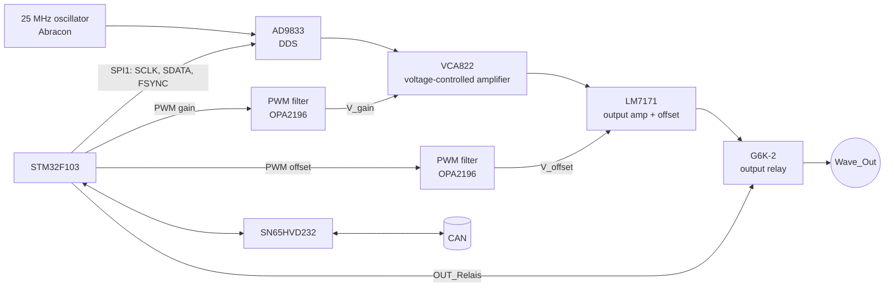

# DDS Waveform Generator

> **A digitally controlled function generator.** An AD9833 DDS chip makes sine, triangle and square waves up to 12.5 MHz. A voltage-controlled amplifier sets the amplitude and a DC offset is added, both set digitally.

[← Back to ModLab overview](../index.md)

---

## At a Glance

| | |
|---|---|
| **Function** | Function / signal generator |
| **Signal source** | **AD9833** DDS, 25 MHz reference oscillator |
| **Waveforms** | Sine, triangle, square |
| **Frequency range** | 1 Hz … 12.5 MHz, **1 Hz steps** (DDS resolution 0.093 Hz) |
| **Amplitude** | Set in 0.1 Vpp steps (VCA822 voltage-controlled amplifier) |
| **Offset** | Set in 0.1 V steps (signed) |
| **Output** | LM7171 high-speed output amplifier, output relay |
| **MCU** | STM32F103C8T6 @ 72 MHz, SPI to the DDS, 2 × PWM for gain & offset |
| **CAN address** | `0x40` (+ jumper → `0x40–0x43`) |
| **TFT page** | `0x02` |
| **PCB** | 160 × 100 mm, 104 parts |
| **Revision** | V1 (2022-11-24), built |
| **Schematic** | [doc/schematics/Waveform_Generator.pdf](../../doc/schematics/Waveform_Generator.pdf) |

---

## Overview

Earlier waveform generators in the FMAS were discrete fixed-frequency oscillators or XR2206-based. For the ModLab, a **Direct Digital Synthesis (DDS)** design was chosen. The **Analog Devices AD9833** creates very precise frequencies from a crystal-stable 25 MHz clock and is fully programmable over SPI.

Most of the analog design around the AD9833 is based on the excellent guide by **Daumemo** ([daumemo.com](https://daumemo.com)).

The signal chain:

1. **AD9833** creates the raw waveform at the selected frequency.
2. A **VCA822** (wideband voltage-controlled amplifier) sets the **amplitude**. Its gain-control voltage is a filtered PWM signal from the STM32.
3. An **LM7171** high-speed op-amp acts as the **output amplifier** and adds the **DC offset**, which is a second filtered PWM signal.
4. An **Omron G6K-2 relay** connects or disconnects the output.

---

## Hardware

### Block diagram

### Schematic sheets

| Sheet | Contents |
|---|---|
| **Overview** | Backplane connector, sheet links |
| **Analog** | AD9833 with 25 MHz oscillator, *PWM Filters*, *Voltage Controlled Amplifier (VCA)*, *Output Amplifier and Offset*, *Output Relais* |
| **CPU** | STM32F103C8, crystal, SN65HVD232, address jumper, SWD |
| **Power** | Bulk capacitance, TVS, **AP1117-33** (+3.3 V), **L7905** (−5 V) |

### Key components

| Function | Part |
|---|---|
| DDS | **AD9833** (MSOP-10) |
| DDS clock | **25 MHz** Abracon ABLNO oscillator |
| Voltage-controlled amplifier | **TI VCA822** (wideband VCA, linear-in-V/V gain control) |
| Output amplifier | **TI LM7171** (high-speed, high-output-current voltage-feedback op-amp) |
| PWM filter / control op-amp | **TI OPA2196** (dual, precision, rail-to-rail) |
| Output relay | **Omron G6K-2** |
| Microcontroller | STM32F103C8T6 |
| CAN transceiver | SN65HVD232 |
| Output connector | `J201` 2-pin "Wave_Out" |

### Power rails used

**±15 V** for the output stage and analog circuits, **−5 V** (L7905) and **+5 V** for the VCA, **+3.3 V** (AP1117-33) for the MCU and DDS. **+24 V** is available on the connector.

---

## Firmware

**Project:** [`Software/Waveform`](../../Software/Waveform)

| | |
|---|---|
| Build | PlatformIO `genericSTM32F103C8`, `framework = stm32cube`, ST-Link |
| Clock | 12 MHz HSE × 6 = 72 MHz |
| Code generation | STM32CubeMX (`Waveform.ioc`) via stm32pio |
| Libraries | `lib/modlab` (CAN protocol), `lib/AD98336` (AD9833 driver) |

### Pin map

| Pin | Function |
|---|---|
| PA5 / PA7 | SPI1 SCK / MOSI → AD9833 (master, 8-bit, MSB first, CPOL high) |
| PA6 | AD9833 **FSYNC** (GPIO) |
| PA0 – TIM2 CH1 | PWM **gain** (amplitude) |
| PA1 – TIM2 CH2 | PWM **offset** |
| PA4 | **Output relay** |
| PB4 / PB3 | Address jumper bit 0 / 1 |
| PB8 / PB9 | CAN RX / TX |
| PB6 / PB7 | I²C1 (100 kHz, reserved) |

### AD9833 driver

The driver (`ad9833.c/.h`) provides:

| Function | Purpose |
|---|---|
| `AD9833_Init(wave, freq, phase)` | Reset, set waveform, frequency and phase |
| `AD9833_SetFrequency(freq)` | Calculate and write FREQ0 (2 × 14-bit words) |
| `AD9833_SetWaveform(wave)` | Sine, triangle, square, square ÷ 2 |
| `AD9833_SetPhase(deg)` | Phase register |
| `AD9833_OutputEnable()` / `AD9833_SleepMode()` | Output control / power down |

The frequency tuning word is calculated from the 25 MHz master clock:

$$
\text{FREQREG} = f_\text{out}\cdot\frac{2^{28}}{f_\text{MCLK}} = f_\text{out}\cdot\frac{2^{28}}{25\,\text{MHz}}
\qquad\Rightarrow\qquad \Delta f = \frac{25\,\text{MHz}}{2^{28}} \approx 0.093\,\text{Hz}
$$

The output is limited to $f_\text{MCLK}/2 = 12.5\,\text{MHz}$. Every 16-bit register write is sent as two SPI bytes (MSB first) while FSYNC is low.

### Amplitude and offset

TIM2 runs at 16-bit resolution (≈ 1.1 kHz). The AD9833's square output (logic level) and its sine/triangle output (≈ 0.6 Vpp) have very different amplitudes, so the firmware uses **separate gain calibrations**:

$$
\text{CCR}_\text{gain} =
\begin{cases}
\dfrac{V_{pp} - 0.4\,\text{V}}{1\,\text{V}}\cdot 779.83 + \text{0x1BFF} & \text{square}\\[2ex]
\dfrac{V_{pp}}{1\,\text{V}}\cdot 2645.18 + \text{0x1EFF} & \text{sine / triangle}
\end{cases}
$$

$$
\text{CCR}_\text{offset} = \text{0x8210} - n_{100\text{mV}}\cdot \text{0x160}
$$

`0x8210` is the calibrated **0 V offset** point (about mid-scale), and each 100 mV step moves the PWM by 352 counts.

### Main loop

1. Drive the output relay from `outputState`.
2. If a new frequency or waveform has arrived, re-initialise the AD9833.
3. Update the gain and offset PWM.

### CAN interface

| Command | Index | Size | Meaning |
|---|---|---|---|
| Set 32 bit (`0x18`) | `0x10` | 4 B | **Frequency** [1 Hz] |
| Set 16 bit (`0x14`) | `0x20` | 2 B | **Amplitude** Vpp [0.1 V] |
| | `0x30` | 2 B | **Offset** [0.1 V], signed |
| Set mode (`0x60`) | – | 1 B | Waveform: `0` square, `1` sine, triangle (see note) |
| Enable output (`0x40`) | – | – | Close output relay |
| Disable output (`0x41`) | – | – | Open output relay |
| Ping (`0x05`) | – | – | Discovery |

*Note: the protocol documentation and the HBC use `2` for triangle, while the module firmware header defines `TRIANGLEWAVE = 3`. One of them should be aligned.*

### TFT integration

On page `0x02` the display sends **10 bytes** of process data: module ID, waveform, frequency (4 B), amplitude (2 B), offset (2 B), all LSB first. The HBC forwards these as *Set mode*, *Set32* and *Set16* commands. The output of each of the up to 4 generators (`t51…t54`) is switched with `0x50`.

---

## Status

✅ Hardware built, ✅ firmware complete (PWM, AD9833, CAN).

---

## Files

| Type | Location |
|---|---|
| KiCad project | [`Hardware/V3/Waveform_Generator`](../../Hardware/V3/Waveform_Generator) |
| BOM | `Hardware/V3/Waveform_Generator/Waveform_Generator.csv` |
| Schematic PDF | [`doc/schematics/Waveform_Generator.pdf`](../../doc/schematics/Waveform_Generator.pdf) |
| Front panel | `Hardware/frontpanels/finished/Function-Generator.FCStd`, `function_generator.3mf`, template `waveform_generator.fpd` |
| Firmware | [`Software/Waveform`](../../Software/Waveform) |

**Credits:** analog design based on the AD9833 guide by **Daumemo** – [daumemo.com](https://daumemo.com)
