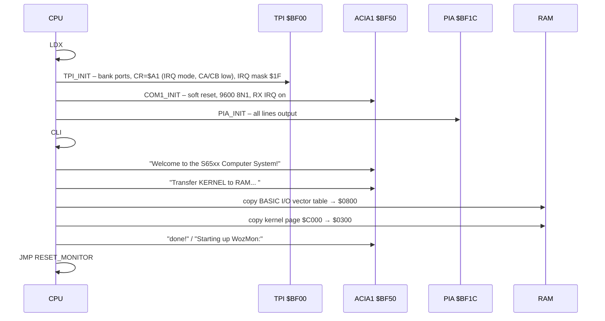

# Firmware & Software

> **One 512 KB Flash, 32 ROM banks, three personalities.** The S65 firmware boots from ROM bank 0, copies a small kernel into RAM, starts the WozMon monitor and can jump into EhBASIC (bank 1) or Microsoft BASIC (bank 2).

[← Back to S65xx overview](index.md)

---

## At a Glance

| | |
|---|---|
| **Language** | 65C02 assembly (uses 65C02-only opcodes such as `PHX`, `PLY`, `BBR4`) |
| **Toolchain** | **cc65**: `ca65 --cpu 65c02` + `ld65` with a custom linker config |
| **Build script** | `Firmware/cc65/Main-FW/compile.bash` (bash) |
| **Programmer** | `minipro -p SST39SF040 -w rom.bin` (TL866-type programmer, ZIF socket on the ROM card) |
| **Output** | `rom.bin` – **524 288 bytes** = 32 banks × 16 KB, unused space filled with `$DB` |
| **Console** | COM1 (6551 ACIA at `$BF50`), 9600 baud 8N1, interrupt-driven receive |
| **Monitor** | WozMon (Ben Eater's port, adapted) |
| **BASIC** | EhBASIC 2.23 (S65 port of 2.22p5), Microsoft BASIC (single-file port of `mist64/msbasic`) |
| **Status** | Early development (README: all software items still open) |

---

## 1. Source Overview

| File | Content |
|---|---|
| `Main-FW/source/main.s` | Reset/boot code, kernel copy, ISR/NMI, ROM-bank jump table, boot messages, BASIC vector table, hardware vectors, includes WozMon and both BASICs |
| `Main-FW/memory.cfg` | ld65 memory map: ZP, stack, input buffer, kernel, 32 RAM banks, 32 ROM banks, segment placement |
| `Main-FW/compile.bash` | Assemble all `source/*.s`, link to `rom.bin`, optional hexdump (`-d`) or flash (`-f`) |
| `lib/io.s` | I/O base addresses (`TPI1 = $BF00` … `RTC = $BF90`) |
| `lib/tpi.s` | 6525 register names for the bank TPI and the IDE TPI, `TPI_INIT`, `IDE_INIT` |
| `lib/acia.s` | 6551 register names and bit documentation, `COM1_INIT`…`COM4_INIT`, `COM1_TRANSMIT`…`COM4_TRANSMIT` |
| `lib/via.s` | VIA 1–3 register names, `VIA1_Init` (LCD port, CB1 interrupt), `VIA2_Init`, `VIA3_Init` |
| `lib/pia.s` | `PIA_INIT` – all 16 PIA lines as outputs (LED port) |
| `lib/sid.s` | SID 8580 register names (3 voices, filter, misc) |
| `lib/macros.s` | `cpt addr` – put a string pointer into zero page for `PRINT_MSG` |
| `lib/kernel.s` | Input ring buffer, `CHRIN`, `CHROUT`, `PRINT_MSG`, `SW_ROMBANK`, `LOAD`/`SAVE` stubs |
| `lib/wozmon.s` | WozMon, zero-page variables moved to `$E4–$EB` to coexist with EhBASIC |
| `lib/ehbasic.s` | EhBASIC 2.23, refactored for ca65 and the S65 |
| `lib/msbasic.s` | Microsoft BASIC as one file, based on the CBM2 configuration |
| `6502_EhBASIC_V2.22-master/` | Upstream EhBASIC 2.22 (original and `patched/` 2.22p5), reference manual PDF |

---

## 2. Toolchain & Build

```bash
cd Firmware/cc65/Main-FW
./compile.bash        # assemble + link → output/rom.bin, main.map, rom.lbl, main.s.list
./compile.bash -d     # … and show a hexdump
./compile.bash -f     # … and flash the SST39SF040 with minipro
```

Steps inside the script:

1. Empty `output/`.
2. `ca65 --cpu 65c02 <file> -I ../../lib` for every file in `source/` (today only `main.s`, which `.include`s the libraries).
3. `ld65 -C memory.cfg -m main.map … -o rom.bin -Ln rom.lbl`.

---

## 3. Memory Layout

### RAM usage

| Range | Use | Defined in |
|---|---|---|
| `$0000–$00FF` | Zero page (BASICs, WozMon, kernel pointers) | `memory.cfg` `ZP` |
| `$0100–$01FF` | Stack | `STACK` |
| `$0200–$02FF` | 256-byte **input ring buffer** (`INPUT_BUF`) – also WozMon's line buffer `IN` | `kernel.s`, `wozmon.s` |
| `$0300–$07FF` | **RAM kernel** (`KERNEL`, 1.25 KB reserved, `$93` bytes used) | `KERNEL_RAM` segment |
| `$0800–$080C` | EhBASIC Ctrl-C flags and I/O vectors (`VEC_IN`, `VEC_OUT`, `VEC_LD`, `VEC_SV`) | `ehbasic.s` |
| `$0900–$BEFF` | BASIC program space (`Ram_base`/`RAMSTART2` = `$0900`, EhBASIC `Ram_top` = `$BF00`) | BASIC sources |
| `$8000–$BEFF` | Banked RAM window (`RAM00`…`RAM31` in `memory.cfg`) | `memory.cfg` |

*EhBASIC uses the banked window as normal program memory, so it relies on RAM bank 0 being selected.*

### Zero page in the upper area

| Address | Use |
|---|---|
| `$E2` | `ZP_WAIT` – copy of the ACIA status for `BBR4` |
| `$E4–$EB` | WozMon (`XAML`, `XAMH`, `STL`, `STH`, `L`, `H`, `YSAV`, `MODE`), moved from `$24–$2B` |
| `$EC/$ED` | Ring buffer `READ_PTR`/`WRITE_PTR` **and** string pointer for `PRINT_MSG` (see [open points](#9-status--open-points)) |

---

## 4. ROM Bank Layout

The linker config defines `ROM00`…`ROM31`, all at `$C000`, 16 KB each, written one after the other into `rom.bin`. Unused bytes are filled with **`$DB`** – the 65C02 `STP` opcode, so a jump into empty ROM stops the CPU instead of running garbage.

| Bank | Content | Range (from `main.map`) |
|:---:|---|---|
| 0 | **System ROM** | see below |
| 1 | **EhBASIC 2.23** | `$C000–$E848` (≈ 10.1 KB), own vectors at `$FFFA` |
| 2 | **Microsoft BASIC** | `$C000–$E0AB` (≈ 8.2 KB), own vectors at `$FFFA` |
| 3–31 | free (`$DB` fill) | |

**Bank 0 in detail:**

| Address | Segment | Content |
|---|---|---|
| `$C000` | `KERNEL_RAM` (load address) | RAM kernel image, linked to run at `$0300`, copied at boot |
| `$C100` | `CODE` | Reset/boot code |
| `$C200` | `JP_TBLE` | Page-aligned **jump table** for WozMon: `$C200` → EhBASIC, `$C205` → MS BASIC |
| `$C20A` | `MONITOR` | WozMon |
| `$C2EF` | `RODATA` | Messages, BASIC vector table, init routines |
| `$FFFA` | `VECTORS` | NMI, RESET, IRQ |

All three banks carry the same vector table (`NMI`, `RESET`, `ISR`). `NMI` and `ISR` live in the RAM kernel, so interrupts work no matter which ROM bank is visible.

---

## 5. Boot Sequence



The README brainstorm plans a longer boot later: **self-test** (RAM check, ROM check + version) → load kernel to RAM → start monitor.

---

## 6. RAM Kernel & Drivers

### Why a RAM kernel?

When software switches the ROM bank, the code that does the switching must not be in the ROM window – otherwise the next instruction comes from a different bank. The S65 solves this by linking the kernel to **run at `$0300`** but storing it in ROM bank 0 (`KERNEL_RAM: load=ROM00, run=KERNEL`). At boot one 256-byte page is copied to RAM. From then on every ROM bank can call the same I/O routines and the ISR.

### Kernel API

| Routine | Function | In / out |
|---|---|---|
| `CHRIN` | Get a key from the input buffer, echo it | C = 1 and char in A if a key was available, C = 0 otherwise |
| `CHROUT` | Send a character to COM1 | A = char |
| `PRINT_MSG` | Print a zero-terminated string | pointer in `$EC/$ED` (set with macro `cpt`) |
| `INIT_BUFFER` / `WRITE_BUFFER` / `READ_BUFFER` / `BUFFER_SIZE` | 256-byte ring buffer (Ben Eater) | – |
| `SW_ROMBANK` | Write A to TPI port B (ROM bank) and `JMP $C000` | A = bank |
| `LOAD`, `SAVE` | Stubs (`RTS`) – data storage not implemented yet | – |
| `COM1_TRANSMIT`…`COM4_TRANSMIT` | Wait for TDRE (`BBR4` on a copy of the status) and send A | A = char |
| `ISR` | Read ACIA1 status and TPI `AIR`, store received byte in the ring buffer | – |
| `NMI` | `RTI` | – |

### Serial setup (`acia.s`)

`COM1_INIT` … `COM4_INIT` all program **8N1 at 9600 baud** from the internal baud-rate generator (1.8432 MHz crystal), receive interrupt on, transmit interrupt off, DTR active. A 19 200-baud setting is prepared as a comment. The file documents every bit of the 6551 status, control and command registers – useful material for an article.

### Interrupt path for serial input

ACIA 1 → `/IRQ_0.0` → VIA 1 (CB1, diode-OR) → `/IRQ_0` → TPI input I0 → `/IRQ` → CPU → `ISR` → ring buffer → `CHRIN`. See [Interrupt System](index.md#8-interrupt-system).

---

## 7. WozMon

WozMon is the 256-byte monitor of the Apple-1, here in Ben Eater's port with changes for the S65:

- Zero-page variables moved from `$24–$2B` to **`$E4–$EB`**, so they do not collide with EhBASIC.
- Input through `CHRIN` (interrupt-driven buffer) instead of polling the ACIA, output through `COM1_TRANSMIT`, CR+LF line endings.
- The ESC backslash prompt is commented out.

**Usage (classic WozMon syntax):**

| Input | Effect |
|---|---|
| `C000` | Show one byte |
| `C000.C0FF` | Hex dump of a range |
| `0300: A9 41 20` | Write bytes |
| `0300R` | Run from address |
| **`C200R`** | Start **EhBASIC** (ROM bank 1) |
| **`C205R`** | Start **Microsoft BASIC** (ROM bank 2) |

The jump table at `$C200` is page-aligned so the entry addresses stay fixed when the rest of the ROM changes.

---

## 8. BASIC Interpreters

### EhBASIC 2.23 (S65 port)

- Base: Lee Davison's **Enhanced BASIC 2.22** with the community patches **2.22p1–p5** (decimal-mode removal, buffer fixes, string compare fixes, fixes from the 6502.org forum).
- **2.23 "S65xx Port by Synthron":** refactored to assemble with ca65, ported to the S65, zero-page clean-up (`$E2–$EE` freed for the monitor/kernel).
- Configuration: `Ram_base = $0900`, `Ram_top = $BF00` (46 592 bytes ≈ 45.5 KB for programs), Ctrl-C flags and I/O vectors at `$0800`, assembled at `$C000` in ROM bank 1, sign-on *"Enhanced BASIC 2.23"*.
- I/O: EhBASIC calls `VEC_IN`/`VEC_OUT`, which the boot code points to the RAM kernel's `CHRIN`/`CHROUT`. `LOAD`/`SAVE`/Ctrl-C currently point to `$C000` (restart BASIC).
- License string *"Derived from EhBASIC"* is included in the binary as required.

### Microsoft BASIC

- *"Single-File Port from github.com/mist64/msbasic with some small influence by Ben Eater's fork."*
- Configuration based on the **CBM2** defines, `CONFIG_SMALL` code reductions removed, all `CONFIG_2C`-and-lower changes applied (newest MS BASIC version of that repo). Easter egg enabled.
- `MONCOUT = CHROUT`, `MONRDKEY = CHRIN` → uses the same RAM kernel.
- Program RAM from `$0900`, stack top `$FA`.
- Goal from the header: *"have MS Basic on a working stand as a single file to include. I don't care about byte-identical compilation."*
- To-do in the header: remove remaining system-specific code (CBM1/CBM2/`CONFIG_CBM_ALL`).

---

## 9. Status & Open Points

**Done**

- cc65 project with 32-bank ROM image and flash script
- Boot code, RAM kernel with interrupt-driven serial input
- WozMon port with ROM-bank jump table
- EhBASIC and MS BASIC assembled into banks 1 and 2
- Driver skeletons and register definitions for TPI, ACIA, VIA, PIA, SID

**Open (README)**

- WozMon: serial I/O, input buffer, block write
- Kernel syscalls and hardware drivers
- File system (FAT?), DOS-like UI, operating system
- Serial program bootloader
- Self-test (RAM/ROM check + version)

A list of details noticed while reading the code (zero-page and buffer overlaps, TPI port direction, init order) is collected in the [review notes](review-notes.md#firmware). They explain why the boot path ends at WozMon today and are a good starting point for the next firmware steps.
