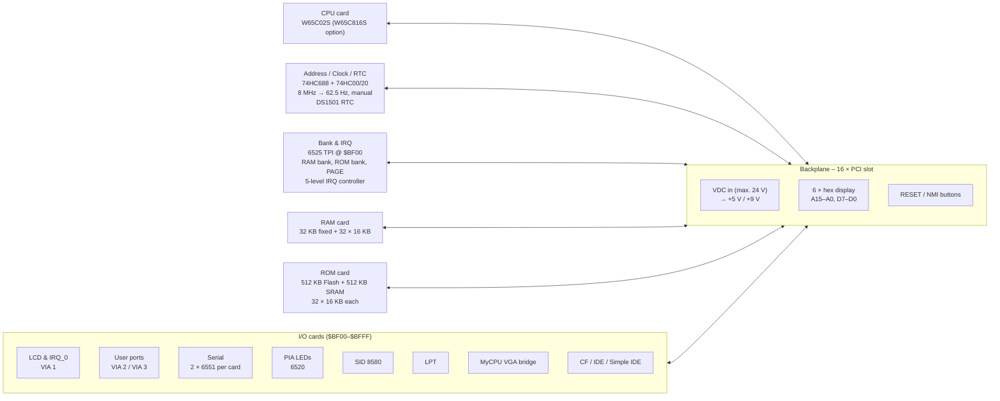
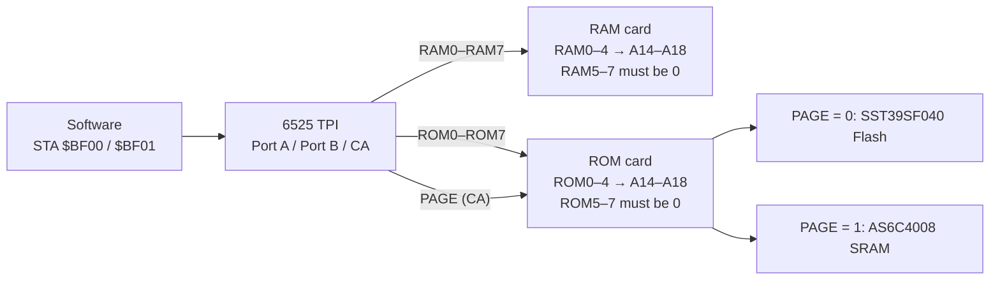
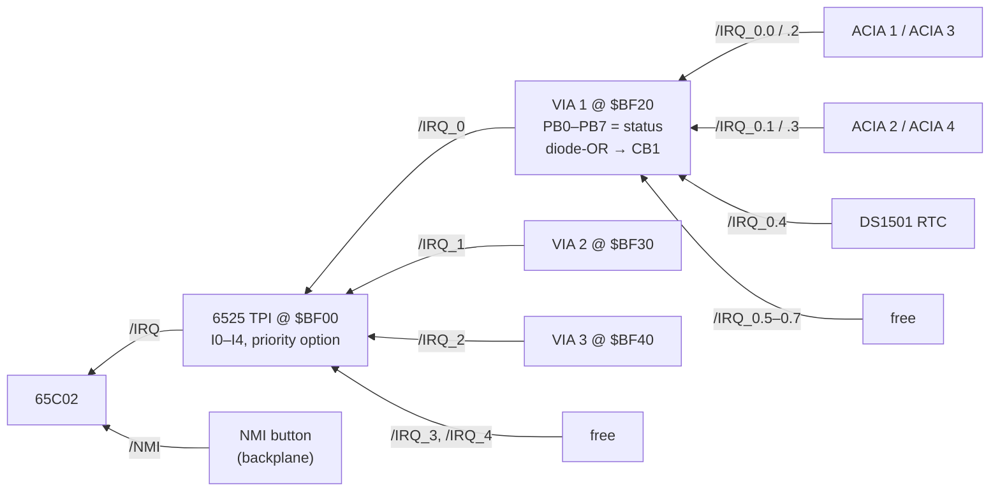
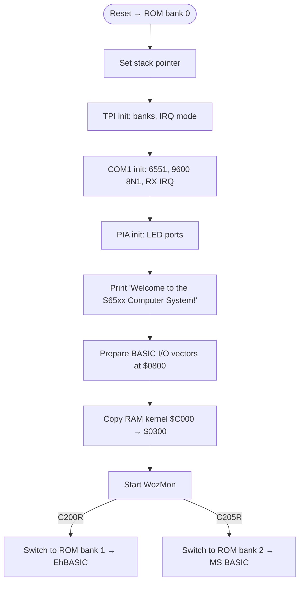

# S65xx Computer System – A Modular 8-Bit Backplane Computer

> *"Yet another 8bit Retro Computer. Completely bloated, overkill and fully hackable!"* – project README

The **S65xx Computer System** (short **S65**, some boards say **SY65**) is a self-designed, modular **8-bit computer** around the **WDC 65C02** (optionally the **65C816**). Every function lives on its own small plug-in card: CPU, ROM, RAM, banking/interrupt controller, address decoder with clock and RTC, serial ports, parallel ports, LCD, sound chip, mass storage and even a bridge to a foreign graphics card. All cards plug into a **16-slot backplane** that uses cheap **PCI card-edge connectors** with a fully custom 6502 pinout.

The system has **1.5 MB of memory** in three windows: 32 KB of fixed RAM, a 16 KB banked RAM window and a 16 KB banked ROM window, each bank selectable by software. A classic Commodore **6525 TPI** does the bank switching and acts as a priority interrupt controller.

| | |
|---|---|
| **Author** | Marco Müller ("Synthron", github.com/Synthron) |
| **Status** | Hardware designed (all 17 cards drawn in KiCad, rev 1.0, mid-2024). Firmware in early development (boot code, RAM kernel, WozMon, BASIC ports prepared) |
| **CPU** | **W65C02S** (DIP-40). **W65C816S** prepared via jumpers and DNP latch/buffer |
| **Clock** | 8 MHz oscillator, divided down to 4 / 2 / 1 / 0.5 MHz, plus 1 kHz … 62.5 Hz and a manual single-step button, chosen by a jumper |
| **Memory** | 32 KB fixed RAM + 32 × 16 KB banked RAM + 32 × 16 KB banked Flash + 32 × 16 KB banked "ROM-window" SRAM. Bus prepared for 256 banks each |
| **I/O** | 256-byte I/O page at `$BF00–$BFFF`, every card decodes its own sub-address |
| **Backplane** | 16 slots, PCI 5 V card-edge connectors (2 × 62 positions), 71 signals, 39 GND, 8 × +5 V, 2 × +9 V |
| **Card format** | approx. 83 × 68 mm, mostly 4-layer, DIP ICs + 0805 passives |
| **Peripherals** | 4 × RS-232 (6551), 2 × user ports (6522), LED port (6520), LCD (HD44780, 4-bit), SID 8580 sound, LPT printer port, CF card, 8-bit and 16-bit IDE, RTC (DS1501), MyCPU VGA bridge |
| **Firmware** | 65C02 assembler with **cc65** (ca65/ld65), 512 KB ROM image split into 32 banks: system ROM + WozMon, **EhBASIC 2.23** (S65 port), **Microsoft BASIC** (single-file port of mist64/msbasic) |
| **Tools** | KiCad 8 (schematics/PCBs), FreeCAD (PCB clamp), WinCUPL-style PLD source for the GAL16V8, cc65, minipro (TL866-type programmer) |
| **License** | No license file in the repository yet. PCBs carry the OSHW logo |

---

## Table of Contents

1. [What is the S65xx?](#1-what-is-the-s65xx)
2. [History & Timeline](#2-history--timeline)
3. [Design Philosophy](#3-design-philosophy)
4. [System Architecture](#4-system-architecture)
5. [The Backplane Bus](#5-the-backplane-bus)
6. [Memory Map & Banking](#6-memory-map--banking)
7. [I/O Map](#7-io-map)
8. [Interrupt System](#8-interrupt-system)
9. [Clock, Reset & Debugging Aids](#9-clock-reset--debugging-aids)
10. [Hardware Design Approach](#10-hardware-design-approach)
11. [Firmware & Software](#11-firmware--software)
12. [Modules](#12-modules)
13. [Project Status & Roadmap](#13-project-status--roadmap)
14. [Repository Structure](#14-repository-structure)
15. [Media & Downloads](#15-media--downloads)
16. [License & Credits](#16-license--credits)

---

## 1. What is the S65xx?

Classic 6502 homebrew computers (Ben Eater's breadboard computer, the RC6502, many SBCs) put everything on one board or one breadboard. The S65 splits the computer into **cards on a backplane**, much like an RC2014 or an S-100 system, but with a bus made for the 65xx family:

- **one CPU card** holds the processor and nothing else (plus the optional 65816 bank latch),
- **one address/clock card** decodes the four main memory regions, generates the system clock and carries the real-time clock,
- **memory cards** (ROM, RAM) and a **bank/IRQ card** provide 1.5 MB of banked memory,
- **I/O cards** each decode their own address inside the I/O page and can be combined freely,
- **the backplane** has 16 slots, a power supply (+5 V and +9 V), reset and NMI buttons and six **hex displays** that show the address and data bus live.

The README sums up the intent: *"Completely bloated, overkill and fully hackable!"* – the goal is not a minimal design but a computer with every classic peripheral, built to be explored and extended.

---

## 2. History & Timeline

The repository contains no explicit changelog. The timeline below is reconstructed from the KiCad title blocks, backup files and source headers.

| Date | Milestone | Source |
|---|---|---|
| 2018-07-07 | GAL16V8 7-segment decoder ("7seg-test") written – later reused for the backplane hex displays | `GALs/gal-7seg.pld` header |
| 2024-06-16 | **Backplane "SY65 Bus Card x16"**, rev 1.0 | Bus_Card title block |
| 2024-06-30 | **All module cards rev 1.0**, system overview schematic rev 1.1 | title blocks |
| 2024-07-10 | Rework of SID, VIA cards and overview (KiCad auto-backups) | `*-backups/*.zip` |
| 2024-08-22 | Last backup of the VIA user-port card | `VIAs-backups` |
| after 2024 | Firmware: cc65 build system, RAM kernel, WozMon port, EhBASIC 2.23 and MS BASIC ports | `Firmware/cc65` |

**Inspiration and references found in the repository:**

- **Ben Eater's 6502 project** – WozMon port and the interrupt-driven input ring buffer are credited to Ben Eater; MS BASIC "with some small influence by Ben Eater's fork".
- **RC2014** – the folder `rc2014/` holds redrawn RC2014 (Z80) schematics: CPU, clock, 64K RAM, pageable ROM, 512K ROM/512K RAM, SIO/2, ACIA, digital I/O, **82C55-based IDE** and **CF card**. The S65 CF card uses the same timing circuit (74HCT74 + 74LS32) and the S65 "buffered IDE" card follows the same "parallel port drives the IDE bus" idea, with a 6525 TPI instead of an 82C55 *(inferred)*.
- **Commodore** – 6520 PIA, 6525 TPI, 6551 ACIA and the SID 8580 are classic MOS/CSG chips. The custom KiCad library `65xx-library.kicad_sym` contains symbols for almost the whole 65xx family (6502…6510, 6520…6551, VIC/VIC-II, SID 6581/8580, W65C02/W65C816/W65C22/W65C51 and more).
- **MyCPU** – a dedicated card connects the S65 to the graphics unit of the MyCPU homebrew computer.

---

## 3. Design Philosophy

- **One function per card.** Each card is small (≈ 83 × 68 mm) and does exactly one job. Faulty or experimental cards can be swapped without touching the rest of the system.
- **Distributed address decoding.** The address/clock card only decodes the four big regions (`/L_RAM`, `/H_RAM`, `/IO`, `/ROM`). Inside the I/O page every card decodes its own address with a **74HC138** (plus solder jumpers where a card can appear twice). New I/O cards need no change elsewhere.
- **Banking on the bus.** Eight **RAM bank lines** and eight **ROM bank lines** plus a **PAGE** line are bus signals. Today's cards use 32 banks each; the bus is ready for 256.
- **65C02 today, 65C816 tomorrow.** The CPU card and the bank card have jumpers and solder bridges to switch to the 65C816. In that mode the CPU card latches the 65816 bank byte and can bridge it onto the RAM/ROM bank lines.
- **Robust bus.** The PCI edge connector gives 120 contacts on a cheap, mechanically robust slot. Roughly every third contact is GND, and +5 V is fed on eight contacts.
- **Debug-friendly.** Live hex displays of address and data, LEDs on R/W and CLK, a clock that goes down to 62.5 Hz or single steps, reset/NMI buttons, a prototyping card and a bus-extender function.
- **Classic chips.** WDC CMOS parts for CPU and VIAs, classic MOS/CSG peripherals elsewhere (6520, 6525, 6551, SID 8580), standard 74HC logic, through-hole DIP packages for all "interesting" chips.

---

## 4. System Architecture



**How it works:**

1. The **CPU** puts an address on the bus. The **address card** decides with a few gates whether it hits fixed RAM (`$0000–$7FFF`), banked RAM (`$8000–$BEFF`), the I/O page (`$BF00–$BFFF`) or banked ROM (`$C000–$FFFF`), and drives one of four select lines.
2. The **RAM** and **ROM** cards combine the select line with the **bank lines** from the bus to address their 512 KB chips.
3. The **bank lines** are outputs of the **6525 TPI** on the bank card. Software writes a bank number to the TPI and the window changes instantly.
4. Each **I/O card** watches `/IO` and the low address byte and enables its chip when its 4-, 8-, 16- or 32-byte block is addressed.
5. Interrupts from the peripherals are collected in two stages (VIA 1 for the serial/RTC group, TPI for everything) and reach the CPU as one `/IRQ`.

---

## 5. The Backplane Bus

### Connector

The bus uses **PCI 5 V card-edge connectors** (TE **5145154-4**, 2 × 62 positions, key at positions 50/51) on the backplane and the KiCad `BUS_PCI` card-edge footprint on the cards. Only the mechanics are PCI – the pinout is completely custom (**do not plug in real PCI cards**).

### Pinout

Side A and side B as defined in the custom symbol `Bus_PCI_6502` (verified from the PCB pad nets of the backplane):

| Pin | Side A | Side B | | Pin | Side A | Side B |
|:---:|---|---|---|:---:|---|---|
| 1 | GND | GND | | 32 | `/IRQ_0.5` | `/IRQ_4` |
| 2 | A1 | A0 | | 33 | `/IRQ_0.6` | `/NMI` |
| 3 | A3 | A2 | | 34 | `/IRQ_0.7` | `PAGE_ROM` |
| 4 | GND | GND | | 35 | GND | GND |
| 5 | A5 | A4 | | 36 | +5 V | +5 V |
| 6 | A7 | A6 | | 37 | GND | GND |
| 7 | GND | GND | | 38 | `SYNC / VPA` | `/VP` |
| 8 | A9 | A8 | | 39 | `Ø2 / VDA` | `/ML` |
| 9 | A11 | A10 | | 40 | GND | GND |
| 10 | GND | GND | | 41 | `RDY` | `/RES` |
| 11 | A13 | A12 | | 42 | `BE` | `R/W` |
| 12 | A15 | A14 | | 43 | GND | GND |
| 13 | GND | GND | | 44 | GND | `CLK` |
| 14 | +5 V | +5 V | | 45 | `E` | GND |
| 15 | GND | GND | | 46 | GND | `M/X` |
| 16 | D1 | D0 | | 47 | +5 V | +5 V |
| 17 | D3 | D2 | | 48 | GND | GND |
| 18 | GND | GND | | 49 | +9 V | +9 V |
| 19 | D5 | D4 | | 50–51 | *key* | *key* |
| 20 | D7 | D6 | | 52 | GND | GND |
| 21 | GND | GND | | 53 | RAM0 | ROM0 |
| 22 | +5 V | +5 V | | 54 | RAM1 | ROM1 |
| 23 | GND | GND | | 55 | RAM2 | ROM2 |
| 24 | `/IO` | `/L_RAM` | | 56 | RAM3 | ROM3 |
| 25 | `/ROM` | `/H_RAM` | | 57 | GND | GND |
| 26 | GND | GND | | 58 | RAM4 | ROM4 |
| 27 | `/IRQ_0.0` | `/IRQ` | | 59 | RAM5 | ROM5 |
| 28 | `/IRQ_0.1` | `/IRQ_0` | | 60 | RAM6 | ROM6 |
| 29 | `/IRQ_0.2` | `/IRQ_1` | | 61 | RAM7 | ROM7 |
| 30 | `/IRQ_0.3` | `/IRQ_2` | | 62 | GND | GND |
| 31 | `/IRQ_0.4` | `/IRQ_3` | | | | |

*`RDY` and `BE` are labelled `~RDY` / `~BE` in the schematics but are the active-high W65C02S inputs; both are pulled up on the CPU card.*

### Signal groups

| Group | Signals | Count |
|---|---|:---:|
| Address / data | A0–A15, D0–D7 | 24 |
| Region selects (from the address card) | `/L_RAM`, `/H_RAM`, `/IO`, `/ROM` | 4 |
| Banking (from the bank card) | RAM0–RAM7, ROM0–ROM7, `PAGE_ROM` | 17 |
| Interrupts | `/IRQ`, `/IRQ_0`…`/IRQ_4`, `/IRQ_0.0`…`/IRQ_0.7`, `/NMI` | 15 |
| CPU control & status | `CLK`, `R/W`, `/RES`, `RDY`, `BE`, `SYNC/VPA`, `Ø2/VDA`, `/VP`, `/ML`, `E`, `M/X` | 11 |
| Power | GND × 39, +5 V × 8, +9 V × 2 | 49 |

The 65816 status pins (`VPA`, `VDA`, `E`, `M/X`) share contacts with their 65C02 equivalents (`SYNC`, `Ø2 out`, –, `/SO`).

### Power

The backplane takes a DC input (JST-XH, silkscreen *"V_In max. 24V"*) and makes **+5 V** for all logic and **+9 V** for the SID 8580 with two TO-220 three-pin regulators. See [Backplane](modules/bus-card.md).

---

## 6. Memory Map & Banking

| Start | End | Size | Region | Select line | Card |
|---|---|---:|---|---|---|
| `$0000` | `$7FFF` | 32 768 | Fixed RAM | `/L_RAM` = A15 low **and** CLK high | [RAM](modules/ram.md) (CY62256) |
| `$8000` | `$BEFF` | 16 128 | **Banked RAM** window, 32 banks (bus: 256) | `/H_RAM` = A15 high, A14 low, not I/O, CLK high | [RAM](modules/ram.md) (AS6C4008) |
| `$BF00` | `$BFFF` | 256 | I/O page | `/IO` = A15…A8 = `$BF` (74HC688) | all I/O cards |
| `$C000` | `$FFFF` | 16 384 | **Banked ROM** window, 32 Flash banks + 32 SRAM banks (bus: 2 × 256) | `/ROM` = A15 and A14 high | [ROM](modules/rom.md) |

### How banking works



- **RAM banks.** TPI port A (`$BF00`) drives RAM0–RAM7. The RAM card feeds RAM0–RAM4 to address lines A14–A18 of a 512 KB SRAM and enables the chip only if RAM5–RAM7 are 0 → **32 banks of 16 KB**. The top 256 bytes of each bank are hidden behind the I/O page.
- **ROM banks.** TPI port B (`$BF01`) drives ROM0–ROM7 in the same way for the `$C000–$FFFF` window → **32 banks of 16 KB**.
- **PAGE.** TPI pin CA selects whether the ROM window shows the **Flash** (PAGE = 0) or a second **512 KB SRAM** (PAGE = 1) on the ROM card. So programs can be loaded into "ROM space" and run from RAM.
- **Reset state.** After reset the TPI ports are inputs; 3.3 kΩ pull-downs on all bank lines and a 1 kΩ pull-down on PAGE select **RAM bank 0, ROM bank 0, Flash** – the CPU always boots from Flash bank 0.
- **Room to grow.** Bank lines 5–7 are decoded on the cards, so further RAM/ROM cards with other `RAM5–7` / `ROM5–7` combinations can add up to 256 banks per window *(the overview schematic notes "up to 256 Banks")*.

**Total memory as built:** 32 KB + 512 KB + 512 KB + 512 KB = **1 568 KB** *(computed)*.

---

## 7. I/O Map

All I/O lives in page `$BF`. The addresses below are verified from the decoder wiring on each card.

| Start | End | Size | Device | Card | IRQ |
|---|---|:---:|---|---|---|
| `$BF00` | `$BF07` | 8 | 6525 TPI – bank select & priority IRQ controller | [Bank & IRQ](modules/bank-irq.md) | drives `/IRQ` |
| `$BF08` | `$BF0F` | 8 | 6525 TPI – buffered 16-bit IDE | [IDE](modules/ide.md) | – |
| `$BF10` | `$BF11` | 2 | LPT 1 (data, control/status) – jumper 1-2 | [LPT](modules/lpt.md) | – |
| `$BF12` | `$BF13` | 2 | LPT 2 – jumper 2-3 (second card) | [LPT](modules/lpt.md) | – |
| `$BF14` | `$BF16` | 3 | MyCPU VGA bridge (data, addr low, addr high/strobes) | [MyCPU VGA](modules/mycpu-vga.md) | – |
| `$BF17` | `$BF1B` | 5 | *free* | | |
| `$BF1C` | `$BF1F` | 4 | 6520 PIA – 16 LEDs / ports | [PIA LEDs](modules/pia-led.md) | – |
| `$BF20` | `$BF2F` | 16 | W65C22 VIA 1 – LCD + IRQ_0 sub-controller | [LCD & IRQ](modules/lcd-irq.md) | `/IRQ_0` |
| `$BF30` | `$BF3F` | 16 | W65C22 VIA 2 – user port 1 | [User Ports](modules/vias.md) | `/IRQ_1` |
| `$BF40` | `$BF4F` | 16 | W65C22 VIA 3 – user port 2 | [User Ports](modules/vias.md) | `/IRQ_2` |
| `$BF50` | `$BF53` | 4 | 6551 ACIA 1 (COM1) – first card, bridges 1-2 | [Serial](modules/serial.md) | `/IRQ_0.0` |
| `$BF54` | `$BF57` | 4 | 6551 ACIA 2 (COM2) – first card, bridges 1-2 | [Serial](modules/serial.md) | `/IRQ_0.1` |
| `$BF58` | `$BF5B` | 4 | 6551 ACIA 3 (COM3) – second card, bridges 2-3 | [Serial](modules/serial.md) | `/IRQ_0.2` |
| `$BF5C` | `$BF5F` | 4 | 6551 ACIA 4 (COM4) – second card, bridges 2-3 | [Serial](modules/serial.md) | `/IRQ_0.3` |
| `$BF60` | `$BF7F` | 32 | SID 8580 | [SID](modules/sid.md) | – |
| `$BF80` | `$BF87` | 8 | Direct (8-bit) IDE | [Simple IDE](modules/ide-simple.md) | – |
| `$BF88` | `$BF8F` | 8 | CompactFlash (True-IDE, 8-bit) | [CF](modules/cf.md) | – |
| `$BF90` | `$BF9F` | 16 | DS1501 real-time clock | [Address/Clock/RTC](modules/address-clock-rtc.md) | `/IRQ_0.4` |
| `$BFA0` | `$BFFF` | 96 | *free* | | |

---

## 8. Interrupt System

The **6525 TPI** on the bank card runs in *interrupt mode*: port C becomes a 5-input interrupt controller (I0–I4) with an `/IRQ` output to the CPU. Input I0 is expanded by **VIA 1** on the LCD card into eight more lines. Together that gives **14 interrupt lines** (README: *"5 separate interrupt lines … IRQ_0 is further divided into 8 lines for communication modules"*).



| Line | Source | Status |
|---|---|---|
| `/IRQ_0.0` | ACIA 1 | used |
| `/IRQ_0.1` | ACIA 2 | used |
| `/IRQ_0.2` | ACIA 3 (second serial card) | optional |
| `/IRQ_0.3` | ACIA 4 (second serial card) | optional |
| `/IRQ_0.4` | RTC | used |
| `/IRQ_0.5`–`/IRQ_0.7` | – | free |
| `/IRQ_0` | VIA 1 (collects `/IRQ_0.x`) | used |
| `/IRQ_1` | VIA 2 | used |
| `/IRQ_2` | VIA 3 | used |
| `/IRQ_3`, `/IRQ_4` | – | free |
| `/NMI` | push button on the backplane | used |

**How IRQ_0 is split:** all eight `/IRQ_0.x` lines go to VIA 1 port B (to read *which* device fired) and through eight LL4148 diodes into a wired-OR on VIA 1's **CB1** input (to *trigger* an interrupt). VIA 1 then pulls `/IRQ_0`, which is TPI input I0.

---

## 9. Clock, Reset & Debugging Aids

| Feature | Implementation | Card |
|---|---|---|
| System clock | 8 MHz DIP-14 oscillator → 74LS393 → **8 / 4 / 2 / 1 / 0.5 MHz** | [Address/Clock/RTC](modules/address-clock-rtc.md) |
| Slow clock | 74HC14 RC oscillator ≈ **1 kHz** → 74LS393 → **1000 / 500 / 250 / 125 / 62.5 Hz** | same |
| Single step | Push button, RC-debounced, 74HC14 Schmitt trigger → **"MAN"** | same |
| Clock select | 2 × 11 pin header: one jumper connects the chosen source to `CLK` | same |
| Reset / NMI | Two push buttons on the backplane | [Backplane](modules/bus-card.md) |
| Bus monitor | 6 × GAL16V8 + 7-segment digits: **A15–A0** and **D7–D0** in hex, latched on CLK | [Backplane](modules/bus-card.md) |
| Activity LEDs | LEDs on `R/W` and `CLK` | [Backplane](modules/bus-card.md) |
| Bus extender / proto area | Card with edge connector **and** a slot on top, all signals labelled, test loops | [Proto](modules/proto.md) |

With the clock at 62.5 Hz or on the manual button, the hex displays show every bus cycle – ideal for watching the boot code step by step.

---

## 10. Hardware Design Approach

All boards are drawn in **KiCad 8**. The full system is also available as one hierarchical schematic (`Hardware/overview.kicad_sch`, PDF export `Hardware/overview.pdf`) that pulls in the 16 card schematics.

**Common building blocks on (almost) every card:**

| Block | Implementation |
|---|---|
| Card outline | ≈ 83 × 68 mm incl. PCI card-edge fingers (`Connector_PCBEdge:BUS_PCI`) |
| Layers | 4 layers (F.Cu, In1.Cu, In2.Cu, B.Cu). Exception: prototyping card (2 layers) |
| Address decoding | **74HC138** on `/IO` + A4–A7 (16-byte blocks), a second '138 or the chip's own chip selects for smaller blocks |
| Strobe generation | 74HC00/74AHC2G00: `/RD = NAND(CLK, R/W)`, `/WR = NAND(CLK, NOT R/W)` for non-65xx chips (LPT, VGA, IDE, CF) |
| Options | Solder jumpers (2- and 3-pad) for alternative addresses, IRQ lines and 65816 mode |
| Decoupling | 100 nF 0805 per IC, electrolytics where needed |
| Silkscreen | Card name ("S65 …"/"SY65 …"), address range, connector pinouts, OSHW, ESD and WEEE logos, S65 logo |
| Packages | DIP for logic and peripherals (sockets / ZIF for the Flash), SOP for the RTC, TSSOP-8 for the tiny 2-gate NANDs |

**Mechanics.** A FreeCAD model `Hardware/PCB-Clamp/clamp.FCStd` (+ `.3mf` print file) and a STEP copy in the backplane folder describe a 3D-printed **clamp**, probably to hold the cards in the backplane *(inferred from the name)*.

---

## 11. Firmware & Software

The firmware is written in **65C02 assembly** and built with **cc65** (`ca65` + `ld65`). The linker config describes **32 ROM banks** of 16 KB that are concatenated into one **512 KB image** for the SST39SF040 Flash. Bank 0 is the system ROM, bank 1 holds **EhBASIC**, bank 2 **Microsoft BASIC**.



The key idea is the **RAM kernel**: I/O routines (`CHRIN`, `CHROUT`, ring buffer, ISR, bank switch) are copied to `$0300` at boot, so code in any ROM bank can use them and the bank-switch routine can safely change the ROM bank it is not running from.

Full details: [Firmware & Software](firmware.md).

---

## 12. Modules

| Card | Function | Key parts | Address | Page |
|---|---|---|---|---|
| **Backplane** | 16 slots, power, hex bus monitor, RESET/NMI | 16 × TE 5145154-4, 6 × GAL16V8 + 7-seg | – | [bus-card.md](modules/bus-card.md) |
| **CPU** | Processor, 65816 option | W65C02S / W65C816S, 74HC245, 74HC573 | – | [cpu.md](modules/cpu.md) |
| **Address / Clock / RTC** | Region decoding, clock generator, RTC | 74HC688, 74HC00, 74LS20, 74LS393, DS1501, 8 MHz osc. | RTC `$BF90` | [address-clock-rtc.md](modules/address-clock-rtc.md) |
| **ROM (Paged ROM/RAM)** | 512 KB Flash + 512 KB SRAM in the ROM window | SST39SF040, AS6C4008, 74HC138 | `$C000–$FFFF` | [rom.md](modules/rom.md) |
| **RAM** | 32 KB fixed + 512 KB banked RAM | CY62256, AS6C4008, 74HC138 | `$0000–$BEFF` | [ram.md](modules/ram.md) |
| **Bank & IRQ** | Bank registers, PAGE, priority IRQ | 6525 TPI | `$BF00` | [bank-irq.md](modules/bank-irq.md) |
| **LCD & IRQ_0** | Character LCD, IRQ_0 sub-controller | W65C22 | `$BF20` | [lcd-irq.md](modules/lcd-irq.md) |
| **User Ports** | 2 × 20-bit GPIO ports | 2 × W65C22 | `$BF30`, `$BF40` | [vias.md](modules/vias.md) |
| **Serial (dual ACIA)** | 2 × RS-232 + TTL headers per card, 2 cards possible | 2 × 6551, 4 × MAX232, 1.8432 MHz | `$BF50–$BF5F` | [serial.md](modules/serial.md) |
| **PIA LEDs** | 16 LEDs + 2 port headers | 6520 | `$BF1C` | [pia-led.md](modules/pia-led.md) |
| **SID** | Sound | MOS 8580 | `$BF60` | [sid.md](modules/sid.md) |
| **LPT** | Centronics printer port, 2 cards possible | 74HCT574, 74AHC541 | `$BF10` / `$BF12` | [lpt.md](modules/lpt.md) |
| **MyCPU VGA** | Bridge to the MyCPU graphics unit | 3 × 74HCT574, 74AHC541, DIN 41612 | `$BF14` | [mycpu-vga.md](modules/mycpu-vga.md) |
| **Buffered IDE** | 16-bit IDE via TPI ports | 6525 TPI, 74HCT04 | `$BF08` | [ide.md](modules/ide.md) |
| **Simple (Direct) IDE** | 8-bit IDE directly on the bus | 74HC138, 74AHC2G00 | `$BF80` | [ide-simple.md](modules/ide-simple.md) |
| **CF Card** | CompactFlash in True-IDE mode | 74HC00, 74LS32, 74HCT74 | `$BF88` | [cf.md](modules/cf.md) |
| **Prototyping** | Bus breakout, extender, proto area | 1 slot + edge fingers | – | [proto.md](modules/proto.md) |

---

## 13. Project Status & Roadmap

From the README to-do list:

**Hardware**

- ✅ Backplane bus, CPU, ROM, RAM, Bank/IRQ, LCD/IRQ, SIO, PIO, user ports, IDE, Simple-IDE, CF, SID, Addr + RTC + Clock, prototyping board, LPT, MyCPU graphics interface – *"Finish Hardware"* is checked.

**Software**

- ⏳ WozMon: serial I/O, input buffer, extension for block write
- ⏳ Kernel functions: general syscalls, hardware drivers
- ⏳ RAM kernel
- ⏳ BASIC (MS BASIC) and EhBASIC
- ⏳ File system (FAT?)
- ⏳ Operating system, "DOS-like UI"
- ⏳ Serial program bootloader

**Planned boot routine (README brainstorm):** self-test (RAM check, ROM check + version) → load kernel functions to RAM → start monitor.

*What exists today:* boot code, RAM kernel with serial output and interrupt-driven input buffer, WozMon port, ROM bank jump table, EhBASIC 2.23 and MS BASIC sources assembled into banks 1 and 2. See [Firmware](firmware.md#9-status--open-points).

---

## 14. Repository Structure

```
S65-main/
├── README.md                       Short description, to-do list, memory map, IRQ map
├── Hardware.zip                    Archive copy of the Hardware folder
├── Firmware/
│   ├── cc65/
│   │   ├── Main-FW/
│   │   │   ├── compile.bash        Build (ca65/ld65) and flash (minipro) script
│   │   │   ├── memory.cfg          ld65 config: RAM/ROM banks, segments
│   │   │   ├── source/main.s       Boot code, ISR, jump table, messages, vectors
│   │   │   └── output/             rom.bin (512 KB), map, labels, listing
│   │   └── lib/                    acia.s, tpi.s, via.s, pia.s, sid.s, io.s, macros.s,
│   │                               kernel.s, wozmon.s, ehbasic.s, msbasic.s
│   └── 6502_EhBASIC_V2.22-master/  Upstream EhBASIC 2.22 (original + patched) + manual
├── Hardware/
│   ├── overview.kicad_*            Hierarchical system schematic (+ overview.pdf)
│   ├── library/                    65xx-library.kicad_sym, TE 5145154-4 symbol
│   ├── modules/                    One KiCad project per card (17 projects)
│   │   ├── Bus_Card/               Backplane + GALs/gal-7seg.pld/.jed
│   │   ├── CPU/ ROM/ RAM/ Bank_IRQ/ Address_Decode/
│   │   ├── LCD_IRQ/ VIAs/ ACIA2/ PIA_LED/ SID/ LPT/ MyCPU_VGA/
│   │   └── IDE/ IDE-Simple/ CF/ Proto/
│   └── PCB-Clamp/                  FreeCAD clamp + 3MF print file
├── rc2014/                         Reference: redrawn RC2014 (Z80) schematics
└── s65/                            This documentation suite
```

---

## 15. Media & Downloads

| Asset | Path |
|---|---|
| Full system schematic (PDF) | `Hardware/overview.pdf` |
| KiCad projects (one per card) | `Hardware/modules/*` |
| Custom 65xx symbol library | `Hardware/library/65xx-library.kicad_sym` |
| GAL hex-decoder source + JEDEC | `Hardware/modules/Bus_Card/GALs/gal-7seg.pld`, `.jed` |
| ROM image (512 KB, 32 banks) | `Firmware/cc65/Main-FW/output/rom.bin` |
| Build script | `Firmware/cc65/Main-FW/compile.bash` |
| EhBASIC reference manual | `Firmware/6502_EhBASIC_V2.22-master/Enhanced_6502_BASIC_reference_manual.pdf` |
| PCB clamp (FreeCAD / 3MF) | `Hardware/PCB-Clamp/` |

**Suggested additions for the website:** photos of the populated backplane with all cards, a close-up of the hex displays while single-stepping, KiCad 3D renders of each card, a short video "from reset to WozMon prompt at 62.5 Hz", a terminal screenshot of the boot message and BASIC, and a printable bus pinout poster.

**Article ideas based on this material:**

1. *Why PCI slots for a 6502?* – the backplane and its pinout.
2. *1.5 MB on an 8-bit CPU* – banking with a 6525 TPI.
3. *14 interrupts from one pin* – the two-stage IRQ controller.
4. *Watching a CPU think* – hex displays, GAL decoder, 62.5 Hz clock.
5. *One ROM, three personalities* – RAM kernel, WozMon, EhBASIC and MS BASIC in banks.
6. *Talking to foreign hardware* – the MyCPU VGA bridge.
7. *Mass storage for a 6502* – CF, 8-bit IDE and 16-bit IDE compared.

---

## 16. License & Credits

- **License:** the repository does not contain a license file yet. The PCB silkscreens carry the **Open Source Hardware** logo.
- **Design and firmware:** Marco Müller ("Synthron").
- **Third-party code in the firmware:**
  - **EhBASIC** by Lee Davison (v2.22 with community patches, ported to ca65 as v2.23 by Synthron). Free for non-commercial use; derivative binaries must contain the string *"Derived from EhBASIC"* – present at the end of `ehbasic.s`.
  - **Microsoft BASIC for 6502** – single-file port of the reconstructed source from the `mist64/msbasic` project.
  - **WozMon** by Steve Wozniak, via Ben Eater's port; **input ring buffer** by Ben Eater.
- **Hardware references:** RC2014 designs (folder `rc2014/`), CF timing circuit after *vtsys.pl* (credited in the CF schematic), MyCPU graphics unit.

---

### Sitemap

- **S65xx Computer System** (this page)
  - [Firmware & Software](firmware.md)
  - [Backplane (Bus Card x16)](modules/bus-card.md)
  - [CPU](modules/cpu.md)
  - [Address Decoding, Clock & RTC](modules/address-clock-rtc.md)
  - [ROM – Paged ROM/RAM](modules/rom.md)
  - [RAM](modules/ram.md)
  - [Bank & IRQ](modules/bank-irq.md)
  - [LCD & IRQ_0](modules/lcd-irq.md)
  - [User Ports (VIAs)](modules/vias.md)
  - [Serial (Dual ACIA)](modules/serial.md)
  - [PIA LEDs](modules/pia-led.md)
  - [SID 8580](modules/sid.md)
  - [LPT](modules/lpt.md)
  - [MyCPU VGA Interface](modules/mycpu-vga.md)
  - [Buffered IDE](modules/ide.md)
  - [Simple IDE](modules/ide-simple.md)
  - [CF Card](modules/cf.md)
  - [Prototyping Card](modules/proto.md)
  - [Review notes for the author](review-notes.md) *(not for publication)*
