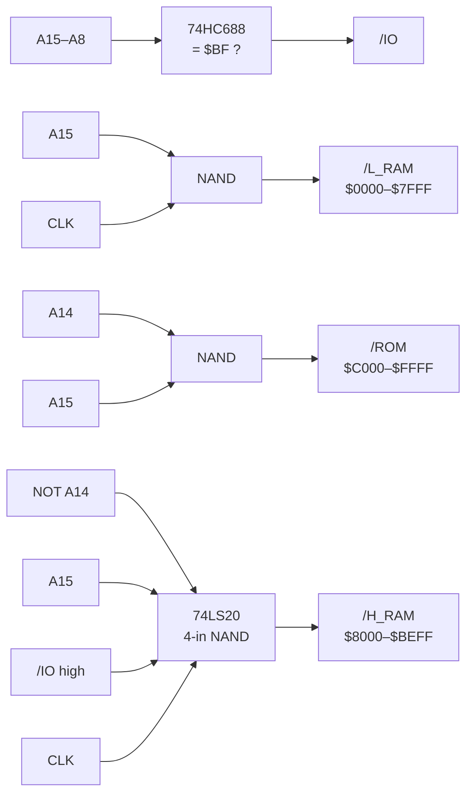
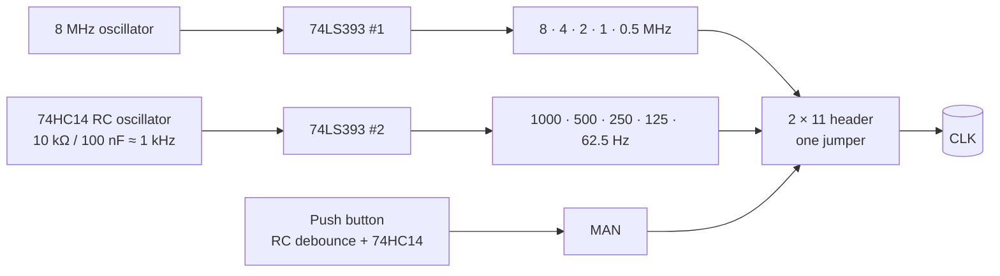

# Address Decoding, Clock & RTC

> **Three jobs on one card.** It splits the 64 KB address space into RAM, banked RAM, I/O and ROM, it generates the system clock from 8 MHz down to a single push-button step, and it keeps the time with a battery-backed DS1501.

[← Back to S65xx overview](../index.md)

---

## At a Glance

| | |
|---|---|
| **Function** | Main address decoder, clock generator, real-time clock |
| **Decoder** | 74HC688 (I/O page compare), 74HC00, 74LS20, 74HC14 |
| **Outputs to the bus** | `/L_RAM`, `/H_RAM`, `/IO`, `/ROM`, `CLK` |
| **Clock sources** | 8 MHz DIP-14 oscillator, 74HC14 RC oscillator (≈ 1 kHz), push button |
| **Clock divider** | 74LS393 (dual 4-bit counter) |
| **Clock choices** | 8 / 4 / 2 / 1 / 0.5 MHz, 1000 / 500 / 250 / 125 / 62.5 Hz, manual |
| **RTC** | **DS1501YZ** (SOP-28), 32.768 kHz crystal, **CR2032** backup cell |
| **RTC address** | `$BF90–$BF9F` (74HC138, "PORT 144@16") |
| **RTC interrupt** | `/IRQ_0.4` |
| **PCB** | ≈ 83 × 68 mm, 4 layers, silkscreen "SY65 Clock / ADDR / RTC" |

---

## Address Decoding

| Signal | Logic | Region |
|---|---|---|
| `/L_RAM` | NAND(NOT A15, CLK) | `$0000–$7FFF`, only while CLK is high |
| `/H_RAM` | NAND(NOT A14, A15, `/IO`, CLK) | `$8000–$BEFF`, I/O page excluded, CLK high |
| `/IO` | 74HC688: A15…A8 = `1011 1111` | `$BF00–$BFFF` |
| `/ROM` | NAND(A14, A15) | `$C000–$FFFF` |

The RAM selects are qualified with CLK so write data is only taken while it is valid. `/IO` and `/ROM` are pure address decodes – the I/O chips use CLK themselves, and the ROM is read-only (the SRAM in the ROM window adds CLK on the [ROM card](rom.md)).

---

## Clock Generator

The 2 × 11 header J2 has every source on the odd pins and `CLK` on all even pins. One jumper selects the clock:

| Pin pair | 1-2 | 3-4 | 5-6 | 7-8 | 9-10 | 11-12 | 13-14 | 15-16 | 17-18 | 19-20 | 21-22 |
|---|---|---|---|---|---|---|---|---|---|---|---|
| **CLK** | 8 MHz | 4 MHz | 2 MHz | 1 MHz | 500 kHz | 1 kHz | 500 Hz | 250 Hz | 125 Hz | 62.5 Hz | manual |

The push button SW1 is an edge-mounted switch with a 10 kΩ / 100 nF debounce network and a Schmitt-trigger inverter. Combined with the [backplane's hex displays](bus-card.md) it turns the S65 into a single-step trainer.

*Keep in mind:* the CPU and RAM are fast CMOS parts, but some classic peripherals (6520, 6525, 6551, SID) are specified for 1–2 MHz *(depending on speed grade)*. The SID's pitch also depends directly on CLK.

---

## Real-Time Clock (DS1501)

| Item | Value |
|---|---|
| Chip | Dallas/Maxim **DS1501YZ**, Y2K-compliant watchdog RTC (custom symbol in `65xx-library`) |
| Bus interface | 8-bit parallel, A0–A3, `/CE` = `/OE` = NAND(CLK, PORT_144), `/WE` = R/W |
| Address | `$BF90–$BF9F` (A4 tied to GND) |
| Crystal | 32.768 kHz, Frontier FM206 (G33270007) |
| Backup | CR2032 in a Keystone 3002 holder |
| Interrupt | `/IRQ` → bus `/IRQ_0.4` → VIA 1 |
| Reset | `/RESET` connected to `/RES` |
| Other | `/PWR` and `/KS` pulled up (1 kΩ), SQW not used |

---

## Components

| Function | Ref. | Part |
|---|---|---|
| I/O page comparator | U7 | 74HC688 |
| Gates | U2 | 74HC00 |
| 4-input NAND | U3 | 74LS20 |
| Inverters / RC oscillator / debounce | U1 | 74HC14 |
| Clock divider | U5 | 74LS393 |
| RTC address decoder | U6 | 74HC138 |
| RTC | U4 | DS1501YZ |
| Oscillator | X1 | 8 MHz, DIP-14 |
| RTC crystal | Y1 | 32.768 kHz |
| Battery | BT1 | CR2032 |
| Clock select | J2 | 2 × 11 pin header, horizontal |
| Manual clock | SW1 | edge push button |

---

## Files

| Type | Location |
|---|---|
| KiCad project | [`Hardware/modules/Address_Decode`](../../Hardware/modules/Address_Decode) |
