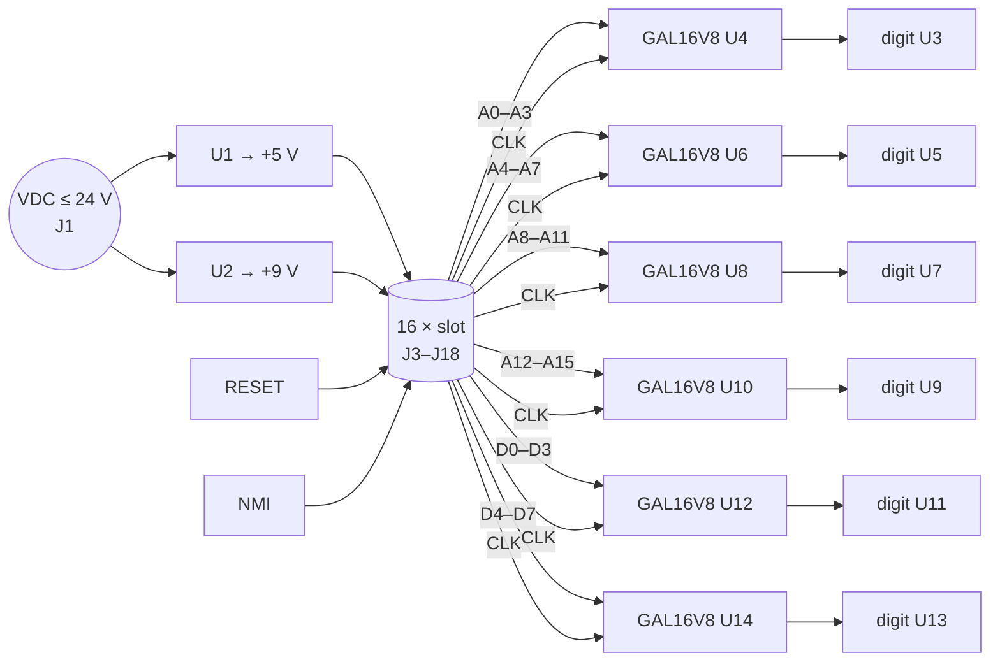

# Backplane – "SY65 Bus Card x16"

> **The spine of the S65.** Sixteen PCI slots, a +5 V / +9 V power supply, RESET and NMI buttons and six live hex displays that show what the CPU is doing on the address and data bus.

[← Back to S65xx overview](../index.md)

---

## At a Glance

| | |
|---|---|
| **Function** | Backplane, power supply, bus termination, bus monitor, reset/NMI |
| **Slots** | **16** × TE **5145154-4** (PCI 5 V card-edge connector, 2 × 62 positions) |
| **Power input** | DC jack J1 (JST-XH 2-pin), silkscreen *"V_In max. 24V"* |
| **Supplies** | **+5 V** (U1) and **+9 V** (U2), two TO-220 three-pin regulators (value "SY317", 7805-style pinout) |
| **Bus monitor** | 6 × 7-segment digits (SA39-11EWA, common anode) driven by 6 × **GAL16V8**: A15–A0 and D7–D0 in hex |
| **Indicators** | LED on **R/W**, LED on **CLK** |
| **Buttons** | **RESET** (SW1 → `/RES`), **NMI** (SW2 → `/NMI`) |
| **Termination** | 10 kΩ pull-downs on A0–A15 and D0–D7 (two SIP-9 arrays per byte), 2 × 10 kΩ on R/W and CLK |
| **PCB** | **350 × 108 mm**, 4 layers, M3 mounting holes, OSHW logo |
| **Schematic** | "SY65 Bus Card x16", rev 1.0, 2024-06-16, hierarchical: 4 × connector sheet (4 slots each), 6 × segment sheet |

---

## Overview

The backplane connects all cards in parallel. It is the only board without a CPU-side function of its own, but it adds three things that make the S65 pleasant to work with:

1. **Power.** One DC input up to 24 V, regulated to +5 V for logic and +9 V for the SID 8580. Both rails are distributed on 8 (+5 V) and 2 (+9 V) contacts per slot.
2. **A live bus monitor.** Six hex digits show the 16-bit address and the 8-bit data bus. At the slow or manual clock settings of the [address/clock card](address-clock-rtc.md) you can follow every bus cycle.
3. **Defined idle levels.** Pull-downs on all address and data lines, R/W and CLK keep the bus (and the displays) quiet when no card drives it.

---

## Block Diagram



---

## Hex Display Decoder (GAL16V8)

Each digit uses one GAL16V8 as a **registered hex-to-7-segment decoder**. The four input bits go to pins 2–5, the system **CLK** to pin 1 (register clock), `/OE` (pin 11) is tied to GND. Outputs pins 13–19 drive segments A–G through 1 kΩ resistors (active low for the common-anode digits). The decimal point is not used.

Source: `GALs/gal-7seg.pld` (CUPL syntax, device `g16v8a`, originally "7seg-test" from 2018):

```
PIN 1 = CLK;  PIN [2..5] = [E0..3];  PIN [13..19] = [S0..6];
FIELD inputs = [E0..3];  FIELD outputs = [S0..6];
TABLE inputs => outputs.d {
    0=>40; 1=>79; 2=>24; 3=>30; 4=>19; 5=>12; 6=>02; 7=>78;
    8=>00; 9=>10; A=>08; B=>03; C=>46; D=>21; E=>06; F=>0E;
}
```

The `.d` suffix makes all outputs registered, so every digit updates on the **rising edge of CLK** and holds the value for the rest of the cycle. Letters appear as **A b C d E F** *(derived from the table)*. A compiled `gal-7seg.jed` is in the same folder.

---

## Slot Connector

All 16 slots are wired 1:1 (J3–J18). The full pinout is in the [overview](../index.md#5-the-backplane-bus).

| Item | Value |
|---|---|
| Part | TE Connectivity **5145154-4**, PCI 5 V, 120 contacts + key (custom symbol in `Hardware/library/5145154-4.kicad_sym`) |
| Card side | KiCad `Connector_PCBEdge:BUS_PCI` footprint |
| Power per slot | 8 × +5 V, 2 × +9 V, 39 × GND |
| Signals | 71 |

---

## Components

| Function | Ref. | Part |
|---|---|---|
| Slots | J3–J18 | TE 5145154-4 |
| DC input | J1 | JST-XH B2B, 2-pin |
| +5 V regulator | U1 | "SY317", TO-220 |
| +9 V regulator | U2 | "SY317", TO-220 |
| Hex decoders | U4, U6, U8, U10, U12, U14 | GAL16V8 in DIP-20 sockets |
| Hex digits | U3, U5, U7, U9, U11, U13 | SA39-11EWA (0.39", common anode) |
| Segment resistors | R7–R48 | 1 kΩ 0805 |
| Bus pull-downs | RN1–RN6 | 10 kΩ SIP-9 (A0–A7, A8–A15, D0–D7, each twice) |
| R/W, CLK pull-downs | R3–R6 | 10 kΩ |
| R/W, CLK LEDs | D1, D2 + R1, R2 | 0805 LED, 1 kΩ |
| Buttons | SW1, SW2 | XKB TS-1187A SMD push buttons |

---

## Mechanics

`Hardware/modules/Bus_Card/clamp-Clamp.stp` and `Hardware/PCB-Clamp/` (FreeCAD + 3MF) contain a 3D-printable clamp *(purpose inferred: holding the cards in their slots)*.

---

## Files

| Type | Location |
|---|---|
| KiCad project | [`Hardware/modules/Bus_Card`](../../Hardware/modules/Bus_Card) |
| GAL source / JEDEC | [`Hardware/modules/Bus_Card/GALs`](../../Hardware/modules/Bus_Card/GALs) |
| Slot symbol | [`Hardware/library/5145154-4.kicad_sym`](../../Hardware/library/5145154-4.kicad_sym) |
| Clamp | [`Hardware/PCB-Clamp`](../../Hardware/PCB-Clamp) |
