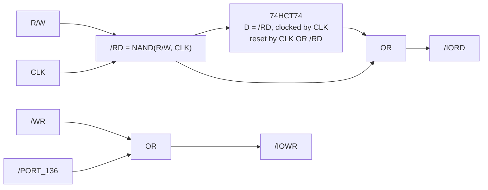

# CF Card Interface

> **Mass storage in a card slot.** A CompactFlash socket in True-IDE mode, 8 bit wide, with a small flip-flop timing circuit borrowed from the RC2014 world.

[← Back to S65xx overview](../index.md)

---

## At a Glance

| | |
|---|---|
| **Function** | CompactFlash card interface |
| **Mode** | **True IDE** (`/OE`/ATA-SEL tied to GND), **master** (CSEL = GND) |
| **Data width** | 8 bit (D0–D7) – card must be set to 8-bit mode (SET FEATURES `$01`) |
| **Address** | `$BF88–$BF8F` ("PORT 136@8") |
| **Logic** | 74HC138, 74HC00, 74LS32, 74HCT74 |
| **Socket** | 3M N7E50-A516xx-30 CF header (Type I/II) |
| **Interrupts** | none (INTRQ not connected) |
| **PCB** | ≈ 83 × 68 mm, 4 layers, silkscreen "S65 CF-Card – $BF88-$BF8F" |

---

## How It Works

The eight IDE task-file registers are at `$BF88–$BF8F` – the same layout as on the [Simple IDE card](ide-simple.md#how-it-works), just 8 bytes higher.

| CF pin | Signal | Connection |
|:---:|---|---|
| 2–6, 21–23 | D0–D7 | bus D0–D7 |
| 7 | `/CE1` (`/CS0`) | `/PORT_136` |
| 32 | `/CE2` (`/CS1`) | 1 kΩ pull-up (inactive) |
| 18–20 | A2–A0 | bus A2–A0 |
| 8, 10–12, 14–17 | A3–A10 | GND |
| 9 | `/OE` (ATA SEL) | GND → True-IDE mode |
| 34 | `/IORD` | from timing circuit |
| 35 | `/IOWR` | `/WR` OR `/PORT_136` |
| 36, 44 | `/WE`, `/REG` | 1 kΩ pull-ups |
| 39 | CSEL | GND (master) |
| 41 | RESET | `/RES` |
| 45, 46 | `/DASP`, `/PDIAG` | 330 Ω / 1 kΩ pull-ups |
| 13, 38 | VCC | +5 V |

### Timing circuit

A note on the schematic credits the read timing to *"http://www.vtsys.pl/interface-compact-flash/"*. The same circuit is in the RC2014 CF schematic in `rc2014/cf.kicad_sch`:

The flip-flop shapes `/IORD` so that the read strobe meets the CF card's timing at the S65's clock rates *(purpose inferred from the source)*.

---

## Components

| Function | Ref. | Part |
|---|---|---|
| Address decoder | U4 | 74HC138 (Y0 `$BF80` unused here, Y1 `$BF88`) |
| Gates | U1 | 74HC00 |
| OR gates | U2 | 74LS32 |
| Timing flip-flop | U3 | 74HCT74 |
| Pull-ups | R1–R5 | 1 kΩ / 330 Ω |
| CF socket | J1 | 3M N7E50-A516xx-30 |
| Bus | J2 | PCI card edge |

---

## Files

| Type | Location |
|---|---|
| KiCad project | [`Hardware/modules/CF`](../../Hardware/modules/CF) |
| Reference | [`rc2014/cf.kicad_sch`](../../rc2014/cf.kicad_sch) |
