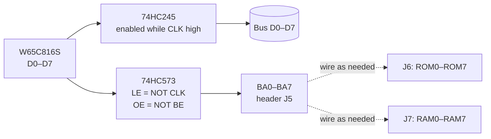

# CPU Card

> **The processor and nothing else.** A W65C02S in a DIP-40 socket, pull-ups for the control inputs – and a hidden second life as a 65C816 card with a bank-address latch and a data-bus buffer.

[← Back to S65xx overview](../index.md)

---

## At a Glance

| | |
|---|---|
| **Function** | System CPU |
| **CPU** | **W65C02S** (DIP-40). Footprint and jumpers also fit the **W65C816S** |
| **Clock input** | `CLK` from the bus → CPU pin 37 (PHI2 in) |
| **Pull-ups** | 3.3 kΩ array on `/RES`, `/IRQ`, `/NMI`, `RDY`, `BE` and the two mode jumpers |
| **65816 option** | 74HC573 bank latch (BA0–BA7), 74HC245 data buffer, 74HC00 control, 3 bridge headers |
| **Mode selection** | Solder jumpers JP1 (`E`), J1 (`ABORT`/PHI1), J2 (`SO`/`M/X`) |
| **PCB** | ≈ 83 × 68 mm, 4 layers, silkscreen "S65 CPU" |
| **Schematic** | "S65xx Computer System", rev 1.0, 2024-06-30 |

---

## Overview

In **6502 mode** the card is almost passive: the CPU's address, data and control pins go straight to the bus. U2, U3 and U4 are not populated and the data lines are bridged across the footprint of U3 (*"Bridge indicated Pins on U3"*).

In **65816 mode** the extra parts handle the 65816's multiplexed bank address: during PHI2 low the CPU puts address bits A16–A23 on the data bus. U4 (74HC573) latches them as **BA0–BA7**, U3 (74HC245) connects the CPU data pins to the bus only during PHI2 high. Three 8-pin headers let you wire the bank address onto the bus bank lines.

---

## Mode Jumpers (from the silkscreen)

| Mode | JP1 (`E`) | J1 (`ABORT`) | J2 (`SO`/`MX`) | U2, U3, U4 |
|---|:---:|:---:|:---:|---|
| **6502** | open | 1-2 | 1-2 | not populated, bridge U3 data pins |
| **65816** | closed | 2-3 | 2-3 | 74HC00, 74HC245, 74HC573, no bridging |

| CPU pin | 65C02 function | 65C816 function | Handling on the card |
|:---:|---|---|---|
| 1 | `/VP` | `/VP` | to bus `/VP` |
| 3 | PHI1 out | `/ABORT` | J1: 1-2 = PHI1 (unused), 2-3 = pull-up |
| 5 | `/ML` | `/ML` | to bus `/ML` |
| 7 | `SYNC` | `VPA` | to bus `SYNC/VPA` |
| 35 | NC | `E` (emulation) | JP1 to bus `E` |
| 36 | `BE` | `BE` | bus `BE` + pull-up |
| 37 | PHI2 in | PHI2 in | bus `CLK` |
| 38 | `/SO` | `M/X` | J2: 1-2 = pull-up (`/SO` inactive), 2-3 = bus `M/X` |
| 39 | PHI2 out | `VDA` | to bus `Ø2/VDA` |

---

## 65816 Bank Address

| Header | Signals |
|---|---|
| J5 "Bank Bridge A" | BA0–BA7 (latched 65816 bank byte) |
| J6 "Bank Bridge B" | ROM0–ROM7 (bus ROM bank lines) |
| J7 "Bank Bridge C" | RAM0–RAM7 (bus RAM bank lines) |

Silkscreen: *"in 65816-Mode bridge as needed"*. On the [Bank & IRQ card](bank-irq.md) the matching solder jumpers JP1–JP16 are cut, so the TPI no longer drives the lines that the 65816 takes over.

---

## Components

| Function | Ref. | Part |
|---|---|---|
| CPU | U1 | W65C02S / W65C816S, DIP-40 |
| Control logic | U2 | 74HC00 (65816 only) |
| Data buffer | U3 | 74HC245 (65816 only) |
| Bank latch | U4 | 74HC573 (65816 only, schematic value 74LS573) |
| Pull-ups | RN1 | 3.3 kΩ SIP-9 |
| Mode jumpers | JP1, J1, J2 | solder jumpers (2- and 3-pad) |
| Bank headers | J5–J7 | 1 × 8 pin headers |
| Bus | J3 | PCI card edge |

---

## Files

| Type | Location |
|---|---|
| KiCad project | [`Hardware/modules/CPU`](../../Hardware/modules/CPU) |
