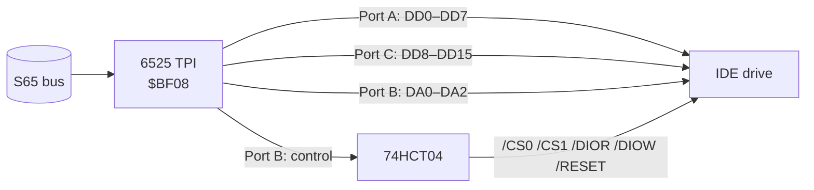

# Buffered IDE Card (TPI IDE)

> **A full 16-bit IDE port for an 8-bit CPU.** A second 6525 TPI drives the IDE bus like a parallel port: 16 data lines, three address lines and all control strobes under software control.

[← Back to S65xx overview](../index.md)

---

## At a Glance

| | |
|---|---|
| **Function** | 16-bit IDE/ATA interface ("Buffered IDE", "TPI IDE") |
| **Chip** | MOS **6525 TPI** |
| **Address** | `$BF08–$BF0F` |
| **Data path** | TPI port A = DD0–DD7, TPI port C = DD8–DD15 |
| **Address/control** | TPI port B: PB0–PB2 = DA0–DA2, further lines → `/CS0`, `/CS1`, `/DIOW`, `/DIOR`, `/RESET` via 74HCT04 inverters *(inferred from the labels)* |
| **Connectors** | 40-pin 2.54 mm IDC (3.5" drives) and 44-pin 2.0 mm header (2.5" drives / DOMs) |
| **Drive power** | `IDEVCC` via solder jumper JP1 (+5 V) on the 44-pin header and a 2-pin power header |
| **Activity LED** | from `/DASP` (pin 39), 330 Ω |
| **PCB** | ≈ 83 × 68 mm, 4 layers, silkscreen "S65 IDE – $BF08 - $BF0F" |
| **Status** | Schematic complete. **The PCB file looks unfinished** (several pads without nets) |

---

## Concept

This card follows the idea of the **RC2014 82C55 IDE** board (a copy of that schematic is in `rc2014/ide.kicad_sch`), with a 6525 TPI instead of the 82C55 *(inferred)*:

Because the software toggles every strobe, the timing is slow but always within spec, and **16-bit transfers** are possible – needed for hard disks that do not support the 8-bit transfer mode. Compare with the faster but 8-bit-only [Simple IDE](ide-simple.md) and [CF](cf.md) cards.

---

## IDE Connector (J1, 40-pin)

| Pin | Signal | | Pin | Signal |
|:---:|---|---|:---:|---|
| 1 | `/RESET` | | 2 | GND |
| 3, 5, … 17 | DD7 … DD0 (TPI PA7 … PA0) | | 4, 6, … 18 | DD8 … DD15 (TPI PC0 … PC7) |
| 19 | GND | | 21 | DMARQ (10 kΩ pull-down) |
| 23 | `/DIOW` | | 25 | `/DIOR` |
| 29 | `/DMACK` (10 kΩ pull-up) | | 33, 35, 36 | DA1, DA0, DA2 |
| 37 | `/CS0` | | 38 | `/CS1` |
| 39 | `/DASP` → LED | | 22–30 even, 40 | GND |

The 44-pin header J3 has the same assignment plus pins 41/42 = `IDEVCC` and 43/44 = GND.

---

## Components

| Function | Ref. | Part |
|---|---|---|
| Port chip | U2 | 6525 TPI |
| Inverters | U3 | 74HCT04 |
| Address decoder | U4 | 74HC138 |
| Gates | U1 | 74AHC2G00 (TSSOP-8) |
| IDE connectors | J1, J3 | 2 × 20 IDC 2.54 mm, 2 × 22 2.0 mm |
| Drive power | JP1, J2 | solder jumper, 2-pin header |
| Activity LED | D1, R1 | LED, 330 Ω |
| Bus | J4 | PCI card edge |

---

## Files

| Type | Location |
|---|---|
| KiCad project | [`Hardware/modules/IDE`](../../Hardware/modules/IDE) |
| Driver | `IDE_INIT` in [`Firmware/cc65/lib/tpi.s`](../../Firmware/cc65/lib/tpi.s) (intended: all ports output, all lines high – see [review notes](../review-notes.md#firmware)) |
| Reference | [`rc2014/ide.kicad_sch`](../../rc2014/ide.kicad_sch) |
