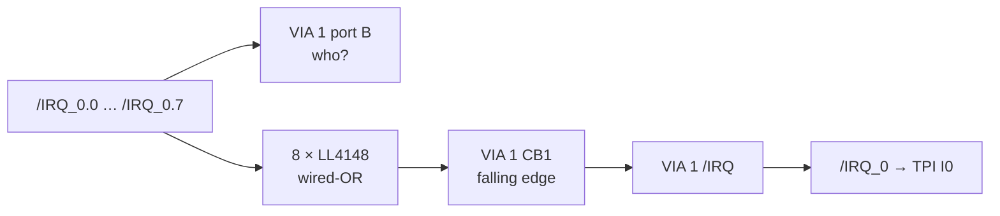

# LCD & IRQ_0 Card

> **A display port and an interrupt expander.** VIA 1 drives a character LCD in 4-bit mode on port A and collects eight interrupt lines on port B, so one TPI input becomes eight.

[← Back to S65xx overview](../index.md)

---

## At a Glance

| | |
|---|---|
| **Function** | Character LCD interface, interrupt sub-controller for `/IRQ_0.0`–`/IRQ_0.7` |
| **Chip** | **W65C22S** VIA ("VIA 1") |
| **Address** | `$BF20–$BF2F` (74HC138, "PORT 32@16") |
| **LCD** | HD44780-compatible, **4-bit mode**: 16 × 2 / 20 × 4 (1 × 16 header) or **40 × 4** with two enables (2 × 8 header) |
| **Contrast** | 10 kΩ trimmer (Bourns TC33X) |
| **Interrupts in** | `/IRQ_0.0`–`/IRQ_0.7` on port B (3.3 kΩ pull-ups) + diode-OR on CB1 |
| **Interrupt out** | VIA `/IRQ` → bus `/IRQ_0` → TPI input I0 |
| **PCB** | ≈ 83 × 68 mm, 4 layers, silkscreen "S65 LCD & IRQ – $BF20 - $BF2F" |

---

## Port Assignment

| VIA pin | Signal | Use |
|---|---|---|
| PA0 | RS | LCD register select |
| PA1 | R/W | LCD read/write |
| PA2 | E1 | LCD enable (single controller / upper half of 40 × 4) |
| PA3 | E2 | second enable for 40 × 4 displays |
| PA4–PA7 | D4–D7 | LCD data (4-bit mode). D0–D3 of the LCD are not driven |
| PB0–PB7 | `/IRQ_0.0`–`/IRQ_0.7` | interrupt status (read) |
| CB1 | wired-OR of all `/IRQ_0.x` | interrupt trigger (8 × LL4148 + 4.7 kΩ pull-up) |
| CA1, CA2, CB2 | – | not connected |

---

## Interrupt Expander

When any device on `/IRQ_0.x` pulls its line low, the diode pulls CB1 low. With CB1 set to "negative edge" and its interrupt enabled, VIA 1 raises `/IRQ_0`. The ISR reads port B to find out which line is active.

The firmware routine `VIA1_Init` (in `via.s`) sets port A as output, PCR = `$CC` (CA2/CB2 low outputs, CA1/CB1 negative edge) and enables only the CB1 interrupt (`IER = $90`).

**Current assignment** of `/IRQ_0.x`: ACIA 1–4 on `.0`–`.3`, RTC on `.4`, `.5`–`.7` free. See [Interrupt System](../index.md#8-interrupt-system).

---

## LCD Connectors

| Header | Pinout | For |
|---|---|---|
| DS1, 1 × 16 | standard HD44780 order: GND, 5 V, VEE, RS, RW, E1, D0–D7, (backlight not connected) | 16 × 2 (WC1602A) up to 20 × 4 – silkscreen *"LCD 4x20 max"* |
| DS2, 2 × 8 | D7/D6, D5/D4, D3/D2, D1/D0, E1/RW, RS/VEE, GND/5V, E2/NC | 40 × 4 displays with two controllers |

---

## Components

| Function | Ref. | Part |
|---|---|---|
| VIA | U2 | W65C22S (DIP-40) |
| Address decoder | U1 | 74HC138 |
| IRQ diodes | D1–D8 | LL4148 (MiniMELF) |
| IRQ pull-ups | RN1 | 3.3 kΩ SIP-9 |
| CB1 pull-up | R1 | 4.7 kΩ |
| Contrast | RV1 | 10 kΩ trimmer |
| Bus | J1 | PCI card edge |

---

## Files

| Type | Location |
|---|---|
| KiCad project | [`Hardware/modules/LCD_IRQ`](../../Hardware/modules/LCD_IRQ) |
| Driver | [`Firmware/cc65/lib/via.s`](../../Firmware/cc65/lib/via.s) |
