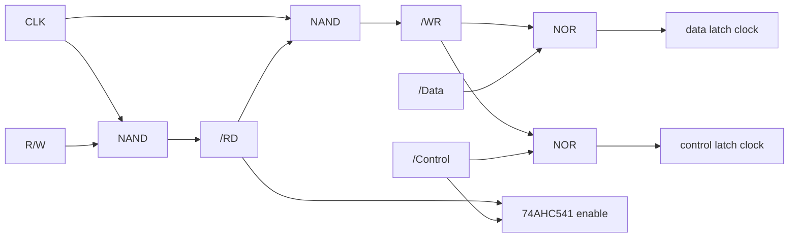

# LPT Card – Parallel Printer Port

> **A Centronics port from five logic chips.** A latched data register, a latched control register with read-back and an input buffer for the printer status – on a DB-25 like on a PC.

[← Back to S65xx overview](../index.md)

---

## At a Glance

| | |
|---|---|
| **Function** | Parallel (Centronics/LPT) port |
| **Logic** | 2 × 74HCT574 (data, control), 74AHC541 (status/read-back), 74HC00, 74HC02, 2 × 74HC138 |
| **Connector** | **DB-25 female**, edge mount (PC-style) |
| **Addresses** | Card 1 (jumpers 1-2): `$BF10` data, `$BF11` control/status. Card 2 (jumpers 2-3): `$BF12`, `$BF13` |
| **Pull-ups** | 10 kΩ on BUSY, `/ACK`, PEMPTY, `/FAULT`, SEL_IN |
| **Interrupts** | none (status is polled) |
| **PCB** | ≈ 83 × 68 mm, 4 layers, silkscreen "S65 LPT" |

---

## Registers

| Address | Write | Read |
|---|---|---|
| `$BF10` (`$BF12`) | **Data register** → PD0–PD7 (74HCT574, outputs always enabled) | – |
| `$BF11` (`$BF13`) | **Control register** (74HCT574): bit 4 `/SEL_OUT`, bit 5 `/RESET`, bit 6 `/AUTOFD`, bit 7 `/STROBE` | **Status + control read-back** (74AHC541) |

**Status / read-back bits:**

| Bit | 7 | 6 | 5 | 4 | 3 | 2 | 1 | 0 |
|---|---|---|---|---|---|---|---|---|
| Read | `/STROBE` | `/AUTOFD` | `/RESET` | SEL_IN | `/FAULT` | PEMPTY | `/ACK` | BUSY |

Bits 4–7 of the control register come back on the same bit positions, so software can always read the current control state.

---

## Strobe Generation

The same pattern (`/RD`, `/WR` from CLK and R/W, NOR to make a latch clock) is used on the [MyCPU VGA card](mycpu-vga.md).

---

## DB-25 Pinout

| Pin | Signal | Direction | Pin | Signal | Direction |
|:---:|---|---|:---:|---|---|
| 1 | `/STROBE` | out | 14 | `/AUTOFD` | out |
| 2–9 | PD0–PD7 | out | 15 | `/FAULT` | in |
| 10 | `/ACK` | in | 16 | `/RESET` | out |
| 11 | BUSY | in | 17 | SEL_IN | in |
| 12 | PEMPTY | in | 18–25 | GND | |
| 13 | `/SEL_OUT` | out | | | |

---

## Components

| Function | Ref. | Part |
|---|---|---|
| Data latch | U5 | 74HCT574 |
| Control latch | U6 | 74HCT574 |
| Status buffer | U4 | 74AHC541 |
| Strobe gates | U3, U7 | 74HC00, 74HC02 |
| Address decoders | U1, U2 | 74HC138 (`$BF10–$BF17`, then single bytes) |
| Address jumpers | JP1 (Data), JP2 (Control) | 3-pad solder jumpers |
| Pull-ups | RN1 | 10 kΩ SIP-6 |
| Connector | J1 | DB-25 female, edge mount |
| Bus | J2 | PCI card edge |

---

## Files

| Type | Location |
|---|---|
| KiCad project | [`Hardware/modules/LPT`](../../Hardware/modules/LPT) |
