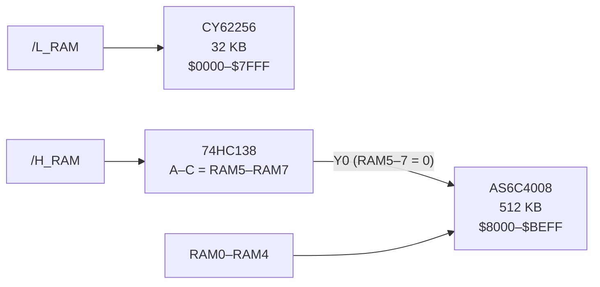

# RAM Card

> **32 KB that are always there, plus 512 KB in banks.** The RAM card fills the lower half of the address space with fixed RAM and the `$8000–$BEFF` window with 32 switchable 16 KB banks.

[← Back to S65xx overview](../index.md)

---

## At a Glance

| | |
|---|---|
| **Function** | Fixed RAM `$0000–$7FFF` + banked RAM `$8000–$BEFF` |
| **Fixed RAM** | **CY62256-70PC**, 32 KB |
| **Banked RAM** | **AS6C4008-55PCN**, 512 KB = 32 × 16 KB |
| **Bank lines used** | RAM0–RAM4 → A14–A18, RAM5–RAM7 must be 0 (*"Select only lower 32 banks"*) |
| **Select lines** | `/L_RAM`, `/H_RAM` from the [address card](address-clock-rtc.md) (already CLK-qualified) |
| **PCB** | ≈ 83 × 68 mm, 4 layers, silkscreen "SY65 32k + 32x16k RAM" |

---

## How It Works

- The **CY62256** is selected directly by `/L_RAM`. Its `/OE` is linked to `/CS` via solder jumper JP2 ("OE_L").
- The **AS6C4008** gets the 14 CPU address lines A0–A13 plus RAM0–RAM4 on A14–A18. A 74HC138 enables it only when `/H_RAM` is active **and** RAM5–RAM7 are 0. Its `/OE` is linked to `/CE` via JP1 ("OE_H").
- Both chips use R/W directly as `/WE`. Because `/L_RAM` and `/H_RAM` already contain CLK, writes only happen during PHI2 high.
- The window is 16 128 bytes: the last page of each bank (`$BF00–$BFFF`) is covered by the I/O page.

**Banked RAM capacity visible to the CPU:** 32 × 16 128 = 516 096 bytes *(computed)*.

---

## Components

| Function | Ref. | Part |
|---|---|---|
| Fixed RAM | U2 | CY62256-70PC (DIP-28) |
| Banked RAM | U1 | AS6C4008-55PCN (DIP-32) |
| Bank decoder | U4 | 74HC138 |
| `/OE` links | JP1, JP2 | solder jumpers, bridged |
| Bus | J1 | PCI card edge |

---

## Files

| Type | Location |
|---|---|
| KiCad project | [`Hardware/modules/RAM`](../../Hardware/modules/RAM) |
