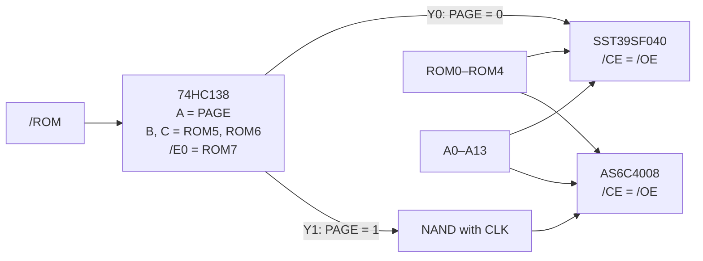

# ROM Card – Paged ROM/RAM

> **512 KB of Flash and 512 KB of SRAM behind one 16 KB window.** The ROM card serves the `$C000–$FFFF` region and lets software choose one of 32 Flash banks – or one of 32 RAM banks in the same window.

[← Back to S65xx overview](../index.md)

---

## At a Glance

| | |
|---|---|
| **Function** | Banked ROM window `$C000–$FFFF` |
| **Flash** | **SST39SF040**, 512 KB, in a 32-pin **ZIF socket** (3M Textool 232-1285-09-0602J) |
| **SRAM** | **AS6C4008-55PCN**, 512 KB |
| **Banks** | 32 × 16 KB Flash (PAGE = 0) + 32 × 16 KB SRAM (PAGE = 1) |
| **Bank lines used** | ROM0–ROM4 → A14–A18, ROM5–ROM7 must be 0 |
| **Decoder** | 74HC138 + 74HC00 |
| **PCB** | ≈ 83 × 68 mm, 4 layers, silkscreen "SY65 Paged ROM RAM – 512k ROM, 512k RAM, 32 banks" |

---

## How It Works

1. The [address card](address-clock-rtc.md) asserts `/ROM` for `$C000–$FFFF`.
2. The 74HC138 combines `/ROM`, `PAGE` and the upper bank lines ROM5–ROM7. Output **Y0** (`PAGE = 0`) selects the Flash, **Y1** (`PAGE = 1`) selects the SRAM. Any other value of ROM5–ROM7 leaves the card silent, so further ROM cards could serve other bank ranges.
3. ROM0–ROM4 feed address lines A14–A18 of both chips → 32 banks of 16 KB.
4. The SRAM chip select is additionally gated with **CLK** (74HC00), so writes into the ROM window are clean. Its `/WE` is connected to R/W.
5. The Flash write-enable (`PGM`) is tied to +5 V: the Flash is **read-only in the system** and is programmed in an external programmer – hence the ZIF socket.

**After reset** PAGE and all bank lines are pulled low on the [Bank & IRQ card](bank-irq.md) → Flash bank 0 is visible and the CPU boots from it.

---

## Use Cases

- **Several firmware images** in one Flash: system ROM + WozMon in bank 0, EhBASIC in bank 1, MS BASIC in bank 2, 29 banks free (see [Firmware](../firmware.md#4-rom-bank-layout)).
- **RAM in ROM space**: switch PAGE to 1, load a program into the ROM window and run it – ideal for testing new "ROM" code without reflashing *(application inferred)*.

---

## Components

| Function | Ref. | Part |
|---|---|---|
| Flash | U2 | SST39SF040 (DIP-32, ZIF socket) |
| SRAM | U4 | AS6C4008-55PCN (DIP-32) |
| Bank/page decoder | U1 | 74HC138 |
| Gates | U3 | 74HC00 (inverter + CLK gating) |
| SRAM `/OE` link | JP1 | solder jumper "OE_H", bridged |
| Bus | J1 | PCI card edge |

---

## Files

| Type | Location |
|---|---|
| KiCad project | [`Hardware/modules/ROM`](../../Hardware/modules/ROM) |
| ROM image | [`Firmware/cc65/Main-FW/output/rom.bin`](../../Firmware/cc65/Main-FW/output/rom.bin) |
