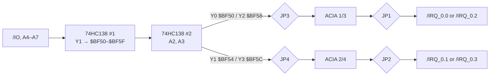

# Serial Card – Dual ACIA

> **Two full RS-232 ports per card, up to four in the system.** Two 6551 ACIAs with all modem lines, MAX232 level shifters, DE-9 connectors and TTL headers.

[← Back to S65xx overview](../index.md)

---

## At a Glance

| | |
|---|---|
| **Function** | 2 × asynchronous serial port (RS-232 and TTL) |
| **UART** | 2 × **6551** ACIA |
| **Baud clock** | 1.8432 MHz DIP-14 oscillator, shared by both ACIAs |
| **Level shifters** | 4 × **MAX232** (two per port: TxD/RxD/RTS/CTS and DTR/DSR/DCD) |
| **Connectors per port** | DE-9 **male** (edge mount, DTE pinout) + 1 × 9 TTL header |
| **Addresses** | Card 1 (bridges 1-2): ACIA 1 `$BF50`, ACIA 2 `$BF54`. Card 2 (bridges 2-3): ACIA 3 `$BF58`, ACIA 4 `$BF5C` |
| **Interrupts** | Card 1: `/IRQ_0.0`, `/IRQ_0.1`. Card 2: `/IRQ_0.2`, `/IRQ_0.3` |
| **PCB** | ≈ 83 × 68 mm, 4 layers, silkscreen "S65 Serial" |

---

## Address & IRQ Selection

| Solder bridges | Port | ACIA address | IRQ line |
|---|---|---|---|
| **1-2** (first card) | Port 1 | `$BF50–$BF53` | `/IRQ_0.0` |
| | Port 2 | `$BF54–$BF57` | `/IRQ_0.1` |
| **2-3** (second card) | Port 1 | `$BF58–$BF5B` | `/IRQ_0.2` |
| | Port 2 | `$BF5C–$BF5F` | `/IRQ_0.3` |

Set all four bridges (JP1–JP4) the same way.

---

## Connectors

**DE-9 (J1 = COM1/3, J2 = COM2/4)** – standard PC (DTE) pinout:

| Pin | 1 | 2 | 3 | 4 | 5 | 6 | 7 | 8 | 9 |
|---|---|---|---|---|---|---|---|---|---|
| Signal | DCD | RxD | TxD | DTR | GND | DSR | RTS | CTS | – |

**TTL header (J3 = Port 1, J4 = Port 2)**, 1 × 9, logic levels before the MAX232:

| Pin | 1 | 2 | 3 | 4 | 5 | 6 | 7 | 8 | 9 |
|---|---|---|---|---|---|---|---|---|---|
| Signal | +5 V | TxD | RxD | RTS | CTS | DTR | DSR | DCD | GND |

**Note:** the TTL inputs (RxD, CTS, DSR, DCD) are wired to the MAX232 receiver outputs. The TTL header is therefore best used for monitoring, or with the MAX232s removed, when a TTL device drives these lines *(inferred from the netlist)*.

---

## Registers (per ACIA)

| Offset | Register |
|:---:|---|
| +0 | Data (TX/RX) |
| +1 | Status (write = programmed reset) |
| +2 | Command |
| +3 | Control |

The firmware (`acia.s`) documents every bit of status, control and command and sets up **9600 baud, 8N1, receive interrupt on, transmit interrupt off, DTR active** for COM1–COM4. COM1 is the system console.

---

## Components

| Function | Ref. (PCB) | Part |
|---|---|---|
| ACIA 1/3 | U3 | 6551 |
| ACIA 2/4 | U6 | 6551 |
| Level shifters | U1, U2, U4, U5 | MAX232 (1 µF pump capacitors) |
| Address decoders | U7, U8 | 74HC138 |
| Baud oscillator | X1 | 1.8432 MHz, DIP-14 |
| Serial connectors | J1, J2 | DE-9 male, edge mount |
| TTL headers | J3, J4 | 1 × 9 pin header |
| Address / IRQ bridges | JP1–JP4 | 3-pad solder jumpers |
| Bus | J5 | PCI card edge |

---

## Files

| Type | Location |
|---|---|
| KiCad project | [`Hardware/modules/ACIA2`](../../Hardware/modules/ACIA2) |
| Driver | [`Firmware/cc65/lib/acia.s`](../../Firmware/cc65/lib/acia.s) |
