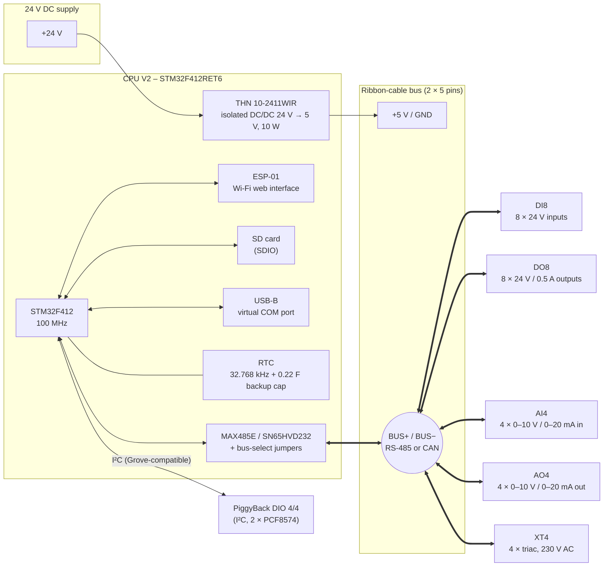
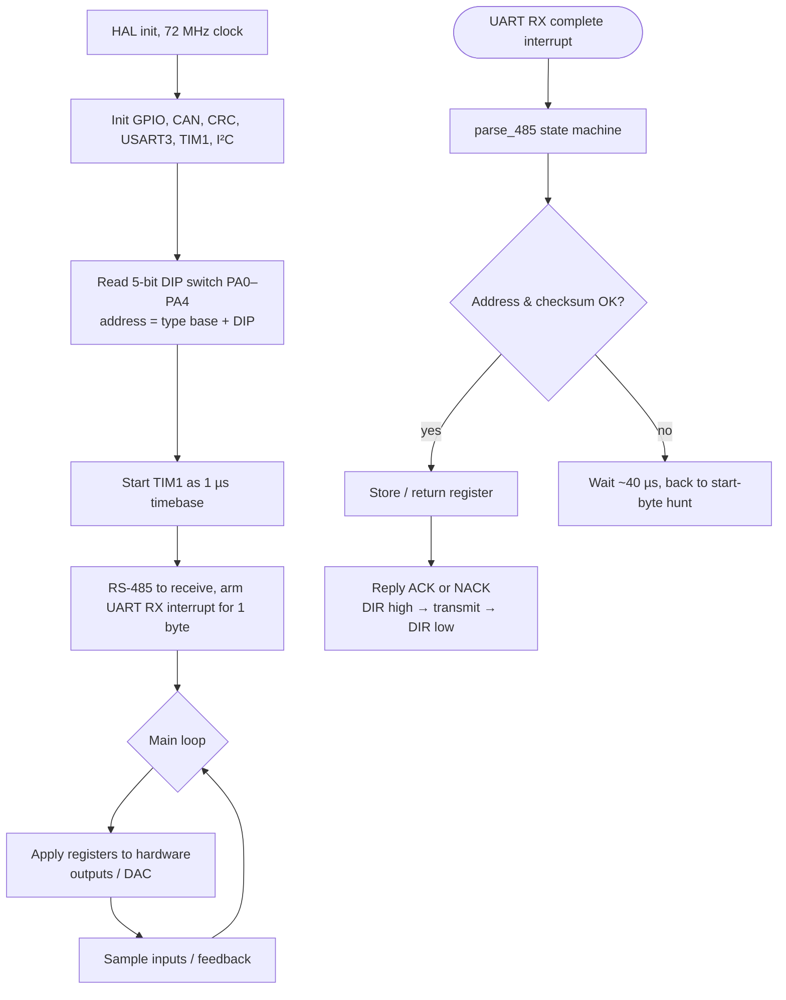

# SynPLC – An Open-Source Modular PLC with STM32 Microcontrollers

> *"In theory, one could build a LOGO!-type PLC from Arduinos."* – the idea the SynPLC grew out of

The **SynPLC** is an open-source, modular **programmable logic controller (PLC)** for **home automation**. A central **CPU module** controls a row of small I/O modules: digital inputs, digital outputs, analog inputs, analog outputs and a triac interface for switching mains loads. All modules are **100 × 77 mm** boards connected by one **10-pin ribbon-cable bus**. The bus carries the 5 V supply and a differential data pair that runs either **RS-485** or **CAN**.

Each module has its **own STM32 microcontroller**. It handles its I/O locally and talks to the CPU through a small, custom register protocol. The field side (24 V inputs/outputs, analog loops, mains) is **galvanically isolated** from the logic bus on every I/O module.

| | |
|---|---|
| **Author** | Marco Müller ("Synthron") |
| **Status** | Work in progress. Hardware generation V2: DO8 and DI8 tested, AO4/AI4/XT4 in test, CPU V2 designed and reviewed |
| **Purpose** | Home automation; 24 V-compatible digital and analog I/O, AC switching / phase control |
| **Form factor** | 100 × 77 mm, 4-layer PCBs, ribbon-cable bus (2 × 5 pins, 2.54 mm) |
| **System supply** | 24 V DC → isolated DC/DC (10 W) on the CPU → **5 V on the bus** |
| **Module bus** | RS-485 *or* CAN on one shared differential pair (selected by jumpers) |
| **Protocol** | Custom RS-485 register protocol (start byte, address, command/register, data, XOR checksum), 1 MBaud. CAN protocol planned |
| **CPU** | STM32F412RET6 @ 100 MHz (CPU V2), ESP-01 Wi-Fi module, SD card, USB, RTC |
| **I/O modules** | STM32F103C8T6 @ 72 MHz |
| **Tools** | KiCad (PCBs), FreeCAD (enclosures), LTspice (analog simulations), STM32CubeMX + stm32pio + PlatformIO (firmware), LaTeX (technical documentation) |
| **License** | Creative Commons **CC BY-SA 4.0** (all resources and documents) |
| **Source** | [GitHub](https://github.com/Synthron/SynPLC) · [GitLab](https://gitlab.synthron.de/Synthron/SynPLC) |

---

## Table of Contents

1. [What is the SynPLC?](#1-what-is-the-synplc)
2. [History – From a 24 V Arduino to STM32 Modules](#2-history--from-a-24-v-arduino-to-stm32-modules)
3. [Design Philosophy](#3-design-philosophy)
4. [System Architecture](#4-system-architecture)
5. [The Module Bus](#5-the-module-bus)
6. [Communication Protocol](#6-communication-protocol)
7. [Hardware Design Approach](#7-hardware-design-approach)
8. [Enclosure](#8-enclosure)
9. [Software Architecture](#9-software-architecture)
10. [Modules](#10-modules)
11. [Project Status & Roadmap](#11-project-status--roadmap)
12. [Repository Structure](#12-repository-structure)
13. [Media & Downloads](#13-media--downloads)
14. [License & Credits](#14-license--credits)

---

## 1. What is the SynPLC?

A classic small PLC (such as a Siemens LOGO!) is one closed box with a fixed number of inputs and outputs. The SynPLC splits this box into **independent modules**:

- **one CPU module** runs the control program and owns the bus. It also provides the user-facing interfaces: USB serial monitor, a Wi-Fi web interface (ESP-01, read-only for now), an SD card for log files and (later) programs, and an RTC.
- **I/O modules** each do one job: 8 × 24 V digital inputs, 8 × 24 V digital outputs, 4 × analog inputs (0–10 V / 0–20 mA), 4 × analog outputs (0–10 V / 0–20 mA) or 4 × triac outputs for AC loads.
- **one ribbon cable** connects everything. It supplies 5 V to all modules and carries the bus.

You can add modules of the same type side by side. Every I/O module has a **5-bit DIP switch**, so up to **32 modules per type** can be addressed. The module type is fixed in firmware and forms the upper three bits of the 8-bit bus address.

The control logic is currently written in **C** and flashed to the CPU. Later, programs are meant to be written in **Structured Text** (IEC 61131-3) and loaded from the SD card. This step is postponed for now.

---

## 2. History – From a 24 V Arduino to STM32 Modules

### The idea

The SynPLC started as the idea of a **24 V-compatible Arduino**. It soon became clear that such a board could imitate a LOGO! PLC. That led to the plan for a complete, self-made PLC system.

### Modules V1 – Proof of concept (discontinued)

The first generation was a **proof of concept** built around the easy-to-program **ATmega328P** with the Arduino framework. It included a CPU module, a DO module, a DI module and an AO module (AI, interface/PWM and phase-control modules were planned). V1 only used RS-485.

The hardware was not as refined as wanted. Many compromises led to **high production costs and hard-to-source parts**. All V1 modules are now discontinued and decommissioned.

### Modules V2 – STM32 (current)

V2 was designed "with the mindset of more generic circuitry without losing accuracy or stability":

- Every module uses an **STM32F103C8T6** (the CPU V2 uses an **STM32F412RET6**).
- Every module carries **both an RS-485 and a CAN transceiver**. Jumpers select which one drives the bus.
- All boards share the same **100 × 77 mm, 4-layer** format and the same bus connector.
- Big improvements were made on the **analog modules** (isolated I²C DAC/ADC, precision resistors, CV/CC switching).
- The **triac interface (XT4)** was added.

The PCBs were reviewed by community members before ordering. The silkscreens credit **"Blind_Via"** (DO8, DI8, XT4) and **"theBrutzler"** (AO4, AI4) as reviewers.

### CPU: V1 (STM32F103) → V2 (STM32F412)

The first STM32 CPU was based on an STM32F103C8 (firmware project `software/CPU/F103`, CubeMX file `CPU_old.ioc`). **CPU V2** (2023) moves to the much larger **STM32F412RET6** with SDIO for the SD card, USB OTG, more timers and an I²C port for an I/O **PiggyBack** board.

---

## 3. Design Philosophy

- **Distributed intelligence.** Every module has its own microcontroller. It samples inputs, drives outputs and checks its own feedback. The CPU only exchanges register values.
- **Isolation everywhere.** The field side of every I/O module is galvanically isolated from the 5 V logic bus: optocouplers (TLP291-4) on digital modules, an isolated I²C link (ADuM1250) on analog modules, opto-triacs on the triac module. The schematics require **≥ 1.5 mm creepage/clearance** across the isolation barrier (AO4: "750 VAC creepage and clearance, min. 1.5 mm").
- **Robust field interfaces.** 24 V I/Os are protected with **36 V TVS diodes** (SM6T36A / P6SMB36CA). Digital inputs have a current limit (max. 2 mA) and tolerate up to 33 V DC. Field supplies are protected against reverse polarity.
- **One bus, two physical layers.** The bus pair can run RS-485 (simple, robust, easy to implement on any controller) or CAN (multi-master, hardware arbitration). The custom protocol is kept simple so that it is "easy to implement on other controllers too".
- **Off-the-shelf parts.** V2 replaced hard-to-source V1 parts with common components: STM32F103, MAX485E, SN65HVD232, AP1117-33, TLP291-4, LM358, BT136.
- **One form factor.** All boards have the same size and bus connector, so they fit the same enclosure family.

---

## 4. System Architecture



**How it works:**

1. The **CPU** gets 24 V DC. Its isolated **DC/DC converter** makes 5 V. The 5 V supplies the CPU itself and, through the ribbon cable, **all I/O modules**. Each module makes its own 3.3 V with an AP1117-33 LDO.
2. The CPU is the **bus master**. It sends a request frame to one module address (e.g. "write output register of DO module 1") and waits for the reply.
3. Every module listens on the bus. It parses the frame in a UART interrupt state machine, checks the address and checksum, stores or returns the register value and answers with **ACK** or **NACK + error code**.
4. In its main loop, each module applies its registers to the hardware (switch outputs, write DAC values) and samples its inputs.
5. Field-side power (24 V for outputs, analog loops, mains for triacs) is connected **directly at each module's terminals** and stays isolated from the bus.

---

## 5. The Module Bus

All modules connect through a **10-pin (2 × 5, 2.54 mm) pin header**. Every I/O module has **two** of these headers, so the ribbon cable can be daisy-chained from module to module. The technical note recommends **twisted-pair ribbon cable** for stable communication.

### Pinout (verified from the PCB pad nets of all boards)

| Pin | Signal | | Pin | Signal |
|:---:|---|---|:---:|---|
| 1 | +5 V (VCC) | | 2 | +5 V (VCC) |
| 3 | +5 V (VCC) | | 4 | +5 V (VCC) |
| 5 | GND | | 6 | GND |
| 7 | GND | | 8 | GND |
| 9 | **BUS+** | | 10 | **BUS−** |

- **Four pins each** for +5 V and GND increase the current capacity of the ribbon cable.
- **BUS+ / BUS−** are on adjacent pins 9/10. In a twisted-pair ribbon cable they form one twisted pair.

### RS-485 or CAN – the bus-select jumper block

There is only **one** differential pair on the bus. Every board has both an RS-485 transceiver (**MAX485E**) and a CAN transceiver (**SN65HVD232**). A **2 × 3 jumper header** connects one of them to the bus pair. Both cannot be used at the same time.

On the CPU V2 the header (J6) is labelled "Bus Connector":

| Pin | Signal | | Pin | Signal |
|:---:|---|---|:---:|---|
| 1 | RS485− | | 2 | RS485+ |
| 3 | BUS− | | 4 | BUS+ |
| 5 | CAN− | | 6 | CAN+ |

Jumpers on **1–3 / 2–4** select **RS-485**. Jumpers on **3–5 / 4–6** select **CAN** *(inferred from the pin assignment)*. The I/O modules use the same 2 × 3 header (J4), together with on-board **120 Ω** and **150 Ω** termination resistors.

### Power budget

The CPU's **TRACO THN 10-2411WIR** delivers up to **10 W** at 5 V (≈ 2 A) to the whole system. Field loads (outputs, analog loops, triacs) are **not** powered from the bus. Each module gets its field supply at its own terminals.

---

## 6. Communication Protocol

### 6.1 Physical layer

| Item | Value |
|---|---|
| Physical | RS-485 half duplex, MAX485E, direction pin (DE/RE) driven by the MCU |
| UART | 8N1, **1 000 000 baud** in the current firmware (modules and CPU V2; the CPU V2 schematic note says "USART1 = RS485 @ 1MBaud") |
| Earlier spec | The technical note specifies **250 kBaud** (≈ 3000 frames/s at 10 bytes per frame). The CPU-V1 test firmware used 500 kBaud |
| Topology | Single master (CPU). Address space: 7 module types × 32 modules. Electrically, a MAX485E segment supports up to 32 transceivers |

At 1 MBaud one byte takes 10 µs. A complete 10-byte transaction therefore needs about 100 µs plus turnaround delays *(computed)*.

### 6.2 Addressing

The 8-bit slave address = **3-bit module type** (fixed in firmware) + **5-bit DIP-switch address** (set on the module).

| Bits 7–5 | Base address | Module type |
|:---:|:---:|---|
| `000` | `0x00` | Digital Input (DI8) |
| `001` | `0x20` | Digital Output (DO8) |
| `010` | `0x40` | Analog Input (AI4) |
| `011` | `0x60` | Analog Output (AO4) |
| `100` | `0x80` | PWM module (planned) |
| `101` | `0xA0` | Thyristor / triac module (XT4) |
| `110` | `0xC0` | Relay module (planned) |
| `111` | `0xE0` | reserved |

Example: a DO8 with DIP switch = `00011` has the address `0x20 | 0x03 = 0x23`.

### 6.3 Frame structure

**Request (CPU → module)**

| Byte | Content |
|:---:|---|
| 1 | Start byte `0x5A` |
| 2 | Slave address |
| 3 | Instruction (upper nibble) + register (lower nibble) |
| 4 | Data byte (8-bit write) or **LSB** (16-bit write). Not sent for ping and read |
| 5 | **MSB** (16-bit write only) |
| last | Checksum |

**Reply (module → CPU)**

| Byte | Content |
|:---:|---|
| 1 | ACK (`0xC0`) or NACK (`0x30` + error flags) |
| 2 | Data (8-bit read) or LSB (16-bit read). Only for reads |
| 3 | MSB (16-bit read only) |
| last | Checksum |

So a transaction is 4–6 bytes from the CPU and 2–4 bytes from the module.

**Checksum.** XOR all bytes of the frame with the constant `0xC5`:

$$
\text{Checksum} = \texttt{0xC5} \oplus B_1 \oplus B_2 \oplus \dots \oplus B_n
$$

The receiver XORs all received bytes *including* the checksum. If the result is `0xC5`, the frame is intact.

### 6.4 Instructions

| Code (upper nibble) | Instruction | Data bytes | Reply |
|:---:|---|:---:|---|
| `0x0_` | **Ping / bus scan** ("is the slave there?") | 0 | ACK |
| `0x1_` | **Read 8-bit register** | 0 | ACK + 1 data byte |
| `0x2_` | **Write 8-bit register** | 1 | ACK |
| `0x5_` | **Read 16-bit register** | 0 | ACK + 2 data bytes |
| `0x6_` | **Write 16-bit register** | 2 (LSB first) | ACK |

### 6.5 Registers (firmware definition, `synplc.h`)

| Register | Name | Width | Used by |
|:---:|---|:---:|---|
| `0x0` | Input register | 8 bit | DI8 (inputs), DO8 |
| `0x1` | Output register | 8 bit | DO8 |
| `0x2` | Feedback register | 8 bit | DO8 (read-back of the outputs) |
| `0x4`–`0x7` | Channel 1–4 | 16 bit | AO4, AI4, XT4 |
| `0xF` | Error register | 8 bit | all modules |

*The older German protocol chapter (`11-protocol.tex`) used a different register map (e.g. AO voltage/current per channel, channel-enable and status registers). The table above is what the current firmware implements.*

### 6.6 ACK, NACK and error flags

Upper nibble of the reply byte 1: `0xC` = **ACK**, `0x3` = **NACK**. The lower nibble of a NACK carries the error flags (firmware definition):

| Bit | Value | Meaning |
|:---:|:---:|---|
| 0 | `0x01` | Register invalid |
| 1 | `0x02` | Instruction invalid |
| 2 | `0x04` | Processing error |
| 3 | `0x08` | Checksum error – send again |

*The technical note lists coded error values (`0001` register, `0010` instruction, `1100` processing error, `1101` checksum, `1111` system error). The firmware uses the bit-flag variant above.*

### 6.7 Examples (all checksums computed)

```
Write 0xA5 to the outputs of DO8 #1 (address 0x21):
CPU → 5A 21 21 A5 3A        start, addr, W8|REG_OUT, data, checksum
DO  → C0 05                 ACK, checksum

Read the inputs of DI8 #3 (address 0x03):
CPU → 5A 03 10 8C           start, addr, R8|REG_IN, checksum
DI  → C0 0F 0A              ACK, inputs = 0x0F, checksum

Set AO4 #0 (address 0x60) channel 1 to 5000 (half of the 0–10000 range):
CPU → 5A 60 64 88 13 00     start, addr, W16|REG_CH1, LSB, MSB, checksum
AO  → C0 05                 ACK

Frame with a checksum error:
Mod → 38 FD                 NACK | checksum error, checksum
```

### 6.8 CAN

All boards have a CAN transceiver and the STM32 CAN peripheral is configured in every firmware project (CPU V2: 1 Mbit/s; "CAN1 = CAN @ 1Mbit/s" in the schematic). The **CAN protocol itself is not defined yet**. It is on the to-do list ("Define and program CAN protocol").

### 6.9 Ping concept (early design)

An early concept drawing (`doc/pictures/ping_protocol.png`) shows a ping exchange: the master sends *address + `0xAA`*, the slave answers with *CPU address + `0x55`*. The current firmware uses the ping instruction `0x0_` with a normal ACK reply instead.

---

## 7. Hardware Design Approach

All V2 boards are designed in **KiCad** as **100 × 77 mm, 4-layer PCBs** (F.Cu, In1.Cu, In2.Cu, B.Cu).

**Common building blocks on every I/O module:**

| Block | Implementation |
|---|---|
| Microcontroller | **STM32F103C8T6** (Cortex-M3, LQFP-48), **8 MHz crystal × 9 = 72 MHz** |
| RS-485 | **MAX485E**, USART3 (PB10 TX / PB11 RX), direction on **PB12** |
| CAN | **SN65HVD232** (3.3 V), CAN1 remapped to PB8 (RX) / PB9 (TX) |
| Bus select | 2 × 3 jumper header + 120 Ω / 150 Ω termination resistors |
| Logic supply | **AP1117-33** LDO, 5 V bus → 3.3 V |
| Address | **5-position DIP switch** on PA0–PA4 (5 bits → 32 modules per type) |
| Isolation | Optocouplers **TLP291-4** (digital) or **ADuM1250** isolated I²C (analog), ≥ 1.5 mm isolation gap |
| Field protection | **SM6T36A** / **P6SMB36CA** 36 V TVS diodes, reverse-polarity protection of the field supply |
| Field terminals | **CUI TBL009-500-02GY-2GY** 2-pole, 5 mm pitch, pluggable terminal blocks |
| Bus connectors | 2 × **2 × 5 horizontal pin headers** (daisy chain) |
| Programming | 1 × 4 SWD header (3V3, SWDIO, SWCLK, GND) for ST-Link |

**Simulation.** The analog input and output stages were simulated in **LTspice** first ([`hardware/simulations`](../hardware/simulations)). The simulations use LT1013 op-amp models and a 24 V supply. `analog_in.asc` sweeps the input from 0 to 11 V, `analog_out.asc` sweeps the DAC voltage from 0 to 5 V and contains a note "Switch between CC and CV".

---

## 8. Enclosure

The enclosures are modelled in **FreeCAD** and 3D printed ([`hardware/case`](../hardware/case)). All boards share the 100 × 77 mm outline, so one enclosure family fits every module. The following variants exist. Their purpose is *inferred from the file names*:

| File | Purpose |
|---|---|
| `Gehaeuse.FCStd` | Parametric enclosure model ("Gehäuse" = housing) |
| `Gehaeuse-new_base_4_slits.stl`, `…_5_slits_digital.stl`, `…_5_slits_alternative.stl` | Base parts with 4 or 5 slots (for terminals / variants for analog and digital modules) |
| `Gehaeuse-front.stl`, `Gehaeuse-front_cpu.stl` | Front plates (blank / CPU) |
| `Gehaeuse-front_led_4.stl`, `Gehaeuse-front_led_8.stl` | Front plates with 4 LEDs (e.g. AO4) or 8 LEDs (DI8/DO8) |
| `Gehaeuse-cover_logo.stl` | Cover with SynPLC logo |
| `clip.stl` | Mounting clip (probably DIN rail) |
| `CPU_Case_PiggyBack.FCStd` + `.3mf` exports | Enclosure for the CPU V2 with the PiggyBack board: case, front cover, cover with logo, cover with logo + **NFC** |
| `logo.step`, `logo.stl`, `arial.ttf` | Logo geometry and font for embossed text |

---

## 9. Software Architecture

### Toolchain

| Item | Choice |
|---|---|
| Code generation | **STM32CubeMX** (`.ioc` per project), converted to PlatformIO with **stm32pio** (`convert.sh`, `stm32pio.ini`) |
| Build | **PlatformIO**, platform `ststm32`, `framework = stm32cube` (HAL) |
| Boards | `genericSTM32F103C8` (I/O modules, CPU V1), `genericSTM32F412RE` (CPU V2) |
| Upload / debug | **ST-Link** (SWD). CPU V2 uses `reset_after_upload.py` to start the program after flashing |
| Docs | LaTeX technical note [`doc/tech-note.tex`](../doc/tech-note.tex) |

### Module firmware pattern



- Each module project contains a copy of the **`synplc` library** (`lib/synplc/synplc.c/.h`). It holds the address, command, register and error definitions, the RS-485 parser `parse_485()`, the reply helpers `resp2()/resp3()/resp4()` and a TIM1-based `delay_us()`.
- The parser is an **interrupt-driven state machine**: `read_start` (hunt for `0x5A`) → `read_addr_inst` (address + instruction/register, decides how many bytes to receive next) → `read_dat_cs` (data + checksum, validate) → `write_answ` (reply if addressed).
- The main loop is a simple **super-loop** without an RTOS.

### CPU firmware (CPU V2, STM32F412)

The CPU firmware (`software/CPU/F412`) contains the **SynPLC CPU library** `synplc_cpu.c/.h`. It is the master-side counterpart of the module library:

| Function | Purpose |
|---|---|
| `synplc_cpu_ping()` | Ping a module |
| `synplc_cpu_read_reg8()` / `write_reg8()` | Generic 8-bit register access |
| `synplc_cpu_read_reg16()` / `write_reg16()` | Generic 16-bit register access |
| `synplc_read_digital_input()` | Read the inputs of a DI8 |
| `synplc_write_digital_output()` | Write the outputs of a DO8 |
| `synplc_read_analog_input()` | Read one AI4 channel |
| `synplc_write_analog_output()` | Write one AO4 channel (0–10000) |
| `synplc_read_error_status()` | Read the error register |
| `synplc_get_last_error()` | Last error: timeout, NACK, checksum, invalid response |

Every call builds the frame, computes the checksum, sends it with the direction pin and `LED_FLASH` active, waits for the reply with a timeout (default 100 ms) and validates ACK/NACK and checksum.

Five status LEDs show the CPU state: **BOOT** (on during init), **RUN** (PLC loop running), **HEARTBEAT** (1 Hz), **ERROR** (2 Hz blinking for 5 s on communication errors), **FLASH** (on during RS-485 transmission; later also during program updates).

See the [CPU module page](modules/cpu.md) for details.

---

## 10. Modules

| Module | Function | Key specs | Bus address | Status |
|---|---|---|:---:|---|
| [**CPU V2**](modules/cpu.md) | Brain, bus master, power supply | STM32F412RET6 @ 100 MHz, ESP-01, SD, USB, RTC, 24 V → 5 V / 10 W isolated | master | Designed & reviewed, not yet ordered; firmware in development |
| [**CPU PiggyBack DIO 4/4**](modules/cpu-piggyback.md) | Local I/O for the CPU | 4 × DI + 4 × DO 24 V, 2 × PCF8574 over I²C, isolated | I²C `0x20`/`0x21` | Designed (Rev 1.0) |
| [**DO8**](modules/do8.md) | 8 digital outputs | 24 V, 0.5 A per channel, ITS4880R high-side switch, read-back of every output | `0x20`–`0x3F` | V1.2 built & tested |
| [**DI8**](modules/di8.md) | 8 digital inputs | 24 V, max. 2 mA, 2 isolated groups of 4, up to 33 V | `0x00`–`0x1F` | V1.1 built & tested |
| [**AO4**](modules/ao4.md) | 4 analog outputs | 0–10 V or 0–20 mA per channel (relay-switched), MCP4728 12-bit DAC, isolated I²C | `0x60`–`0x7F` | V2.0 built, in test |
| [**AI4**](modules/ai4.md) | 4 analog inputs | 0–10 V or 0–20 mA per channel, ADS1115 16-bit ADC, isolated I²C | `0x40`–`0x5F` | V1.0 built, firmware open |
| [**XT4**](modules/xt4.md) | 4 triac outputs | BT136-500 triacs, 230 V / 1 A, 2 zero-cross detectors, opto-isolated | `0xA0`–`0xBF` | V1 built, in test |

### Planned modules

- **PWM module** (address type `100`). A first schematic draft exists in [`hardware/pcbs/XP_V1`](../hardware/pcbs/XP_V1). It contains a **PCA9635** 16-channel PWM/LED driver, BC846/BC856 transistors, a **BUK98150-55A** logic-level N-MOSFET and the signal names `PWM1`–`PWM8` and `OD1`–`OD8` (8 PWM + 8 open-drain outputs, *inferred*). The PCB is still empty.
- **Relay module** (address type `110`).
- **Thermocouple module.**

---

## 11. Project Status & Roadmap

**Repository**

- ✅ Documentation rewritten in English
- ✅ Reviewed PCBs added
- ⏳ Fill out technical specs of the modules once programmed
- ⏳ Clean up the repo (better folder structure). ✅ Obsolete files deleted

**Hardware**

- ✅ New PCBs with STM32 ordered and assembled
- ✅ DO8 tested, ✅ DI8 tested
- ⏳ AO4, AI4 and XT4 testing
- ⏳ CPU V2: ✅ layout, ✅ review, ⏳ order
- ⏳ New modules: relay module, PWM module
- ✅ Fixes: DI/DO dead channels re-soldered, better CPU connector, MAX485 on the CPU now supplied from 3.3 V

**Software**

- ⏳ Firmware for the new PCBs (CPU, DO, DI, AO, AI, XT)
- ⏳ Port the RS-485 protocol to the new hardware: interrupt-driven, more efficient processing, failsafes when a module does not answer
- ⏳ Define and program the CAN protocol
- ⏳ Generalised CPU code
- ⏸ Structured Text: definition and import/parsing into running code (postponed)

**Resolved issues**

- ✅ "Weird additional bytes sent by the slave after ACK and checksum" – resolved

---

## 12. Repository Structure

```
SynPLC/
├── README.md                 Project readme & to-do list
├── doc/                      LaTeX technical note (tech-note.tex / .pdf)
│   ├── chapters/             About, summary, busses, RS-485 protocol, modules
│   ├── pictures/             Logo, ping-protocol drawing, protocol drawings (.odg)
│   └── titel/                Title page
├── hardware/
│   ├── case/                 FreeCAD enclosures + STL/3MF exports
│   ├── simulations/          LTspice: analog_in.asc, analog_out.asc
│   └── pcbs/                 KiCad projects
│       ├── CPU_V2/           CPU_V2 (STM32F412) + CPU_PiggyBack (DIO 4/4)
│       ├── DI8_V1.1/
│       ├── DO8_V1.2/
│       ├── AI_V1/
│       ├── AO_V2/
│       ├── XT_V1/            Triac interface
│       └── XP_V1/            PWM module draft
└── software/                 PlatformIO / STM32CubeMX projects
    ├── CPU/
    │   ├── F103/             CPU V1 (STM32F103, test firmware)
    │   └── F412/             CPU V2 (STM32F412, synplc_cpu library)
    ├── DI/
    ├── DO/
    ├── AI/
    └── AO/
```

---

## 13. Media & Downloads

| Asset | Path |
|---|---|
| Logo (house with Wi-Fi symbol and PCB traces) | `doc/pictures/SynPLC.png` |
| Ping protocol drawing | `doc/pictures/ping_protocol.png` |
| Protocol drawings (LibreOffice Draw) | `doc/pictures/protokolle.odg` |
| Technical documentation (PDF) | `doc/tech-note.pdf` |
| KiCad projects | `hardware/pcbs/*` |
| LTspice simulations | `hardware/simulations/*.asc` |
| Enclosure models | `hardware/case/*.stl`, `*.3mf`, `*.FCStd` |

*Suggested additions for the website: photos of every assembled module, KiCad 3D renders, the printed enclosures on a DIN rail, a schematic PDF export per board and a short video of the CPU switching DO8 outputs.*

---

## 14. License & Credits

- All resources and documents of the SynPLC project are distributed under **Creative Commons CC BY-SA 4.0**.
- Design and firmware: **Marco Müller** ("Synthron").
- PCB reviews: **Blind_Via** (DI8, DO8, XT4) and **theBrutzler** (AO4, AI4).
- Inspiration: the Siemens **LOGO!** small PLC.

---

### Sitemap

- **SynPLC** (this page)
  - [CPU V2](modules/cpu.md)
  - [CPU PiggyBack DIO 4/4](modules/cpu-piggyback.md)
  - [DO8 – Digital Output](modules/do8.md)
  - [DI8 – Digital Input](modules/di8.md)
  - [AO4 – Analog Output](modules/ao4.md)
  - [AI4 – Analog Input](modules/ai4.md)
  - [XT4 – Triac Interface](modules/xt4.md)
