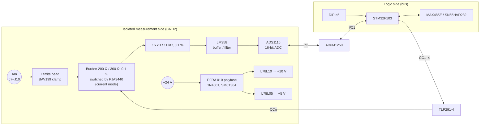

# AI4 – Analog Input Module

> **Four isolated analog inputs for 0–10 V or 0–20 mA.** Precision resistor networks and op-amp buffers scale each signal for a 16-bit ADS1115 ADC on the isolated side. The MCU reads it through an isolated I²C link.

[← Back to SynPLC overview](../index.md)

---

## At a Glance

| | |
|---|---|
| **Function** | 4 × analog input |
| **Modes** | per channel **0–10 V** or **0–20 mA**, switchable (`CC1`–`CC4` control lines) |
| **ADC** | **TI ADS1115**, 4 channels, 16 bit, I²C |
| **Resolution (documentation)** | 12 bit → **2.4 mV** (0–10 V) / **4.8 µA** (0–20 mA) |
| **Signal conditioning** | 4 × **LM358** dual op-amps, **0.1 %** precision resistors (200 Ω, 300 Ω, 11 kΩ, 16 kΩ) |
| **Isolation** | **ADuM1250** isolated I²C + **TLP291-4** optocoupler for mode switching, min. 1.5 mm isolation gap |
| **Field supply** | External **24 V** (polyfuse, reverse-polarity diode, TVS) → on-board +10 V and +5 V |
| **MCU** | STM32F103C8T6 @ 72 MHz |
| **Bus** | RS-485 (MAX485E) or CAN (SN65HVD232), jumper-selectable |
| **Address** | Type `010` → **`0x40`–`0x5F`** (5-bit DIP switch) |
| **PCB** | 100 × 77 mm, 4 layers. Schematic "SynPLC – AI V1.0", Rev A, 2021-06-13. Silkscreen "SynPLC / AI V1.0 / 16.06.21" |
| **Status** | V1.0 built. Hardware test and firmware **open** ⏳ |

---

## Overview

The AI4 measures four analog process values: sensors with **0–10 V** or **0–20 mA** outputs (temperature transmitters, pressure sensors, level sensors, potentiometers …). The complete measurement side, from the terminals to the ADC, is **galvanically isolated** from the PLC logic.

On the isolated side, an **ADS1115** 16-bit ADC digitises the four conditioned signals. The STM32 reads it over I²C through an **ADuM1250** isolator. A quad optocoupler (**TLP291-4**) passes four control lines (`CC1`–`CC4`) across the barrier. They switch four N-MOSFETs (**PJA3440**) that put each channel into current mode *(inferred from the labels and topology)*.

The input stage was simulated in LTspice first ([`analog_in.asc`](../../hardware/simulations/analog_in.asc)).

---

## Hardware

### Block diagram (one channel)

*The order and exact function of the burden and divider resistors are inferred from the component values and the LTspice model. They are not labelled in the schematic.*

### Key components

| Function | Ref. | Part |
|---|---|---|
| Microcontroller | U3 | STM32F103C8T6 (LQFP-48), 8 MHz crystal |
| ADC | U11 | **ADS1115IDGS** (TSSOP-10), 16 bit, 4 channels |
| I²C isolator | U5 | **ADuM1250** |
| Mode-switch optocoupler | U6 | **TLP291-4** |
| Mode-switch MOSFETs | Q1–Q4 | **PJA3440** N-MOSFET |
| Op-amps | U7–U10 | 4 × **LM358** |
| Precision resistors | R36–R43 | 200 Ω and 300 Ω, 0.1 % |
| Precision resistors | R20–R27 | 16 kΩ and 11 kΩ, 0.1 % |
| Input protection | D2–D5 | **BAV199** + ferrite beads |
| Analog supply | U13, U12 | **L78L10** (+10 V), **L78L05** (+5 V) |
| Supply protection | F1, D1, D6 | **PFRA 010** polyfuse, 1N4001, SM6T36A |
| Logic supply | U4 | AP1117-33 |
| RS-485 / CAN | U2 / U1 | MAX485E / SN65HVD232 |
| Address switch | SW1 | 5-position DIP switch ("Address Select") |
| Input terminals | J7–J10 | 4 × 2-pole CUI TBL009-500 |
| Supply terminal | J11 | 2-pole CUI TBL009-500 (+24 V) |
| Bus connectors | J5, J6 | 2 × 5 horizontal pin headers |
| SWD | J1 | 1 × 4 |

*U13 uses the KiCad symbol of an L78L05, but its value field and the net name say L78L10 / +10 V.*

### Scaling (computed, topology not verified)

The ADS1115 has a programmable full-scale range. In the ±4.096 V range:

$$
10\,\text{V}\cdot\frac{11\,\text{k}\Omega}{16\,\text{k}\Omega + 11\,\text{k}\Omega} \approx 4.07\,\text{V}
\qquad
20\,\text{mA}\cdot 200\,\Omega = 4.0\,\text{V}
$$

Both full-scale signals would fit the 4.096 V range of the ADC. This is a plausible reading of the resistor values, not a documented specification.

### LTspice model ([`analog_in.asc`](../../hardware/simulations/analog_in.asc))

Two **LT1013** op-amps, 11 kΩ / 16 kΩ divider, 300 Ω / 200 Ω resistors, 10 nF / 10 pF filter capacitors, 24 V supply. The input voltage is swept from **0 to 11 V** (`.dc V2 0 11`). A current source (0 A) is prepared for current-mode tests.

---

## Firmware

**Project:** [`software/AI`](../../software/AI)

The firmware is currently a **STM32CubeMX skeleton** without application code.

| | |
|---|---|
| Build | PlatformIO `genericSTM32F103C8`, `framework = stm32cube`, ST-Link |
| Clock | 8 MHz HSE × 9 = 72 MHz |
| Configured | GPIO, CAN, I²C1 (100 kHz), TIM1, TIM2, USART3 (115 200 baud for now) |

### Pin map (from `AI.ioc`)

| Pin | Function |
|---|---|
| PA0–PA4 | Inputs: DIP-switch address *(inferred, same as the other modules)* |
| PA8–PA11 | Outputs: `CC1`–`CC4` mode switching *(inferred)* |
| PB6 / PB7 | I²C1 SCL / SDA → ADuM1250 → ADS1115 |
| PB10 / PB11 | USART3 TX / RX (RS-485) |
| PB12 | RS-485 direction |
| PB8 / PB9 | CAN RX / TX |

### Planned bus interface

The CPU library already contains the master side: `synplc_read_analog_input(module, channel, &value)` reads the 16-bit register `0x4 + channel` (instruction `0x54`–`0x57`) from address `0x40 | module`. The module side still has to be written.

---

## Files

| Type | Location |
|---|---|
| KiCad project | [`hardware/pcbs/AI_V1`](../../hardware/pcbs/AI_V1) |
| LTspice simulation | [`hardware/simulations/analog_in.asc`](../../hardware/simulations/analog_in.asc) |
| Firmware | [`software/AI`](../../software/AI) |
| Enclosure | [`hardware/case`](../../hardware/case) |
