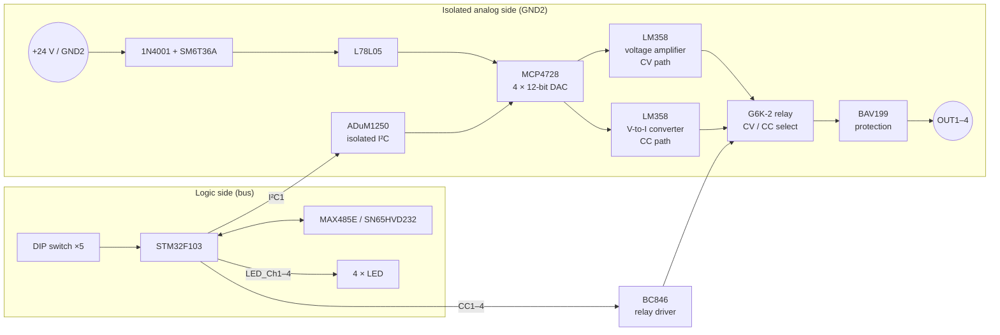

# AO4 – Analog Output Module

> **Four isolated analog outputs, each switchable between 0–10 V and 0–20 mA.** A 4-channel 12-bit DAC behind an isolated I²C link drives op-amp output stages. A small signal relay per channel selects voltage (CV) or current (CC) mode.

[← Back to SynPLC overview](../index.md)

---

## At a Glance

| | |
|---|---|
| **Function** | 4 × analog output |
| **Modes** | per channel **0–10 V (CV)** or **0–20 mA (CC)**, switched by a relay |
| **DAC** | **Microchip MCP4728**, 4 channels, **12 bit**, I²C |
| **Isolation** | **ADuM1250** isolated I²C between MCU and DAC; schematic note: "750 VAC creepage and clearance, min. 1.5 mm" |
| **Output stages** | 4 × **LM358** dual op-amps |
| **Mode relays** | 4 × **Omron G6K-2** DPDT signal relays |
| **Field supply** | External, isolated (+24 V label on the schematic; the documentation asks for **at least 15 V** with common analog ground) |
| **Indicators** | 4 LEDs "channel active" |
| **MCU** | STM32F103C8T6 @ 72 MHz |
| **Bus** | RS-485 (MAX485E) or CAN (SN65HVD232), jumper-selectable |
| **Address** | Type `011` → **`0x60`–`0x7F`** (5-bit DIP switch) |
| **PCB** | 100 × 77 mm, 4 layers. Schematic "SynPLC – AO V2.0", Rev 1, 2021-06-13. Silkscreen "SynPLC / AO V2.0 / 16.06.21" |
| **Status** | V2.0 built, **in test** ⏳ |

---

## Overview

The AO4 provides four analog setpoints for frequency inverters, valves, dimmers, heating controllers and other devices with standard **0–10 V** or **0–20 mA** inputs.

The **whole analog part is isolated** from the PLC logic. The STM32 sits on the bus side and talks to the DAC through an **ADuM1250** I²C isolator. The DAC, the op-amps and the relays run from the external analog supply, which has its own ground (`GND2`). An L78L05 regulator makes the 5 V for the DAC from this supply.

Each channel has a voltage output path and a voltage-to-current path. A **G6K-2 relay** selects which one is connected to the output terminal. The design was simulated in LTspice first ([`analog_out.asc`](../../hardware/simulations/analog_out.asc), note: "Switch between CC and CV").

---

## Hardware

### Block diagram



*The CV/CC path split is inferred from the schematic labels (`OUT1–4`, `CC1–4`, `CC1_Lo–CC4_Lo`), the relay per channel and the LTspice simulation.*

### Key components

| Function | Ref. | Part |
|---|---|---|
| Microcontroller | U3 | STM32F103C8T6 (LQFP-48), 8 MHz crystal |
| DAC | U7 | **MCP4728**, 4 × 12 bit, I²C (7-bit address `0x62` in firmware) |
| I²C isolator | U5 | **ADuM1250AR** |
| Op-amps | U8–U11 | 4 × **LM358** |
| Relays | K1–K4 | **G6K-2** (DPDT) |
| Relay drivers | Q1–Q4 | BC846, flyback diodes LL4148 (D7–D10) |
| Output protection | D11–D14 | **BAV199** |
| Channel networks | R34–R41, R66–R73 | 62 kΩ / 43 kΩ, 100 Ω / 47 Ω, plus 10 kΩ, 100 kΩ, 100 nF, 270 pF |
| Analog supply | U6, D5, D6 | **L78L05** (24 V → 5 V), 1N4001, SM6T36A |
| Logic supply | U4 | AP1117-33 |
| RS-485 / CAN | U2 / U1 | MAX485E / SN65HVD232 |
| Address switch | SW1 | 5-position DIP switch ("Address Select") |
| Channel LEDs | D1–D4 | "Kanal 1–4 aktiv" (channel active) |
| Terminals | J5–J9 | 5 × 2-pole CUI TBL009-500 (4 outputs + supply) |
| Bus connectors | J3, J4 | 2 × 5 horizontal pin headers |
| SWD | J1 | 1 × 4 |

### LTspice model ([`analog_out.asc`](../../hardware/simulations/analog_out.asc))

The simulation models one channel with two **LT1013** op-amps, a 24 V supply and the same 270 pF / 100 Ω / 47 Ω values as the PCB. The DAC voltage is swept from **0 to 5 V** (`.dc V2 0 5 0.1`).

---

## Firmware

**Project:** [`software/AO`](../../software/AO)

| | |
|---|---|
| Build | PlatformIO `genericSTM32F103C8`, `framework = stm32cube`, ST-Link |
| Clock | 8 MHz HSE × 9 = 72 MHz |
| Code generation | STM32CubeMX (`AO.ioc`) via stm32pio (`convert.sh`) |
| Bus | USART3 @ 1 MBaud, interrupt-driven `parse_485()` |
| DAC link | I²C1 @ 100 kHz, MCP4728 "fast write" of all 4 channels |

### Pin map

| Pin | Function |
|---|---|
| PA0–PA4 | DIP-switch address bits 0–4 |
| PA5–PA8 | `CC1`–`CC4` relay control (CV/CC) |
| PA9–PA12 | `LED_Ch1`–`LED_Ch4` |
| PB6 / PB7 | I²C1 SCL / SDA → ADuM1250 → MCP4728 |
| PB10 / PB11 | USART3 TX / RX (RS-485) |
| PB12 | RS-485 direction (`DIR`) |
| PB8 / PB9 | CAN RX / TX |

### Value scaling

The CPU writes a 16-bit value per channel. The firmware converts it to a 12-bit DAC code:

$$
\text{CV mode:}\quad \text{DAC} = \frac{\text{value}}{2.5}
\qquad\qquad
\text{CC mode:}\quad \text{DAC} = \frac{\text{value}}{5}
$$

With the CPU library's range of **0–10000** (CV) a full-scale value gives DAC code 4000. In CC mode a value of 20000 gives the same code 4000. This suggests units of **1 mV** (0–10 V) and **1 µA** (0–20 mA) per LSB *(inferred)*. The real step size is limited by the 12-bit DAC: ≈ 2.5 mV or ≈ 5 µA *(computed for 4000 codes = full scale)*.

*The technical note mentions "16-bit output resolution" (0.15 mV / 0.30 µA). The hardware is a 12-bit DAC. The 16-bit value is the register width on the bus.*

### Operation

1. At start-up the module reads its address `0x60 | DIP`, switches all relays and LEDs off and sets the RS-485 transceiver to receive.
2. Every **100 ms** the main loop converts the four channel registers and writes them to the MCP4728 in one I²C transfer.
3. Bus requests are handled in the UART interrupt. LED 1 toggles with every received byte (debug aid).

### Registers

| Register | Access | Meaning |
|---|---|---|
| `0x4`–`0x7` Channel 1–4 | Write 16 bit (`0x64`–`0x67`) | Output value, LSB first |
| `0xF` Error | Read 8 bit (`0x1F`) | Protocol error flags |

Example – set channel 1 of AO4 #0 to 5000:

```
CPU → 5A 60 64 88 13 00
AO  → C0 05
```

### Open points

- The CV/CC mode bits (`dac_stat`) exist in the firmware but **cannot be set over the bus yet**. All channels currently run in CV mode and the relays are not switched.
- The channel LEDs are not yet driven by the channel state (code present but commented out).

---

## Files

| Type | Location |
|---|---|
| KiCad project | [`hardware/pcbs/AO_V2`](../../hardware/pcbs/AO_V2) |
| LTspice simulation | [`hardware/simulations/analog_out.asc`](../../hardware/simulations/analog_out.asc) |
| Firmware | [`software/AO`](../../software/AO) |
| Enclosure | [`hardware/case`](../../hardware/case) (`Gehaeuse-front_led_4.stl`) |
