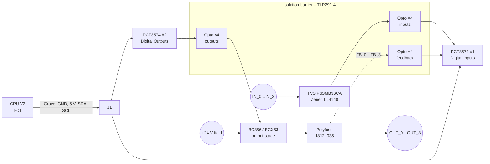

# CPU PiggyBack – DIO 4/4

> **Local I/O for the CPU.** A small add-on board with 4 isolated 24 V digital inputs and 4 isolated 24 V digital outputs. It connects to the CPU over I²C and sits in the same enclosure as the CPU.

[← Back to SynPLC overview](../index.md)

---

## At a Glance

| | |
|---|---|
| **Function** | 4 × digital input + 4 × digital output (24 V) directly on the CPU |
| **Interface** | **I²C**, Grove-compatible 4-pin connector (GND, 5 V, SDA, SCL) |
| **I/O expanders** | 2 × **PCF8574** (one for inputs, one for outputs) |
| **Isolation** | 3 × **TLP291-4** quad optocouplers |
| **Outputs** | 4 × high-side transistor outputs, each with its own **resettable fuse** and read-back (feedback) |
| **Inputs** | 4 × 24 V inputs with TVS and Zener protection |
| **Field terminals** | 5 × 2-pole pluggable terminal blocks (5 mm pitch) |
| **MCU** | none – controlled directly by the CPU |
| **PCB** | 100 × 77 mm outline with a 27 × 27 mm corner cut-out (L-shape), 4 layers, silkscreen "SynPLC / DIO4/4 / Rev 1.0" |
| **Schematic** | "SynPLC CPU PiggyBack IO", Rev 1.0, 2023-04-29 |
| **Status** | Designed |

---

## Overview

Small installations often need only a few I/Os. Instead of adding a full DI8 and DO8 module, the **PiggyBack** gives the CPU four inputs and four outputs of its own. The CPU V2 reserves its I²C1 bus for this board ("I²C1 = Reserved for PiggyBack"). Both boards have the same Grove-compatible connector pinout.

The PiggyBack has no microcontroller. Two **PCF8574** 8-bit I²C port expanders work as the digital I/O ports: one reads the inputs, the other drives the outputs. The **L-shaped outline** leaves room for parts of the CPU board below *(inferred)*.

---

## Hardware

### Block diagram

*The exact wiring of each PCF8574 port bit (which bits carry inputs and which carry feedback) is not documented in text form. The diagram follows the schematic labels `IN_n`, `OUT_n` and `FB_n`.*

### Key components

| Function | Ref. | Part |
|---|---|---|
| I/O expanders | U1, U2 | **PCF8574** (SOIC-16W) |
| Optocouplers | U3, U4, U5 | **TLP291-4** quad optocouplers (12 channels) |
| Output transistors | Q1–Q8 | **BCX53** (PNP, SOT-89) |
| Driver transistors | Q9–Q16 | **BC856** (PNP, SOT-23) |
| Output fuses | F1–F4 | **1812L035/60MR** resettable fuses (0.35 A hold) |
| TVS diodes | D1–D5, D8, D12, D16, D20 | **P6SMB36CA** (36 V, bidirectional) |
| Zener diodes | D6, D10, D14, D18, D30–D33 | 6.8 V |
| Zener diodes | D9, D13, D17, D21 | 5.6 V |
| Diodes | D7, D11, D15, D19 | LL4148 |
| LEDs | D22–D29 | 3 mm THT ("LED Indicators") |
| Ferrite beads | FB1–FB10 | SMB-001 / SMB-002 |
| Bulk capacitor | C1 | 100 µF |
| Input filter | C2/C4/C6/C8, C3/C5/C7/C9 | 1 nF, 470 nF |
| I²C connector | J1 | 1 × 4 pin socket, Grove-compatible |
| Field terminals | J2–J6 | CUI TBL009-500-02GY-2GY, 2-pole, 5 mm |

The input front-end uses the same component set as the [DI8](di8.md) (36 V TVS, 6.8 V / 5.6 V Zeners, LL4148, BCX53, 1 nF / 470 nF), so its electrical behaviour should be similar *(inferred)*.

### I²C addresses

The schematic note lists the PCF8574 addresses as **0x40/0x41** and **0x42/0x43** (8-bit address with R/W bit). In 7-bit notation these are **0x20** and **0x21** *(computed)*.

### Power

- **+5 V** from the CPU via the Grove connector (logic side, PCF8574s, LEDs).
- **+24 V / GND2** field supply via a terminal block (output stage), isolated from the logic side by the optocouplers.

---

## Firmware

The PiggyBack has no firmware of its own. The CPU accesses it through standard PCF8574 I²C reads and writes on I²C1. **A driver in the CPU firmware does not exist yet** (I²C1 is initialised at 100 kHz).

---

## Files

| Type | Location |
|---|---|
| KiCad project | [`hardware/pcbs/CPU_V2/CPU_PiggyBack`](../../hardware/pcbs/CPU_V2/CPU_PiggyBack) |
| Enclosure | [`hardware/case`](../../hardware/case) (`CPU_Case_PiggyBack.*`) |
