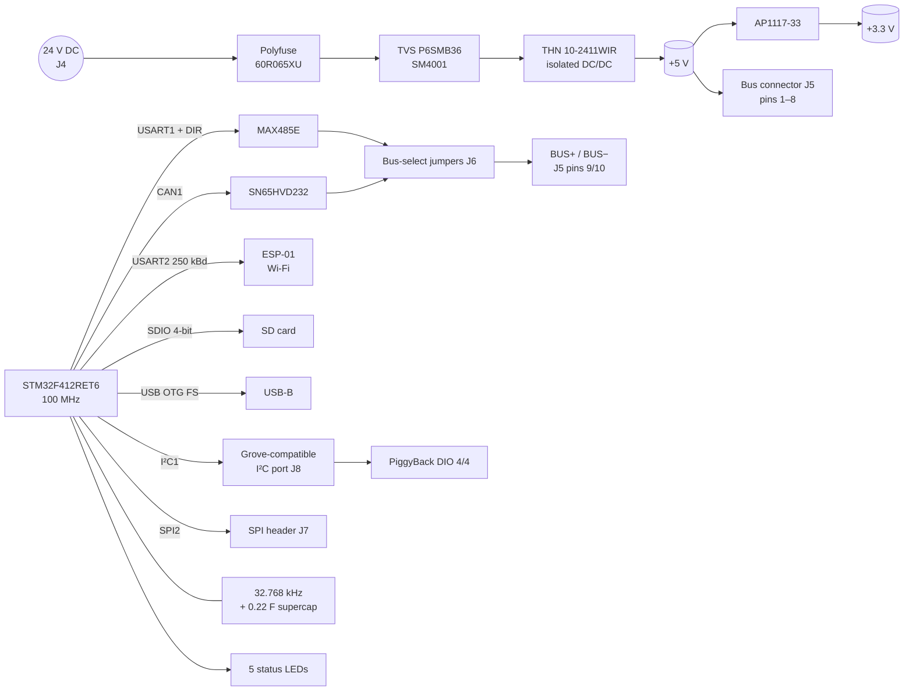
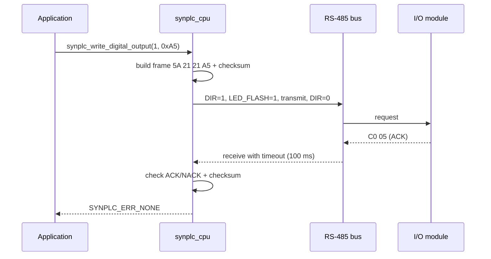

# CPU V2

> **The brain of the SynPLC.** An STM32F412 runs the control program, is the master of the module bus and supplies the whole system with 5 V from an isolated 24 V DC/DC converter. Wi-Fi (ESP-01), SD card, USB and a battery-free RTC are on board.

[← Back to SynPLC overview](../index.md)

---

## At a Glance

| | |
|---|---|
| **Function** | PLC CPU, bus master, system power supply |
| **MCU** | **STM32F412RET6** (Cortex-M4F, LQFP-64), 12 MHz crystal → **100 MHz** |
| **Power input** | **24 V DC** (2-pole terminal) |
| **System supply** | **TRACO THN 10-2411WIR** isolated DC/DC, 24 V → 5 V, **10 W**. Supplies the CPU and all modules over the bus |
| **Bus** | RS-485 (**MAX485E**, 1 MBaud) or CAN (**SN65HVD232**, 1 Mbit/s), selected by jumpers |
| **Wi-Fi** | **ESP-01** module on USART2 (250 kBaud). Web interface, read-only for now |
| **Storage** | **SD card** (GSD09002SEU socket, 4-bit SDIO, card-detect and write-protect) for log files and later Structured Text programs |
| **USB** | **USB-B**, USB OTG FS as virtual COM port (serial monitor) |
| **RTC** | 32.768 kHz crystal, **0.22 F supercap** as backup supply (no battery) |
| **Expansion** | I²C (Grove-compatible) for the [PiggyBack](cpu-piggyback.md), SPI header |
| **Status LEDs** | BOOT, RUN, FLASH, HEARTBEAT, ERROR |
| **PCB** | 100 × 77 mm, 4 layers, schematic "SynPLC – CPU V2", Rev 2, 2023-04-26 |
| **Status** | Layout ✅, review ✅, order pending. Firmware in development |

---

## Overview

The CPU is "the heart of the PLC system and necessary for normal operation. It connects to all IO modules and processes all the data." There is only one CPU per system, so it has no bus address.

Besides control, the CPU is also the **power supply** of the system. A wide-input **10 W DC/DC converter** turns the 24 V DC input into **5 V**, which goes to the bus connector and supplies every module. The documentation mentions that later revisions may add redundancy measures, but not yet.

CPU V2 replaces the earlier STM32F103-based CPU (see [CPU V1](#predecessor-cpu-v1-stm32f103)). The bigger STM32F412 brings SDIO for the SD card, USB OTG, a 32-bit timer pair and much more flash and RAM (512 KB / 256 KB) for the planned Structured Text runtime.

---

## Hardware

### Block diagram

### Key components

| Function | Ref. | Part |
|---|---|---|
| Microcontroller | U1 | **STM32F412RETx**, LQFP-64 |
| DC/DC converter | U2 | **TRACO THN 10-2411WIR** (10 W, 24 V wide input, 5 V output, isolated) |
| 3.3 V regulator | U3 | **AP1117-33** (SOT-223) |
| RS-485 transceiver | U4 | **MAX485E** |
| CAN transceiver | U5 | **SN65HVD232** |
| Wi-Fi module | U6 | **ESP-01** (ESP8266) |
| SD card socket | J1 | GSD09002SEU |
| Main crystal | Y1 | 12 MHz (20 pF load caps) |
| RTC crystal | Y2 | 32.768 kHz, Seiko Epson MC306 |
| RTC backup | C3 | **0.22 F / 5 V** supercap on VBAT |
| Input fuse | F1 | **60R065XU** polyfuse |
| Input protection | D9, D8 | **P6SMB36** TVS, **SM4001** diode |
| Bus ESD protection | D7, D10 | **CDSOT23-T24-Q** dual TVS |
| Bus termination | R40, R46 | 120 Ω |
| Status LEDs | D2–D6 | 3 mm THT LEDs |

### Connectors

| Ref. | Connector | Pinout |
|---|---|---|
| J4 | **24 V input**, 2-pole pluggable terminal (TBL009-500) | +24 V, GND |
| J5 | **Module bus**, 2 × 5 pin header (horizontal) | 1–4 +5 V, 5–8 GND, 9 BUS+, 10 BUS− |
| J6 | **Bus select**, 2 × 3 pin header | 1 RS485−, 2 RS485+, 3 BUS−, 4 BUS+, 5 CAN−, 6 CAN+ |
| J8 | **I²C, Grove-compatible**, 1 × 4 | GND, 5 V, SDA, SCL |
| J7 | **SPI**, 1 × 6 | 3V3, MOSI, MISO, SCK, /CS, GND |
| J2 | **SWD**, JST-XH 1 × 4 | GND, SWCLK, SWDIO, 3V3 |
| J3 | **USB-B** (Lumberg 2411 02) | – |
| JP1 | Solder jumper `V_USB` | Optional supply from USB 5 V *(inferred from the name)* |

**Bus selection:** jumpers on J6 **1–3 / 2–4** connect the RS-485 transceiver to the bus, jumpers on **3–5 / 4–6** connect the CAN transceiver *(inferred from the pin assignment)*.

### Peripheral plan (from the schematic note)

| Peripheral | Use |
|---|---|
| CAN1 | CAN @ 1 Mbit/s |
| USART1 | RS-485 @ 1 MBaud |
| USART2 | ESP-01 @ 250 kBaud |
| SPI2 | reserved |
| I²C1 | reserved for the PiggyBack |
| SDIO | SD card interface |
| USB OTG FS | virtual COM port |

### MCU pin map

| Pin | Signal | | Pin | Signal |
|---|---|---|---|---|
| PA9 / PA10 | USART1 TX / RX (RS-485) | | PB8 / PB9 | CAN1 RX / TX |
| PA8 | `RS485_DIR` | | PB6 / PB7 | I²C1 SCL / SDA |
| PA2 / PA3 | USART2 TX / RX (ESP-01) | | PB10, PC2, PC3 | SPI2 SCK, MISO, MOSI |
| PA11 / PA12 | USB D− / D+ | | PC0 | `SPI_CS1` |
| PB13 | `USB_Disconnect` | | PC8–PC11 | SDIO D0–D3 |
| PA4 / PA5 | SD card detect / write protect | | PB15 / PA6 | SDIO CK / CMD |
| PC12 | `LED_BOOT` | | PB4 | `LED_RUN` |
| PB5 | `LED_FLASH` | | PD2 | `LED_HEARTBEAT` |
| PB3 | `LED_ERROR` | | PB0 | Test point |
| PC14 / PC15 | 32.768 kHz LSE | | PH0 / PH1 | 12 MHz HSE |

### Status LEDs

| LED | Meaning |
|---|---|
| **BOOT** | On during initialisation, off when the main loop starts |
| **RUN** | On while the PLC main loop is running |
| **HEARTBEAT** | 1 Hz blink (toggle every 500 ms) |
| **ERROR** | 2 Hz blinking for 5 s after a non-fatal error (e.g. a bus timeout) |
| **FLASH** | On during RS-485 transmission. Later also during program updates from an external source |

---

## Firmware

**Project:** [`software/CPU/F412`](../../software/CPU/F412)

| | |
|---|---|
| Build | PlatformIO `genericSTM32F412RE`, `framework = stm32cube`, ST-Link, `reset_after_upload.py` |
| Clock | 12 MHz HSE / 6 × 100 / 2 = **100 MHz**, LSE 32.768 kHz |
| Code generation | STM32CubeMX (`CPU.ioc`) via stm32pio |
| Active peripherals | CAN1, USART1, USART2, TIM1–5, TIM8, TIM9, TIM12, I²C1, SPI2, USB device (CDC) |
| Prepared but disabled | RTC, SDIO, FatFS |

### SynPLC CPU library

`synplc_cpu.c/.h` is the bus-master side of the [SynPLC protocol](../index.md#6-communication-protocol).

| Return code | Meaning |
|---|---|
| `SYNPLC_ERR_NONE` (0) | OK |
| `SYNPLC_ERR_TIMEOUT` (1) | No answer in time |
| `SYNPLC_ERR_NACK` (2) | Module answered NACK |
| `SYNPLC_ERR_CHECKSUM` (3) | Reply checksum wrong |
| `SYNPLC_ERR_INVALID_RESP` (4) | Reply is neither ACK nor NACK |

### Current main loop (test program)

The current firmware is a **bring-up / test program**:

1. Initialise all peripherals, BOOT LED on, wait 500 ms, BOOT LED off, RUN LED on.
2. Write a ramp value (0 → 10000 in steps of 100) to **all four channels of AO4 #0** with `synplc_write_analog_output()`, 10 ms apart.
3. If a write fails, start the ERROR-LED blink sequence.
4. Toggle the HEARTBEAT LED every 500 ms.

Commented-out code in the loop shows earlier tests: reading DI8 modules and writing random patterns to DO8 modules.

### Planned features

- Generalised CPU code (scan the bus, cyclic I/O image, user program)
- CAN protocol
- SD card logging, RTC timestamps
- ESP-01 web interface (read-only monitoring)
- **Structured Text** programs loaded from the SD card (postponed)

---

## Predecessor: CPU V1 (STM32F103)

**Project:** [`software/CPU/F103`](../../software/CPU/F103) (`CPU_old.ioc`). The hardware files of this board are not in the repository.

| | |
|---|---|
| MCU | STM32F103C8T6, 8 MHz × 9 = 72 MHz, LSE for the RTC |
| RS-485 | USART3 @ **500 kBaud**, direction on PB5 |
| Second UART | USART2 @ 115 200 baud |
| Other | CAN, SPI2 (+ CS1 on PB12), USB FS, RTC |
| LEDs | BOOT (PA9), ERROR (PA10), RUN (PA15), HEARTBEAT (PB3), FLASH (PB4) |
| Firmware | Test loop: writes random patterns to DO8 #1 (`0x21`) and the inverted pattern to DO8 #3 (`0x23`), heartbeat LED every 100 loops |

The LED concept (BOOT/RUN/FLASH/HEARTBEAT/ERROR) was carried over to CPU V2.

---

## Enclosure

The CPU has its own 3D-printed enclosure for the CPU + PiggyBack stack: `hardware/case/CPU_Case_PiggyBack.FCStd`, with case, front cover and two cover variants (logo, logo + NFC). See [Enclosure](../index.md#8-enclosure).

---

## Files

| Type | Location |
|---|---|
| KiCad project | [`hardware/pcbs/CPU_V2/CPU_V2`](../../hardware/pcbs/CPU_V2/CPU_V2) |
| Firmware (V2) | [`software/CPU/F412`](../../software/CPU/F412) |
| Firmware (V1) | [`software/CPU/F103`](../../software/CPU/F103) |
| Enclosure | [`hardware/case`](../../hardware/case) (`CPU_Case_PiggyBack.*`) |
