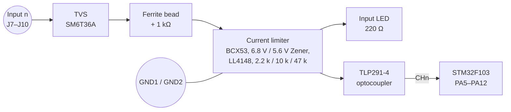

# DI8 – Digital Input Module

> **Eight 24 V inputs in two isolated groups of four.** Each input has a current limit, overvoltage and reverse-polarity protection and an optocoupler, so it can read typical industrial 24 V sensors and switches.

[← Back to SynPLC overview](../index.md)

---

## At a Glance

| | |
|---|---|
| **Function** | 8 × digital input, 24 V DC |
| **Groups** | **2 × 4 inputs**, galvanically isolated from each other (`GND1` / `GND2`) and from the system |
| **Input current** | limited to max. **2 mA** |
| **Voltage range** | **LOW = 0…5 V DC**, **HIGH = 10…33 V DC**, tolerates up to **33 V DC** |
| **Protection** | ESD/surge (36 V TVS), reverse polarity, overcurrent |
| **Isolation** | 2 × **TLP291-4** quad optocouplers, min. 1.5 mm isolation gap |
| **Indicators** | 8 input LEDs |
| **MCU** | STM32F103C8T6 @ 72 MHz |
| **Bus** | RS-485 (MAX485E) or CAN (SN65HVD232), jumper-selectable |
| **Address** | Type `000` → **`0x00`–`0x1F`** (5-bit DIP switch) |
| **PCB** | 100 × 77 mm, 4 layers, silkscreen "SynPLC / DI8 V1.1 / 18.06.20" |
| **Status** | V1.1 built and **tested** ✅ |

---

## Overview

The DI8 reads eight 24 V signals from push buttons, limit switches, sensors or relay contacts. The inputs are split into **two groups of four**, each with its own reference ground (`GND1` for inputs 1–4, `GND2` for inputs 5–8). The two groups are isolated from each other and from the PLC logic. For normal operation, the ground of each input group must be connected to the ground of the signal source (terminal J11 brings out `GND1` and `GND2`).

Every channel has a protected, **current-limited input stage** that drives the LED of an optocoupler. The current is limited to about 2 mA, so the input behaves the same over the whole 10–33 V range.

---

## Hardware

### Block diagram (one channel)



*The exact function of each part in the current limiter is inferred from the topology. The 2 mA limit and the voltage thresholds are from the documentation.*

### Key components

| Function | Ref. | Part |
|---|---|---|
| Microcontroller | U3 | STM32F103C8T6 (LQFP-48), 8 MHz crystal |
| Optocouplers | U5, U6 | 2 × **TLP291-4** (8 channels) |
| Input TVS | D33–D40 | **SM6T36A** |
| Ferrite beads | FB1–FB8 | per channel |
| Series resistors | R43–R50 | 1 kΩ |
| Current-limit transistors | Q1–Q8 | **BCX53** (SOT-89) |
| Zener diodes | D17–D24 / D9–D16 | 6.8 V / 5.6 V |
| Diodes | D25–D32 | LL4148 |
| Resistors | R35–R42 / R19–R26 / R27–R34 | 2.2 kΩ / 10 kΩ / 47 kΩ |
| Filter capacitors | C15–C22 / C23–C30 | 1 nF / 470 nF |
| Input LEDs | D1–D8 | with 220 Ω (R11–R18) |
| RS-485 / CAN | U2 / U1 | MAX485E / SN65HVD232 |
| 3.3 V regulator | U4 | AP1117-33 |
| Address switch | SW1 | 5-position DIP switch |
| Termination | R7, R8 | 120 Ω, 150 Ω |
| Input terminals | J7–J10 | 4 × 2-pole CUI TBL009-500 (inputs 1–8) |
| Ground terminal | J11 | GND1 / GND2 |
| Bus connectors | J5, J6 | 2 × 5 horizontal pin headers |
| Bus select | J4 | 2 × 3 jumper header |
| SWD | J1 | 1 × 4 (3V3, SWIO, SWCLK, GND) |

The schematic contains the note **"Galvanic Isolation / min. 1.5 mm"** for the isolation gap.

---

## Firmware

**Project:** [`software/DI`](../../software/DI)

| | |
|---|---|
| Build | PlatformIO `genericSTM32F103C8`, `framework = stm32cube`, ST-Link |
| Clock | 8 MHz HSE × 9 = 72 MHz |
| Code generation | STM32CubeMX (`Di.ioc`) via stm32pio |
| Bus | USART3 @ 1 MBaud, interrupt-driven `parse_485()` |

### Pin map

| Pin | Function |
|---|---|
| PA0–PA4 | DIP-switch address bits 0–4 |
| PA5–PA12 | `CH1`–`CH8` inputs (from the optocouplers) |
| PB10 / PB11 | USART3 TX / RX (RS-485) |
| PB12 | RS-485 direction (`DIR`) |
| PB8 / PB9 | CAN RX / TX (remapped) |

### Operation

1. At start-up the module reads its address: `0x00 | DIP`.
2. The main loop reads all eight inputs **every 100 µs** in one port access: `reg_in = (GPIOA->IDR & 0x1FE0) >> 5`.
3. Bus requests are handled in the UART interrupt.

### Registers

| Register | Access | Meaning |
|---|---|---|
| `0x0` Input | Read 8 bit (`0x10`) | Bit n = state of input n+1 |
| `0xF` Error | Read 8 bit (`0x1F`) | Protocol error flags |

Example – read DI8 #0, the module answers with the input pattern `0x81`:

```
CPU → 5A 00 10 8F
DI  → C0 81 84
```

---

## Files

| Type | Location |
|---|---|
| KiCad project | [`hardware/pcbs/DI8_V1.1`](../../hardware/pcbs/DI8_V1.1) |
| Firmware | [`software/DI`](../../software/DI) |
| Enclosure | [`hardware/case`](../../hardware/case) (`Gehaeuse-front_led_8.stl`) |
