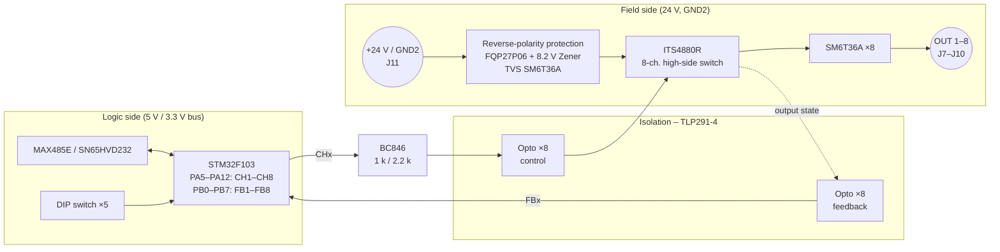

# DO8 – Digital Output Module

> **Eight isolated 24 V outputs with 0.5 A each.** A smart 8-channel high-side switch drives the loads, and every output is read back so the module can detect short circuits and wrong states.

[← Back to SynPLC overview](../index.md)

---

## At a Glance

| | |
|---|---|
| **Function** | 8 × digital output, 24 V DC, high-side switching |
| **Output current** | **0.5 A per channel** |
| **Output driver** | **Infineon ITS4880R** 8-channel smart high-side power switch |
| **Isolation** | Optocouplers (4 × **TLP291-4**) between logic and field side |
| **Diagnostics** | Read-back of every output (feedback register) |
| **Indicators** | 8 channel status LEDs on the front |
| **Field supply** | External **24 V** at a separate terminal, reverse-polarity and TVS protected |
| **MCU** | STM32F103C8T6 @ 72 MHz |
| **Bus** | RS-485 (MAX485E) or CAN (SN65HVD232), jumper-selectable |
| **Address** | Type `001` → **`0x20`–`0x3F`** (5-bit DIP switch) |
| **PCB** | 100 × 77 mm, 4 layers, silkscreen "SynPLC / DO8 V1.2 / 21.06.21" |
| **Status** | V1.2 built and **tested** ✅ |

---

## Overview

The DO8 gives the PLC eight 24 V outputs for relays, contactors, valves, lamps and similar loads. The 24 V for the outputs is supplied **at the module's terminals**. It is galvanically isolated from the 5 V logic bus.

The STM32 drives the eight outputs through optocouplers into an **ITS4880R**, an eight-channel smart high-side switch with integrated protection. A second set of optocouplers feeds the real state of every output back to the MCU. The documentation describes the intended safety function: *"To prevent major faults caused by short circuits, the output channels are measured back and compared to their set value. If a channel differs from its value, the module sets an error bit and shuts off the faulty channel."*

The technical note admits with a wink that not every module was improved in V2 – *"talking about you, DO8…"*.

---

## Hardware

### Block diagram



*Signal chain inferred from the schematic topology and net labels.*

### Key components

| Function | Ref. | Part |
|---|---|---|
| Microcontroller | U3 | STM32F103C8T6 (LQFP-48), 8 MHz crystal |
| High-side switch | IC1 | **ITS4880R** (PG-DSO-36), 8 channels |
| Optocouplers | U5–U8 | 4 × **TLP291-4** (U5/U6 control, U7/U8 feedback *(inferred)*) |
| Channel drivers | Q1–Q8 | BC846 with 1 kΩ / 2.2 kΩ |
| Feedback network | R25–R33, R34–R48 | 47 kΩ / 10 kΩ dividers |
| Output TVS | D5, D6, D8, D9, D11, D13, D14, D16 | **SM6T36A** |
| Supply protection | Q9, D17, D18 | **FQP27P06** P-MOSFET, 8.2 V Zener, SM6T36A *(reverse-polarity protection, inferred)* |
| RS-485 / CAN | U2 / U1 | MAX485E / SN65HVD232 |
| 3.3 V regulator | U4 | AP1117-33 |
| Address switch | SW1 | 5-position DIP switch |
| Termination | R2, R3 | 120 Ω, 150 Ω |
| Field terminals | J7–J10 | 4 × 2-pole CUI TBL009-500 (outputs 1–8) |
| Supply terminal | J11 | +24 V / GND2 |
| Bus connectors | J5, J6 | 2 × 5 horizontal pin headers (daisy chain) |
| Bus select | J4 | 2 × 3 jumper header |
| SWD | J1 | 1 × 4 |

---

## Firmware

**Project:** [`software/DO`](../../software/DO)

| | |
|---|---|
| Build | PlatformIO `genericSTM32F103C8`, `framework = stm32cube`, ST-Link |
| Clock | 8 MHz HSE × 9 = 72 MHz |
| Code generation | STM32CubeMX (`DO.ioc`) via stm32pio |
| Bus | USART3 @ 1 MBaud, interrupt-driven `parse_485()` |

### Pin map

| Pin | Function |
|---|---|
| PA0–PA4 | DIP-switch address bits 0–4 |
| PA5–PA12 | `CH1`–`CH8` output control |
| PB0–PB7 | `FB1`–`FB8` output feedback |
| PB10 / PB11 | USART3 TX / RX (RS-485) |
| PB12 | RS-485 direction (`DIR`) |
| PB8 / PB9 | CAN RX / TX (remapped) |

### Operation

1. At start-up the module reads its address: `0x20 | DIP` (PA0–PA4). All outputs are switched off.
2. The main loop runs every ~1 ms:
   - `set_Output()` writes the output register to PA5–PA12 in one port access.
   - `check_Output()` reads the 8 feedback lines (PB0–PB7) into the feedback register.
3. Bus requests are handled in the UART interrupt.

The **compare-and-shut-off** function (`check_Output()` compares output and feedback, `out_Poll()` switches off the faulty channel) is already in the code but **currently commented out**.

### Registers

| Register | Access | Meaning |
|---|---|---|
| `0x1` Output | Write 8 bit (`0x21`) | Bit n = output n+1 on/off |
| `0x2` Feedback | Read 8 bit (`0x12`) | Measured state of the 8 outputs |
| `0xF` Error | Read 8 bit (`0x1F`) | Protocol error flags |

Example – switch on outputs 1 and 8 on DO8 #0:

```
CPU → 5A 20 21 81 1F
DO  → C0 05
```

### Known firmware limitations

- Read requests on the DO8 currently always return NACK "register invalid", because of a condition in the register check (`reg != ERR || reg != FB` is always true).
- The 16-bit write case in this copy of the library is missing a `break` (fixed in the AO4 copy).

These points match the open README items "parametrize RS485 lib" and "port the RS-485 protocol to the new hardware".

---

## Files

| Type | Location |
|---|---|
| KiCad project | [`hardware/pcbs/DO8_V1.2`](../../hardware/pcbs/DO8_V1.2) |
| Firmware | [`software/DO`](../../software/DO) |
| Enclosure | [`hardware/case`](../../hardware/case) (`Gehaeuse-front_led_8.stl`) |
