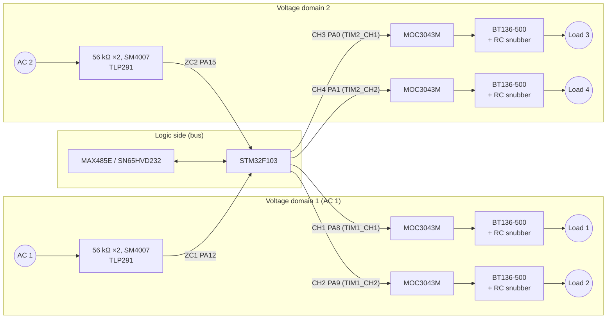

# XT4 – Triac Interface Module

> **Four opto-isolated triac outputs for 230 V AC loads, on two separate voltage domains.** Each domain has its own zero-crossing detector, so the module can switch loads in sync with the mains and is designed for phase-fired control.

[← Back to SynPLC overview](../index.md)

---

## At a Glance

| | |
|---|---|
| **Function** | 4 × AC output (triac) |
| **Rating** | up to **230 V AC, 1 A** per channel (documentation) |
| **Triacs** | 4 × **BT136-500** (500 V, TO-220) |
| **Triac drivers** | 4 × **MOC3043M** opto-triac drivers (zero-cross type) |
| **Voltage domains** | **2**, isolated from each other and from the system (channels 1–2 and 3–4 *(inferred)*) |
| **Zero-crossing detection** | 1 per domain: **TLP291** optocoupler, 2 × 56 kΩ resistors (BOM note: "VIT ZC207 56K"), SM4007 |
| **Modes** | On/off switching. Phase-fired control (PFC) planned, with automatic mains-frequency measurement and drift compensation |
| **Snubbers** | RC 330 Ω + 10 nF per channel |
| **Terminals** | 4 × 2-pole CUI TBL009-500 (5 mm, 10 A per contact) |
| **MCU** | STM32F103C8T6 @ 72 MHz |
| **Bus** | RS-485 (MAX485E) or CAN (SN65HVD232), jumper-selectable |
| **Address** | Type `101` → **`0xA0`–`0xBF`** (5-bit DIP switch) |
| **PCB** | 100 × 77 mm, 4 layers, silkscreen "SynPLC / XT V1 / 17.06.21" |
| **Status** | V1 built, **in test** ⏳. Firmware open |

---

## Overview

The XT4 ("Interface Triac, 4 channels") lets the SynPLC switch **mains-powered loads** directly: lamps, heaters, small motors or pumps. The four channels can either switch AC loads on and off or, as the long-term goal, work as a **phase-fired controller** (dimmer/power control).

For phase-fired control the module needs to know where the mains zero crossings are. Each of the two voltage domains therefore has its own **zero-crossing detector (ZCD)**. According to the documentation, the ZCD also measures the AC frequency automatically and compensates for frequency drift.

The documentation also warns: *"Keep in mind that the triacs can become quite hot."*

---

## Hardware

### Block diagram

*Pin assignments and the domain grouping are inferred from the schematic labels and their positions on the MCU symbol. Each channel output is driven through a BC846 transistor.*

### Channel and ZCD mapping

| Signal | MCU pin | Timer | Driver chain | Terminal |
|---|---|---|---|---|
| `CH1` | PA8 | TIM1_CH1 | Q1 BC846 → U5 MOC3043M → Q6 BT136-500 | J7 |
| `CH2` | PA9 | TIM1_CH2 | Q4 BC846 → U7 MOC3043M → Q8 BT136-500 | J8 |
| `CH3` | PA0 | TIM2_CH1 | Q5 BC846 → U9 MOC3043M → Q9 BT136-500 | J9 |
| `CH4` | PA1 | TIM2_CH2 | Q7 BC846 → U10 MOC3043M → Q10 BT136-500 | J10 |
| `ZC1` | PA12 | – | U6 TLP291 (domain 1) | – |
| `ZC2` | PA15 | – | U8 TLP291 (domain 2) | – |

Channels 1/2 share TIM1 and channels 3/4 share TIM2. One timer per voltage domain can therefore generate firing pulses relative to that domain's zero crossing *(inferred)*.

### Key components

| Function | Ref. | Part |
|---|---|---|
| Microcontroller | U3 | STM32F103C8T6 (LQFP-48), 8 MHz crystal |
| Triacs | Q6, Q8, Q9, Q10 | **BT136-500** |
| Opto-triac drivers | U5, U7, U9, U10 | **MOC3043M** (zero-cross) |
| ZCD optocouplers | U6, U8 | **TLP291** |
| ZCD resistors | R33, R34 | 56 kΩ, "VIT ZC207 56K" |
| ZCD diodes | D1, D2 | SM4007 |
| Channel driver transistors | Q1, Q4, Q5, Q7 | BC846 |
| Gate / driver resistors | R21, R26–R28 / R29, R35–R37 | 360 Ω / 68 Ω |
| Snubbers | R25, R30–R32 + C15–C18 | 330 Ω + 10 nF (KEMET C0805C103JARACTU) |
| RS-485 / CAN | U2 / U1 | MAX485E / SN65HVD232 |
| 3.3 V regulator | U4 | AP1117-33 |
| Address switch | SW1 | 5-position DIP switch |
| Termination | R5, R6 | 120 Ω, 150 Ω |
| AC terminals | J7–J10 | 4 × CUI TBL009-500-02GY-2GY |
| Bus connectors | J5, J6 | 2 × 5 horizontal pin headers |
| Bus select | J4 | 2 × 3 jumper header |
| SWD | J1 | 1 × 4 |

The schematic contains the note **"Galvanische Trennung / mind. 1,5mm"** (galvanic isolation, min. 1.5 mm).

### Design notes

- **Zero-cross drivers vs. phase control.** The MOC3043M is a *zero-crossing* opto-triac driver. It only fires the triac near the mains zero crossing. That is ideal for low-EMI on/off switching and for full-wave packet control. Classic phase-angle control at arbitrary firing angles needs a *random-phase* driver. This should be considered when the PFC mode is implemented.
- **No on-board fuses, varistors or LEDs.** The schematic has no fuse, varistor, heatsink or status LED. Each load circuit has to be fused externally.

---

## Firmware

There is **no firmware project for the XT4 yet** ("Write software for new PCBs – XT" is open in the README). The protocol is already prepared:

- Module type `DEV_XT = 0xA0` in the shared `synplc.h`.
- The 16-bit channel registers `0x4`–`0x7` are marked "XT, AI and AO – 16 bit" (e.g. for a firing angle or power level per channel).

---

## Files

| Type | Location |
|---|---|
| KiCad project | [`hardware/pcbs/XT_V1`](../../hardware/pcbs/XT_V1) |
| Enclosure | [`hardware/case`](../../hardware/case) |
